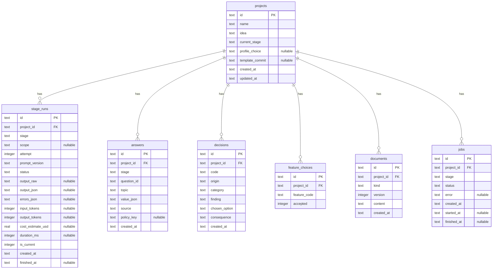

# PRD Generator

## 1. Context & Goal

Aplikasi web lokal yang mengubah ide proyek menjadi `docs/PRD.md` dan `docs/TASKS.md` yang siap dikerjakan Claude Code di proyek yang dibuat dari [template starter Profil A](https://github.com/Vladeouz/profil-a-template). Aplikasi berjalan di laptop pengguna dan memanggil Claude Code mode non-interaktif (`claude -p`), sehingga memakai langganan Claude pengguna tanpa API key.

Masalah yang diselesaikan: generator PRD yang ada (referensi ngodingpakeai.com) meloloskan keputusan teknis yang saling bertentangan, menambah fitur diam-diam, dan menulis task tanpa kriteria yang bisa dibuktikan. Uji coba sebelumnya membuktikan bahwa alur bertahap dengan klarifikasi, review kritis otomatis, dan validasi output menghasilkan PRD dan TASKS yang dikerjakan Claude Code secara disiplin.

Pengguna: satu orang (pemilik aplikasi), di Windows.

Bahan rujukan di repo ini (`docs/reference/`, disalin user sebelum T-001):

- `validate-claude-p-v2.mjs`, `validate-claude-p-stage3-v2.mjs`, `e2e-gym.mjs`: prompt dan validator yang sudah divalidasi untuk tahap 2 sampai 7.
- `e2e-output/`: output nyata tahap 2 sampai 7 untuk ide "Aplikasi membership untuk sebuah gym" (`stage-*.json`, `PRD.md`, `TASKS.md`, `report.json`).
- `validate-report-v2.json`, `validate-report-stage3-v2.json`: output nyata tahap 2 dan 3 untuk beberapa ide, bahan fixture tambahan.

## 2. Scope

### In scope

- Alur 8 tahap per proyek: input ide, klarifikasi produk, klarifikasi teknis, struktur fitur, review kritis, PRD (dengan review kedua), TASKS, export.
- Hanya stack Profil A. Ide yang web-only dan sangat bergantung pada SEO mendapat peringatan dan pilihan eksplisit.
- Konvensi proyek dibaca dari `docs/conventions.md` di salinan lokal repo template.
- Penyimpanan proyek, jawaban, keputusan, dan output di SQLite lokal.
- Tahap panjang berjalan sebagai job di latar belakang dengan progres yang terlihat.
- Catatan pemakaian token per tahap.
- Progres tahap yang di-stream ke UI, dan flowchart fitur (fase, fitur, sub-fitur, task).
- Export ke folder proyek turunan template, atau unduh sebagai file.

### Non-goals

- Multi-user, login, atau deploy ke internet. Server hanya mendengarkan `127.0.0.1`.
- Profil B (Next.js) untuk proyek yang di-generate.
- Chat revisi PRD per bagian.
- Analisis codebase proyek yang sudah ada.
- Menghasilkan `CLAUDE.md` proyek. File itu berasal dari template.
- Menjalankan `pnpm init-project` atau Claude Code untuk proyek turunan.

## 3. Tech Constraints

### Stack

| Komponen | Pilihan |
| --- | --- |
| Runtime | Node.js 24 LTS (`.nvmrc`, `engines`) |
| Package manager | pnpm, dipin lewat `packageManager`; tanpa workspace |
| Framework | Next.js (App Router), React, TypeScript `strict` |
| Styling | Tailwind CSS |
| Database | SQLite lewat `better-sqlite3` + Drizzle ORM + drizzle-kit |
| Validasi | Zod (input route handler dan output setiap tahap) |
| Markdown | `react-markdown` + `remark-gfm` untuk pratinjau |
| Flowchart | `@xyflow/react` (React Flow) |
| Lint dan format | Biome |
| Test | Vitest (unit dan integration), Playwright (end-to-end dengan runner palsu) |

Versi pasti setiap library dipin saat pertama dipasang, hanya memakai versi yang lolos `minimumReleaseAge` pnpm, dan dicatat di `docs/conventions.md`. Build script dependency hanya diizinkan secara eksplisit lewat `allowBuilds` di `pnpm-workspace.yaml` (misalnya `better-sqlite3`).

### Pohon folder

```
.
├── CLAUDE.md
├── README.md
├── .gitattributes .gitignore .editorconfig .nvmrc
├── .env.example
├── package.json pnpm-workspace.yaml biome.json
├── next.config.ts tsconfig.json vitest.config.ts vitest.int.config.ts playwright.config.ts
├── drizzle.config.ts
├── drizzle/                    # migrasi SQL, di-commit
├── prompts/                    # template prompt per tahap, berversi
├── scripts/                    # prereq.mjs, check.mjs (Node, lintas platform)
├── docs/
│   ├── PRD.md TASKS.md conventions.md
│   ├── logs/
│   └── reference/              # bahan rujukan dari uji sebelumnya
├── src/
│   ├── app/                    # halaman dan route handler (/api/...)
│   ├── components/
│   ├── core/                   # config env, error, logger, db client
│   ├── claude/                 # port ClaudeRunner, runner CLI, runner palsu
│   ├── jobs/                   # antrean job dan eksekusi tahap
│   ├── stages/                 # satu folder per tahap: prompt input, skema output, validator
│   ├── template/               # pembaca repo template
│   └── projects/               # domain proyek, jawaban, keputusan, dokumen
└── test/
    ├── unit/ int/ e2e/
    ├── fixtures/claude/        # output tahap nyata untuk runner palsu
    └── helpers/
```

### Konvensi

- **Git, log, dan verifikasi** sama dengan template: branch `<type>/t-xxx-<ringkas>`, commit `<type>: <ringkasan> (T-xxx)`, merge oleh user, log per task di `docs/logs/`, satu task per sesi.
- **`pnpm check`** menjalankan Biome, typecheck, unit test, integration test, dan test end-to-end, lalu menampilkan ringkasan dan menyimpan output langkah yang gagal di `.check-logs/`. Wajib hijau sebelum task dicentang.
- **Tidak ada test otomatis yang memanggil `claude` sungguhan.** Semua test memakai `FakeClaudeRunner` dengan fixture. Pemanggilan sungguhan hanya di langkah verifikasi manual.
- **Prompt adalah file berversi** di `prompts/` (`stage-2.md`, dan seterusnya) dengan front matter `version`. Setiap pemanggilan tahap mencatat versi prompt yang dipakai.
- **Output tahap selalu divalidasi** dengan skema Zod dan validator tambahan per tahap. Output yang gagal validasi dicoba ulang sekali dengan daftar error-nya; bila masih gagal, tahap berstatus gagal dan user bisa mencoba lagi.
- **Teks UI dalam Bahasa Indonesia.** Istilah internal seperti "Profil A" tidak tampil di pertanyaan untuk user.
- **Script otomatisasi dalam Node `.mjs`**, bukan shell.
- **Timestamp disimpan sebagai ISO 8601 UTC**, diisi oleh satu sumber jam di server.

### Pemanggilan Claude Code

Terbukti di uji sebelumnya dan wajib diikuti:

- Perintah dasar: `claude -p --max-turns 1`. Prompt dikirim lewat stdin, tidak pernah lewat argumen.
- Di Windows dijalankan sebagai satu string dengan `shell: true` (menghindari DEP0190); di platform lain dengan array argumen.
- Dijalankan di folder sementara yang kosong, agar Claude Code tidak membaca file proyek.
- Setiap prompt melarang pemakaian tool dan baca-tulis file, dan meminta output JSON murni (tahap 2–5, 7a, 7b) atau Markdown murni (tahap 6).
- Envelope akhir berisi `result`, `usage`, `total_cost_usd`, `is_error`; `usage` dan durasi disimpan.
- Batas waktu per pemanggilan: 15 menit.

Efisiensi (D-09 sampai D-12). Nama flag persis ditetapkan spike T-022 dari `claude --help` versi terpasang, lalu dicatat di `docs/conventions.md`:

- Model dari env `CLAUDE_MODEL` (bawaan `sonnet`), dengan extended thinking dimatikan.
- Overhead Claude Code dikurangi: system prompt sendiri yang pendek, tanpa tool, tanpa server MCP dan pengaturan dari folder user.
- Output memakai format stream (`--output-format stream-json`), sehingga potongan teks diteruskan ke UI selama pemanggilan berjalan.

Uji T-012 (sebelum efisiensi) menjadi baseline: tahap 6 ±70k token input, ±63k token output, ±9 menit; tahap 7 ±108k token input per percobaan; satu proyek ±$12. Targetnya ada di NFR-06.

### Prasyarat lingkungan

`pnpm prereq` memeriksa: Node 24, pnpm, Git, perintah `claude` tersedia, file `.env`, dan `TEMPLATE_DIR` menunjuk salinan lokal repo template yang berisi `docs/conventions.md` dan `scripts/init-project.mjs`. Login Claude Code tidak bisa diperiksa tanpa memakai kuota, jadi hanya disebut sebagai pengingat.

## 4. Data Model



Aturan:

- `answers.stage` dan `jobs.stage` salah satu dari `stage2` sampai `stage7`, `review2`. `stage_runs.stage` sama, kecuali `stage7` diganti `stage7a` (daftar task) dan `stage7b` (detail task per fase). CHECK constraint untuk semua kolom enum.
- `stage_runs.scope`: nomor fase untuk `stage7b`, null untuk tahap lain.
- `stage_runs.status`: `succeeded`, `failed`. `jobs.status`: `queued`, `running`, `succeeded`, `failed`, `interrupted`.
- Hanya satu `stage_runs` per (`project_id`, `stage`, `scope`) yang `is_current = 1` (partial unique index).
- `answers.source`: `user`, `default`, `guess` (default untuk fakta yang hanya diketahui user, seperti masalah dan pengguna).
- `answers.policy_key`: kunci tabel kebijakan tahap 3 bila jawabannya sama dengan default; null untuk jawaban lain.
- `decisions.code` unik per proyek (`RV-01` dari review pertama, `RV2-01` dari review kedua, `D-01` dari pilihan profil); `origin`: `review1`, `review2`, `profile`.
- `documents.kind`: `prd`, `tasks`; `version` naik setiap kali dibuat ulang.
- Hanya satu job `queued` atau `running` di seluruh aplikasi pada satu waktu.
- Menghapus proyek menghapus semua datanya.

## 5. API Contract

Route handler internal di `src/app/api/`, dipanggil oleh UI. Semua body dan query divalidasi Zod. Format error sama dengan template: `{ error: { code, message, details? } }` dengan `code` `BAD_REQUEST`, `NOT_FOUND`, `CONFLICT`, `VALIDATION_ERROR`, `INTERNAL_ERROR`.

| Method dan path | Request | Response |
| --- | --- | --- |
| GET /api/projects | — | `200 Project[]` (terbaru dulu) |
| POST /api/projects | `{ name, idea }` | `201 Project` |
| GET /api/projects/{id} | — | `200 ProjectDetail` (tahap saat ini, jawaban, pilihan, keputusan, dokumen terakhir, job aktif, total token) |
| DELETE /api/projects/{id} | — | `204`; `409` bila ada job berjalan untuk proyek itu |
| POST /api/projects/{id}/stages/{stage}/run | — | `202 Job`; `409` bila ada job lain berjalan atau tahap sebelumnya belum selesai |
| PUT /api/projects/{id}/answers/{stage} | `{ answers: [{ questionId, value }] }` | `200`; `422` bila jawaban tidak cocok dengan pertanyaan |
| PUT /api/projects/{id}/features | `{ accepted: string[] }` | `200`; `422` bila kode fitur tidak ada di rekomendasi |
| PUT /api/projects/{id}/profile | `{ choice: 'A' \| 'A_with_seo_mitigation' \| 'postpone' }` | `200` |
| PUT /api/projects/{id}/decisions/{origin} | `{ choices: [{ findingId, option }] }` | `200`; `422` bila opsi tidak ada |
| GET /api/jobs/{id} | — | `200 Job` (dipakai UI untuk polling) |
| GET /api/jobs/{id}/stream | — | `200 text/event-stream`: event `progress` (`{ chars, step?, totalSteps?, preview }`) selama job berjalan, lalu satu event `done` berisi `Job` |
| GET /api/projects/{id}/graph | — | `200 { nodes, edges }` untuk flowchart: proyek, fase, fitur yang diterima, sub-fitur, dan task bila tahap 7a selesai |
| GET /api/projects/{id}/documents/{kind} | query `download=1` opsional | `200` Markdown |
| POST /api/projects/{id}/export | `{ targetDir }` | `200 { written: string[] }`; `422` bila folder bukan proyek turunan template; `409` bila PRD di folder itu bukan placeholder dan `overwrite` tidak `true` |
| GET /api/settings | — | `200 { templateDir, templateCommit, claudeAvailable }` |

Menjalankan ulang sebuah tahap menandai output tahap-tahap sesudahnya tidak berlaku (`is_current = 0`) dan menghapus dokumen yang bergantung padanya.

## 6. Functional Requirements

### FR-01: Proyek dan input ide

Acceptance criteria:
- [ ] Given halaman utama, When membuat proyek dengan nama dan ide, Then proyek tersimpan dan tahap klarifikasi produk siap dijalankan.
- [ ] Given ide kosong atau lebih dari 4000 karakter, When disimpan, Then `422` dengan `details.idea`.
- [ ] Given daftar proyek, When dibuka, Then setiap proyek menampilkan tahap terakhir yang selesai dan total token yang terpakai.

### FR-02: Eksekusi tahap sebagai job

Acceptance criteria:
- [ ] Given tahap dijalankan, When job berjalan, Then UI menampilkan status dan waktu berjalan tanpa memblokir navigasi, dan perkiraan durasi untuk tahap 6 dan 7.
- [ ] Given job berjalan, When Claude Code mengirim potongan output, Then UI menampilkan progres nyata (jumlah karakter diterima, langkah ke-i dari n untuk tahap 7, dan cuplikan teks terakhir), bukan progres yang hanya dihitung dari waktu; membuka ulang halaman di tengah job tetap menampilkan progres terkini.
- [ ] Given job sedang berjalan, When tahap lain dijalankan, Then `409` dan pesan bahwa satu job berjalan dalam satu waktu.
- [ ] Given output pertama gagal validasi, When dicoba ulang dengan daftar error, Then hasil percobaan kedua dipakai bila valid, dan kedua percobaan tercatat di `stage_runs`.
- [ ] Given server berhenti saat job berjalan, When server hidup lagi, Then job ditandai `interrupted` dan user bisa menjalankannya lagi.
- [ ] Given `claude` keluar dengan error atau melewati batas waktu, When job selesai, Then status `failed` dengan pesan yang menyebut penyebabnya, tanpa menyimpan output setengah jadi.

### FR-03: Klarifikasi produk (tahap 2)

Mengikuti prompt dan validator `validate-claude-p-v2.mjs`, dengan perbaikan yang sudah ditetapkan: tanpa aturan "tanpa koma", nada santai "kamu", dan default untuk topik `masalah` dan `pengguna` ditandai sebagai tebakan.

Acceptance criteria:
- [ ] Given output tahap 2, When divalidasi, Then jumlah pertanyaan sesuai skor `clarity`, default single sama persis dengan opsi, dan default multi berupa array 1–3 opsi.
- [ ] Given pertanyaan tampil, When user memilih opsi, mengisi "Lainnya", atau melewati, Then jawaban tersimpan dengan `source` yang sesuai, dan jawaban default untuk masalah atau pengguna tersimpan sebagai `guess`.
- [ ] Given `deferred_technical`, When tahap 3 dijalankan, Then isinya ikut dikirim sebagai input.

### FR-04: Klarifikasi teknis dan pilihan profil (tahap 3)

Mengikuti `validate-claude-p-stage3-v2.mjs`, dengan perbaikan: istilah internal dilarang di teks untuk user, kebijakan `mobile_masa_depan` kondisional (bila SEO inti produk, default "cukup website"), dan default disimpan sebagai kunci kebijakan.

Acceptance criteria:
- [ ] Given output tahap 3, When divalidasi, Then pertanyaan memakai topik yang diizinkan, tidak menyebut "Profil A" atau "Profil B", dan default sesuai tabel kebijakan.
- [ ] Given rekomendasi Profil B, When ditampilkan, Then user memilih eksplisit antara lanjut dengan stack yang tersedia plus mitigasi SEO, atau menunda; pilihan tersimpan sebagai keputusan `D-01`.
- [ ] Given `detected_risks`, When ditampilkan, Then semuanya terlihat di layar sebelum lanjut ke tahap 4.

### FR-05: Struktur fitur (tahap 4)

Acceptance criteria:
- [ ] Given output tahap 4, When divalidasi, Then setiap fitur MVP ada di tepat satu fase, dependensi tidak mengarah ke fase lebih lambat, dan fitur rekomendasi tidak ada di fase mana pun.
- [ ] Given fitur rekomendasi, When ditampilkan, Then semuanya tidak dicentang secara default, dan hanya yang dicentang user yang masuk ke tahap berikutnya; sisanya masuk non-goals.

### FR-06: Review kritis (tahap 5)

Acceptance criteria:
- [ ] Given output tahap 5, When divalidasi, Then setiap temuan punya bukti, kategori dari daftar yang diizinkan, 2–3 opsi, dan rekomendasi yang sama persis dengan salah satu opsi.
- [ ] Given temuan ditampilkan, When user memilih opsi (default: rekomendasi), Then pilihan tersimpan sebagai keputusan `RV-xx` dengan konsekuensinya.
- [ ] Given draft yang sengaja mengandung empat kesalahan dari `e2e-gym.mjs` (`injectFlaws`), When direview dengan fixture output nyata, Then keempatnya tertangkap (test dengan runner palsu memakai fixture dari `docs/reference/e2e-output/stage-5.json`).

### FR-07: PRD dan review kedua (tahap 6)

Acceptance criteria:
- [ ] Given tahap 6, When prompt dibuat, Then berisi bagian `docs/conventions.md` dari `TEMPLATE_DIR` yang ditetapkan untuk tahap itu (berdasarkan daftar heading), apa adanya, dan `template_commit` proyek dicatat; heading yang tidak ditemukan di template membuat tahap gagal sebelum `claude` dipanggil, dengan pesan yang menyebut heading-nya.
- [ ] Given output AI, When divalidasi, Then bagian 1 sampai 7 ada dengan heading persis, `erDiagram` tunggal, minimal 3 endpoint `METHOD /path`, dan setiap `FR-xx` punya checklist acceptance criteria.
- [ ] Given output AI, When divalidasi, Then PRD merujuk `docs/conventions.md` tanpa menyalin isinya (tidak ada paragraf atau blok kode konvensi yang disalin persis), dan ukuran di atas batas NFR-06 tampil sebagai peringatan, bukan kegagalan.
- [ ] Given keputusan, jawaban bertanda tebakan, dan asumsi tersimpan, When PRD disusun, Then bagian 8 *Assumptions & Decisions* dan *Open Questions* ditulis oleh aplikasi dari data itu, bukan oleh AI.
- [ ] Given PRD selesai, When review kedua dijalankan, Then temuan tentang data model, aturan bisnis tanpa constraint, dan rute UI tanpa endpoint pendukung ditampilkan sebagai keputusan `RV2-xx`; bila user memilih perbaikan, PRD dibuat ulang satu kali dengan keputusan itu.

### FR-08: TASKS (tahap 7)

Tahap 7 berjalan sebagai satu job dengan dua langkah (D-11): 7a membuat daftar task singkat dalam JSON, lalu 7b membuat detail task per fase dalam pemanggilan terpisah. `docs/TASKS.md` disusun aplikasi dari JSON itu.

Acceptance criteria:
- [ ] Given tahap 7a, When prompt dibuat, Then berisi ringkasan PRD yang disusun aplikasi (kode dan judul `FR-xx`, daftar endpoint, nama tabel, fase dan fitur dari tahap 4), bukan PRD utuh.
- [ ] Given output tahap 7a, When divalidasi, Then setiap task punya judul, fase, fitur tahap 4 yang dirujuk, `layer`, `depends_on` yang hanya merujuk task sebelumnya, dan `refs` yang ada di PRD; setiap `FR-xx` dirujuk minimal satu task; tidak ada judul duplikat; tidak ada task setup yang sudah disediakan template (monorepo, Biome, Docker Compose, emulator, pipeline kontrak); ada satu task penghapusan fitur contoh notes setelah fitur pertama.
- [ ] Given tahap 7b, When dijalankan, Then setiap fase dipanggil terpisah dengan task fase itu dan hanya bagian PRD yang dirujuk task-nya; setiap task mendapat `files` dan *done when*; percobaan ulang (D-08) berlaku per fase; menjalankan ulang tahap 7 hanya mengulang fase yang belum punya hasil valid.
- [ ] Given `docs/TASKS.md` disusun aplikasi, When divalidasi, Then setiap *done when* diakhiri `pnpm check` hijau, dan setiap task dengan kriteria manual punya langkah persiapan `.env`, layanan Docker, dan perintah Flutter web dengan `--web-browser-flag=--incognito`; bagian baku ini ditambahkan aplikasi, bukan ditulis AI.

### FR-09: Export

Acceptance criteria:
- [ ] Given PRD dan TASKS selesai, When diunduh, Then dua file Markdown dengan nama `PRD.md` dan `TASKS.md`.
- [ ] Given folder proyek turunan template (ada `scripts/init-project.mjs` dan `.firebaserc` tanpa `demo-template`), When diekspor, Then `docs/PRD.md` dan `docs/TASKS.md` ditulis, dan respons menyebut file yang ditulis.
- [ ] Given folder yang bukan proyek turunan template, atau path relatif, When diekspor, Then `422` dan tidak ada file yang ditulis.
- [ ] Given `docs/PRD.md` di folder tujuan bukan placeholder dari `init-project`, When diekspor tanpa `overwrite`, Then `409` dan file tidak berubah.

### FR-10: Pemakaian token

Acceptance criteria:
- [ ] Given setiap pemanggilan, When selesai, Then token input, token output, perkiraan biaya, dan durasi tersimpan dan tampil per tahap dan total per proyek.
- [ ] Given tahap 6 atau 7 akan dijalankan, When user menekan tombol, Then muncul konfirmasi dengan perkiraan durasi dan pemakaian token berdasarkan rata-rata pemanggilan sebelumnya (atau angka uji bila belum ada).

### FR-11: Pengaturan template

Acceptance criteria:
- [ ] Given `TEMPLATE_DIR` tidak valid, When aplikasi dibuka, Then halaman pengaturan menampilkan masalahnya dan tahap 6–7 tidak bisa dijalankan.
- [ ] Given `TEMPLATE_DIR` valid, When dibuka, Then commit template yang dipakai tampil.

### FR-12: Flowchart fitur

Acceptance criteria:
- [ ] Given tahap 4 selesai, When halaman proyek dibuka, Then tersedia flowchart Proyek → Fase → Fitur → Sub-fitur dari fitur yang diterima user; setelah tahap 7a selesai, task tampil di bawah fiturnya dengan jumlah task per fitur.
- [ ] Given flowchart, When sebuah node dipilih (klik atau keyboard), Then panel detail menampilkan deskripsi fitur atau rincian task (*done when* bila tahap 7b selesai).
- [ ] Given flowchart, When dibuka di lebar 390 px atau di kedua tema, Then graf bisa digeser dan di-zoom, tombol "pas ke layar" tersedia, dan warnanya memakai token desain.
- [ ] Given data flowchart, When disusun, Then tidak ada pemanggilan `claude` tambahan; semua berasal dari data tahap 4 dan 7 yang tersimpan.

## 7. Non-Functional Requirements

- **NFR-01 Lokal:** server hanya mendengarkan `127.0.0.1`; path ekspor divalidasi sebagai path absolut dan tidak pernah dibentuk dari teks output AI.
- **NFR-02 Tanpa kuota di test:** `pnpm check` tidak pernah memanggil `claude` sungguhan; dibuktikan dengan runner yang gagal keras bila perintah sungguhan dipanggil saat `NODE_ENV=test`.
- **NFR-03 Lintas platform:** semua script dan perintah README berjalan di Windows (CMD, PowerShell, Git Bash).
- **NFR-04 Keterlacakan:** setiap dokumen bisa ditelusuri ke versi prompt, output mentah, dan commit template yang menghasilkannya.
- **NFR-05 Waktu verifikasi:** `pnpm check` selesai di bawah 5 menit.
- **NFR-06 Efisiensi:** untuk ide uji gym dari T-012: tahap 6 selesai ≤ 3 menit, tahap 7 (7a + 7b) ≤ 5 menit, PRD ≤ 30 KB, dan perkiraan biaya satu proyek dari tahap 2 sampai 7 ≤ 25% dari baseline T-012. Angka ini boleh disesuaikan hasil spike T-022 dengan persetujuan user.

## 8. Assumptions & Decisions

| ID | Keputusan | Alasan |
| --- | --- | --- |
| D-01 | Next.js App Router dengan route handler, bukan Profil A | Aplikasi web lokal satu pengguna; tidak butuh mobile |
| D-02 | SQLite lewat `better-sqlite3` + Drizzle | Lokal, satu pengguna, satu file; Drizzle sudah dipakai di template |
| D-03 | Job berjalan di proses server Next.js, satu job dalam satu waktu | Paling sederhana; divalidasi di spike T-002, dengan cadangan proses worker terpisah |
| D-04 | Prompt sebagai file berversi | Perubahan prompt bisa ditinjau di Git dan dilacak per output |
| D-05 | Bagian 8 PRD disusun aplikasi dari data | Mencegah keputusan review bergeser saat ditulis ulang AI (kasus RV-08 di uji end-to-end) |
| D-06 | Konvensi proyek dibaca dari `TEMPLATE_DIR` | Satu sumber kebenaran; generator ikut berubah saat template berubah |
| D-07 | Test memakai runner palsu dengan fixture output nyata | Tanpa kuota, deterministik, tetapi realistis |
| D-08 | Satu kali percobaan ulang dengan daftar error | Pola yang terbukti di uji end-to-end |
| D-09 | Model Sonnet di semua tahap dengan extended thinking dimatikan; bisa diganti lewat env `CLAUDE_MODEL` | Uji T-012 dengan model bawaan (kelas Opus) dan thinking: tahap 6 ±9 menit, satu proyek ±$12 |
| D-10 | Prompt hanya membawa bagian `docs/conventions.md` yang relevan per tahap, dan PRD merujuk konvensi tanpa menyalinnya | Seluruh file (±77 KB) ikut di tahap 6 dan 7, dan PRD membengkak ke ±95 KB. D-06 tetap berlaku: sumbernya tetap `TEMPLATE_DIR` |
| D-11 | Tahap 7 dua langkah: daftar task (7a) lalu detail per fase (7b); `TASKS.md` dan bagian bakunya disusun aplikasi | Satu pemanggilan besar ±108k token input dan gagal validasi format berulang (4 panggilan di uji T-012) |
| D-12 | Output Claude Code di-stream ke UI lewat SSE dari job di memori (D-03) | Progres sebelumnya hanya perkiraan waktu |
| D-13 | Flowchart fitur dengan React Flow dari data tersimpan | Gambaran struktur seperti referensi tanpa token tambahan |

### Open Questions

- Tidak ada.
