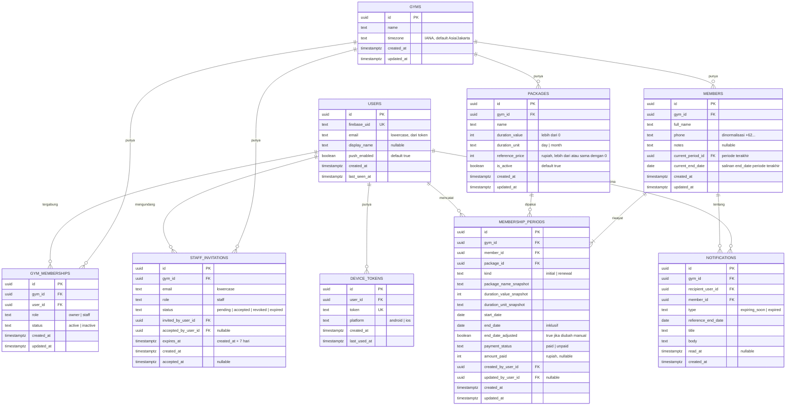

# Aplikasi Membership Gym

## 1. Context & Goal

Pemilik dan staf admin sebuah gym sulit memantau member mana yang masih aktif dan mana yang masa berlakunya sudah habis, karena datanya dicatat manual atau di spreadsheet. *(Masalah ini masih TEBAKAN, lihat Open Questions.)*

Aplikasi ini menggantikan catatan manual dengan aplikasi yang rapi, bisa dipakai di Android, iOS, dan web. Isinya:

- Admin mencatat member baru beserta paket dan tanggal berakhirnya. Ini aksi pertama yang paling penting.
- Admin melihat daftar member dengan status **aktif**, **akan habis**, atau **habis**. Status dihitung di server memakai zona waktu gym.
- Admin memperpanjang membership. Riwayat setiap periode tetap tersimpan.
- Admin mendapat notifikasi di dalam aplikasi, ditambah push notification di HP, untuk member yang akan habis atau sudah habis.

Pengguna aplikasi hanya pemilik gym dan staf admin. Member tidak login.

**Tujuan terukur versi pertama:**
- Admin bisa menambahkan member baru, termasuk paket dan tanggal berakhir, dalam kurang dari 1 menit.
- Admin bisa mengetahui jumlah member aktif, akan habis, dan habis dari satu layar tanpa menghitung manual.
- Setiap member yang masuk masa "akan habis" atau "habis" menghasilkan tepat satu notifikasi per penerima untuk kejadian itu.

## 2. Scope

### In scope

- **F-01: Akun dan login admin.** Daftar akun, login, logout, dan reset password dengan email dan password lewat Firebase Auth. Server memverifikasi ID token di setiap request. Baris `users` dibuat otomatis saat request pertama berdasarkan `firebase_uid`.
- **F-02: Pengelolaan gym dan peran.**
  - Setup profil gym sekali di awal: nama dan zona waktu (default `Asia/Jakarta`).
  - Pemilik mengundang staf lewat email. Undangan dicocokkan saat staf login pertama kali.
  - Pemilik bisa menonaktifkan, mengaktifkan lagi, atau mencabut akses staf.
  - Hak akses dicek per peran di server untuk setiap aksi.
  - Semua data bisnis punya `gym_id`.
- **F-03: Master paket membership.** Pemilik menambah, mengubah, dan menonaktifkan paket. Setiap paket punya nama, durasi, dan harga acuan. Paket yang sudah pernah dipakai tidak bisa dihapus permanen.
- **F-04: Tambah dan kelola data member.**
  - Form tambah member: nama, nomor HP, paket, tanggal mulai, dan status pembayaran awal.
  - Tanggal berakhir dihitung otomatis dan bisa disesuaikan manual.
  - Admin bisa mengedit data member dan membuka halaman detail member.
- **F-05: Daftar member dengan status.**
  - Status aktif, akan habis (7 hari), atau habis dihitung di server.
  - Daftar bisa difilter per status, dicari berdasarkan nama atau nomor HP, dan diurutkan berdasarkan tanggal berakhir.
  - Ada ringkasan jumlah member per status.
- **F-06: Perpanjangan membership.**
  - Admin memilih paket. Tanggal mulai baru dihitung otomatis.
  - Admin mencatat status pembayaran dan nominalnya.
  - Riwayat periode tersimpan per member, termasuk admin yang mencatatnya.
- **F-07: Notifikasi di dalam aplikasi.**
  - Job harian pg-boss berjalan jam 08.00 waktu gym.
  - Ada daftar notifikasi dengan status sudah atau belum dibaca.
  - Tap notifikasi membuka detail member.
  - Notifikasi ganda dicegah.
- **F-08: Push notification ke HP admin.**
  - Hanya untuk Android dan iOS.
  - Token perangkat didaftarkan saat login dan dihapus saat logout.
  - Push dikirim lewat FCM.
  - Setiap akun bisa menyalakan atau mematikan push.
  - Di web hanya ada notifikasi in-app.
- **F-09: Ekspor dan hapus data member.** Ekspor CSV untuk member dan riwayat periodenya, serta hapus permanen satu member beserta riwayatnya. Keduanya khusus pemilik.

**Urutan pembangunan:**

| Fase | Nama | Fitur | Hasil |
|---|---|---|---|
| 0 | Fondasi | F-01, F-02, F-03 | Monorepo, skema awal, login, verifikasi token dan pengecekan peran, setup gym, undangan staf, master paket |
| 1 | Data Member | F-04 | Tambah, edit, dan detail member |
| 2 | Status dan Perpanjangan | F-05, F-06, F-09 | Daftar dengan status, perpanjangan, ekspor, dan hapus permanen |
| 3 | Notifikasi | F-07, F-08 | Notifikasi in-app dan push di Android/iOS |

### Non-goals

- Member tidak bisa login dan tidak punya aplikasi sendiri.
- Tidak ada leaderboard, poin, atau gamifikasi member.
- Pembayaran tidak diproses di aplikasi. Aplikasi hanya mencatat status dan nominal pembayaran.
- Tidak mendukung banyak cabang atau banyak gym (marketplace). Aplikasi hanya untuk satu gym.
- Tidak ada kelas grup, booking personal trainer, atau program latihan.
- Tidak ada integrasi pihak ketiga. Data member diinput manual. Tidak ada email undangan yang dikirim oleh sistem.
- Tidak ada mode offline dan tidak ada pembaruan realtime (WebSocket/SSE).
- Tidak ada push notification di web.
- Tidak ada pengingat WhatsApp atau SMS ke member.
- Tidak ada check-in kehadiran member.
- Tidak ada laporan pendapatan atau tren perpanjangan.
- Tidak ada impor data dari spreadsheet.
- Tidak ada log aktivitas admin yang detail. Yang dicatat hanya pembuat dan pengubah terakhir periode membership.
- Tidak ada upload file atau foto member. Cloud Storage for Firebase belum dipakai di versi pertama.

## 3. Tech Constraints

**Monorepo**
- `apps/app`: Flutter untuk web, Android, dan iOS.
- `apps/api`: Hono + TypeScript.
- `packages/contract`: spesifikasi OpenAPI dan client Dart hasil generate. Client Dart tidak boleh diedit manual.

**Flutter (`apps/app`)**
- Clean Architecture per fitur (`auth`, `gym`, `staff`, `packages`, `members`, `renewals`, `notifications`):
  - `domain/`: entity, interface repository, dan use case.
  - `data/`: data source yang membungkus client OpenAPI, model/DTO beserta mapper ke entity, dan implementasi repository.
  - `presentation/`: widget dan Bloc/Cubit.
- Routing memakai `go_router` dengan redirect berdasarkan status auth dan akses gym.
- DI memakai `get_it` dengan registrasi manual per fitur (`registerXxxFeature()`), tanpa code generation untuk DI.
- Error dikembalikan sebagai sealed `Result<T>` (`Success` / `Failure`). Use case dan repository tidak melempar exception ke presentation.
- FCM hanya diinisialisasi jika `!kIsWeb`.

**Backend (`apps/api`)**
- Clean Architecture per fitur:
  - `domain/`: entity dan aturan murni, misalnya perhitungan status dan tanggal.
  - `usecases/`
  - `infrastructure/`: repository Drizzle.
  - `http/`: route `@hono/zod-openapi`.
- Skema Zod di route adalah sumber tunggal OpenAPI. Spesifikasinya diekspor ke `packages/contract`, lalu client Dart di-generate dari situ.
- Middleware wajib untuk semua endpoint kecuali `GET /health`, dari endpoint pertama yang dibangun:
  1. Verifikasi Firebase ID token.
  2. Upsert `users`.
  3. Muat keanggotaan gym dan peran.
- Setiap route mendeklarasikan peran yang diizinkan.
- Semua query data bisnis difilter dengan `gym_id` dari keanggotaan pengguna, bukan dari input client.

**Database**
- PostgreSQL + Drizzle ORM. Migrasi memakai drizzle-kit dan di-commit ke repo.
- Lokal: Docker Compose (PostgreSQL + Firebase Auth Emulator).

**Auth**
- Firebase Auth (email/password) di client. Backend memverifikasi ID token dengan `firebase-admin`.
- Tabel `users` tidak menyimpan password.
- Peran dan keanggotaan gym disimpan di PostgreSQL.

**Waktu**
- Kolom tanggal membership bertipe `date`. Timestamp bertipe `timestamptz` (UTC).
- "Hari ini" selalu dihitung sebagai tanggal saat ini di `gyms.timezone`.

**Notifikasi**
- Notifikasi in-app disimpan di PostgreSQL.
- Push memakai FCM (`firebase-admin`).
- Job terjadwal memakai pg-boss, dengan skema pg-boss di database yang sama.

**Deploy**
- API berjalan sebagai container yang selalu hidup (satu instance cukup untuk MVP). pg-boss berjalan di proses yang sama.
- Flutter web di hosting statis.
- Android dan iOS lewat store.

**Testing**
- API: Vitest (unit untuk domain dan use case, integration test ke PostgreSQL di Docker).
- App: `flutter_test`, `bloc_test`, dan `mocktail`.
- Lokal: Firebase Auth Emulator.

**Konvensi API**
- JSON memakai camelCase. Tanggal ditulis sebagai `YYYY-MM-DD`, timestamp dalam ISO 8601 UTC.
- ID berupa UUID v4.
- Format error: `{ "error": { "code": string, "message": string, "details"?: object } }`.

## 4. Data Model

**Constraint dan aturan integritas:**

**Unik**
- `users.firebase_uid` unik.
- `gym_memberships(gym_id, user_id)` unik.
- Undangan pending: partial unique index `staff_invitations(gym_id, email) WHERE status = 'pending'`.
- `members(gym_id, phone)` unik.
- `device_tokens.token` unik. Jika token yang sama didaftarkan oleh user lain, `user_id` dipindahkan ke user baru.
- `notifications(recipient_user_id, member_id, type, reference_end_date)` unik. Ini kunci dedupe notifikasi.

**Pemilik**
- Tepat satu `gym_memberships` dengan `role = 'owner'` per gym di MVP.
- Owner tidak bisa dinonaktifkan atau dihapus lewat API.

**Periode membership**
- `members.current_period_id` dan `members.current_end_date` wajib selalu sama dengan periode terakhir (urut `start_date DESC, created_at DESC`).
- Kedua kolom itu diperbarui dalam transaksi yang sama dengan setiap insert atau update `membership_periods`.
- Setiap member punya minimal satu periode (`kind = 'initial'`), dibuat dalam transaksi yang sama dengan member.
- `membership_periods.end_date >= start_date` (CHECK).
- `end_date` hanya boleh diubah manual pada periode terakhir. Periode lama bersifat read-only kecuali `payment_status` dan `amount_paid`.

**Status member**
- Status **tidak disimpan**. Status dihitung dari `current_end_date` dan "hari ini" di zona waktu gym:
  - `expired`: `current_end_date < today`.
  - `expiring_soon`: `today <= current_end_date <= today + 7 hari`.
  - `active`: `current_end_date > today + 7 hari`.

**Foreign key**
- `membership_periods.package_id` memakai `ON DELETE RESTRICT`. Paket yang sudah dipakai tidak bisa dihapus.
- Hapus member memakai `ON DELETE CASCADE` ke `membership_periods` dan `notifications`.

**Isolasi gym**
- Semua tabel bisnis (`packages`, `members`, `membership_periods`, `notifications`, `staff_invitations`) wajib punya `gym_id` dan wajib difilter dengannya.

**Index**
- `members(gym_id, current_end_date)`
- `members(gym_id, lower(full_name))`
- `members(gym_id, phone)`
- `membership_periods(member_id, start_date DESC)`
- `notifications(recipient_user_id, read_at, created_at DESC)`
- `gym_memberships(user_id)`
- `staff_invitations(email, status)`

## 5. API Contract

**Aturan umum:**

- Semua endpoint kecuali `GET /health` wajib memakai `Authorization: Bearer <Firebase ID token>`. Token tidak ada, tidak valid, atau kedaluwarsa menghasilkan `401 UNAUTHENTICATED`.
- **Akses:**
  - **Terautentikasi**: token valid, dengan atau tanpa keanggotaan gym.
  - **Owner**: keanggotaan aktif dengan peran `owner`.
  - **Owner, Staff**: keanggotaan aktif dengan peran `owner` atau `staff`.
- Pengguna tanpa keanggotaan aktif yang memanggil endpoint Owner/Staff mendapat `403 NO_GYM_ACCESS`. Peran yang tidak diizinkan mendapat `403 FORBIDDEN_ROLE`.
- Resource dengan `gym_id` lain dianggap tidak ada (`404 NOT_FOUND`).
- Kode error umum:

| Kode | HTTP |
|---|---|
| `UNAUTHENTICATED` | 401 |
| `NO_GYM_ACCESS` | 403 |
| `FORBIDDEN_ROLE` | 403 |
| `NOT_FOUND` | 404 |
| `CONFLICT` (+ kode spesifik) | 409 |
| `VALIDATION_ERROR` | 422, `details` berisi error per field |

- Paginasi daftar memakai `?page=1&pageSize=20` (maks 100). Response `{ items, page, pageSize, total }`.
- Route statis seperti `/members/summary` dan `/members/export` didaftarkan sebelum `/members/{id}`.

**Objek bersama:**
- `Member`: `{ id, fullName, phone, notes, currentEndDate, status: "active"|"expiring_soon"|"expired", daysLeft, currentPeriod: Period, createdAt, updatedAt }`
- `Period`: `{ id, kind, packageId, packageName, durationValue, durationUnit, startDate, endDate, endDateAdjusted, paymentStatus: "paid"|"unpaid", amountPaid, createdBy: { id, email }, createdAt }`
- `Package`: `{ id, name, durationValue, durationUnit: "day"|"month", referencePrice, isActive, isUsed }`

### Sistem dan akun

**GET /health**
- Akses: publik.
- Response `200 { "status": "ok" }`.

**GET /me**
- Akses: Terautentikasi.
- Membuat `users` jika belum ada. Jika pengguna belum punya keanggotaan, endpoint ini menjalankan pencocokan undangan (lihat FR-04).
- Response `200`: `{ user: { id, email, emailVerified, pushEnabled }, membership: { gymId, gymName, role, status } | null, gymExists: boolean, canBootstrap: boolean }`. Nilai `canBootstrap` adalah true hanya jika belum ada gym dan email sama dengan `BOOTSTRAP_OWNER_EMAIL`.
- Error: 401.

**PATCH /me/settings**
- Akses: Terautentikasi.
- Request `{ pushEnabled: boolean }`.
- Response `200 { pushEnabled }`.
- Error: 401, 422.

### Gym

**POST /gym**
- Akses: Terautentikasi, dengan syarat email token sama dengan env `BOOTSTRAP_OWNER_EMAIL` dan `email_verified = true`.
- Request `{ name: string 1..100, timezone?: IANA string }`. Timezone default `Asia/Jakarta`.
- Response `201 { id, name, timezone }`. Endpoint ini juga membuat keanggotaan `owner`.
- Error:
  - `403 BOOTSTRAP_NOT_ALLOWED`
  - `409 GYM_ALREADY_EXISTS`
  - `422` (termasuk timezone tidak valid)

**GET /gym**
- Akses: Owner, Staff.
- Response `200 { id, name, timezone }`.

**PATCH /gym**
- Akses: Owner.
- Request `{ name?, timezone? }`.
- Response `200 { id, name, timezone }`. Jika timezone berubah, jadwal job harian didaftarkan ulang.
- Error: 403, 422.

### Staf

**GET /staff**
- Akses: Owner.
- Response `200`: `{ members: [{ membershipId, userId, email, role, status, createdAt }], invitations: [{ id, email, status, expiresAt, createdAt }] }`. Undangan yang ditampilkan hanya yang `pending`.

**POST /staff/invitations**
- Akses: Owner.
- Request `{ email: string (email valid) }`.
- Response `201 { id, email, status: "pending", expiresAt }`.
- Error:
  - `409 INVITATION_PENDING`: sudah ada undangan pending untuk email itu.
  - `409 ALREADY_MEMBER`: email sudah terdaftar di gym.
  - `422`

**DELETE /staff/invitations/{id}**
- Akses: Owner.
- Mengubah status undangan menjadi `revoked`.
- Response `204`.
- Error:
  - `404`
  - `409 INVITATION_NOT_PENDING`

**PATCH /staff/{membershipId}**
- Akses: Owner.
- Request `{ status: "active"|"inactive" }`.
- Response `200 { membershipId, status }`.
- Error:
  - `404`
  - `409 CANNOT_MODIFY_OWNER`
  - `422`

**DELETE /staff/{membershipId}**
- Akses: Owner.
- Menghapus keanggotaan staf. Semua token perangkat milik user itu ikut dihapus.
- Response `204`.
- Error:
  - `404`
  - `409 CANNOT_MODIFY_OWNER`

### Paket

**GET /packages?includeInactive=false**
- Akses: Owner, Staff. Staff hanya bisa melihat paket aktif, sehingga `includeInactive` diabaikan untuk staff.
- Response `200 { items: Package[] }`, diurutkan berdasarkan nama.

**POST /packages**
- Akses: Owner.
- Request `{ name: 1..60, durationValue: int 1..366, durationUnit: "day"|"month", referencePrice: int >= 0 }`.
- Response `201 Package`.
- Error:
  - `409 PACKAGE_NAME_EXISTS`: nama duplikat di antara paket aktif, tanpa membedakan huruf besar dan kecil.
  - `422`

**PATCH /packages/{id}**
- Akses: Owner.
- Request: field yang sama dengan POST, ditambah `isActive?: boolean`. Semua field opsional.
- Response `200 Package`. Perubahan tidak mengubah periode yang sudah tercatat, karena periode memakai snapshot.
- Error: 404, 409, 422.

**DELETE /packages/{id}**
- Akses: Owner.
- Response `204`.
- Error:
  - `404`
  - `409 PACKAGE_IN_USE`: paket sudah dipakai. Klien menyarankan menonaktifkan paket.

### Member

**GET /members**
- Akses: Owner, Staff.
- Query:
  - `status?=active|expiring_soon|expired`
  - `q?` (nama mengandung, tanpa membedakan huruf besar dan kecil, atau nomor HP mengandung angka)
  - `sort?=endDate_asc|endDate_desc|name_asc` (default `endDate_asc`)
  - `page`, `pageSize`
- Response `200 { items: Member[], page, pageSize, total }`.
- Error: 422.

**GET /members/summary**
- Akses: Owner, Staff.
- Response `200 { active: int, expiringSoon: int, expired: int, total: int, today: "YYYY-MM-DD" }`.

**POST /members**
- Akses: Owner, Staff.
- Request:
  - `fullName`: 1..100
  - `phone`: string. Dinormalisasi: `08xx` atau `62xx` diubah ke `+62xx`, dengan 9–15 digit.
  - `notes?`: ≤500
  - `packageId`: uuid, paket aktif
  - `startDate`: `YYYY-MM-DD`
  - `endDate?`: `YYYY-MM-DD`, override manual
  - `paymentStatus`: `"paid"|"unpaid"`
  - `amountPaid?`: int ≥ 0
- Response `201 Member`.
- Error:
  - `409 DUPLICATE_PHONE` (`details.memberId` berisi ID member yang sudah ada)
  - `422 PACKAGE_INACTIVE`
  - `422 END_BEFORE_START`
  - `422`

**GET /members/{id}**
- Akses: Owner, Staff.
- Response `200 Member & { periods: Period[] }`. Periode diurutkan dari yang terbaru.
- Error: 404.

**PATCH /members/{id}**
- Akses: Owner, Staff.
- Request `{ fullName?, phone?, notes? }`.
- Response `200 Member`.
- Error: 404, `409 DUPLICATE_PHONE`, 422.

**PATCH /members/{id}/periods/{periodId}**
- Akses: Owner, Staff.
- Request `{ endDate?, paymentStatus?, amountPaid? }`. `endDate` hanya boleh untuk periode terakhir.
- Response `200 Member & { periods: Period[] }`.
- Error:
  - `404`
  - `409 PERIOD_NOT_LATEST`: mencoba mengubah `endDate` periode lama.
  - `422 END_BEFORE_START`
  - `422`

**POST /members/{id}/renewals**
- Akses: Owner, Staff.
- Request `{ packageId, paymentStatus, amountPaid? }`.
- Response `201 { member: Member, period: Period }`.
- Error:
  - `404`
  - `422 PACKAGE_INACTIVE`
  - `422`

**GET /members/export**
- Akses: Owner.
- Response `200`, `Content-Type: text/csv; charset=utf-8`, `Content-Disposition: attachment; filename="members-YYYYMMDD.csv"`.
- Format CSV: satu baris per periode. Kolom:
  - `member_id`, `full_name`, `phone`, `notes`, `current_status`, `current_end_date`
  - `period_kind`, `package_name`, `start_date`, `end_date`
  - `payment_status`, `amount_paid`, `recorded_by_email`, `recorded_at`
- Error: 403.

**DELETE /members/{id}**
- Akses: Owner.
- Menghapus permanen member beserta periode dan notifikasinya.
- Response `204`.
- Error: 403, 404.

### Notifikasi

**GET /notifications?unreadOnly=false**
- Akses: Owner, Staff. Hanya menampilkan notifikasi milik pengguna yang login.
- Response `200 { items: [{ id, type, memberId, title, body, referenceEndDate, readAt, createdAt }], page, pageSize, total }`, diurutkan dari yang terbaru.

**GET /notifications/unread-count**
- Akses: Owner, Staff.
- Response `200 { count: int }`.

**POST /notifications/{id}/read**
- Akses: Owner, Staff (penerima notifikasi).
- Response `204`. Endpoint ini idempoten.
- Error: 404.

**POST /notifications/read-all**
- Akses: Owner, Staff.
- Response `204`.

### Perangkat (push)

**POST /device-tokens**
- Akses: Owner, Staff.
- Request `{ token: string, platform: "android"|"ios" }`.
- Response `201 { id }`. Jika token sudah ada, response `200 { id }` dan tokennya dipindahkan ke user ini.
- Error: `422` (termasuk `platform` selain android/ios, misalnya `web`).

**DELETE /device-tokens/{id}**
- Akses: Terautentikasi (pemilik token).
- Response `204`. Endpoint ini idempoten: jika token tidak ada, tetap `204`.

## 6. Functional Requirements

### FR-01: Daftar, login, logout, dan reset password
Pengguna membuat akun dan masuk dengan email dan password lewat Firebase Auth di Android, iOS, dan web.

Fitur: F-01

Acceptance criteria:
- [ ] Given pengguna belum login, When membuka aplikasi, Then diarahkan ke layar login dan tidak ada layar data yang bisa diakses.
- [ ] Given email dan password benar, When login, Then aplikasi memanggil `GET /me` dan mengarahkan pengguna sesuai hasilnya:
  - punya keanggotaan aktif → beranda
  - `canBootstrap` → setup gym
  - lainnya → layar "Belum punya akses"
- [ ] Given pengguna mendaftar akun baru, When pendaftaran berhasil, Then Firebase mengirim email verifikasi dan aplikasi menampilkan layar "Verifikasi email" dengan tombol kirim ulang dan tombol "Saya sudah verifikasi".
- [ ] Given pengguna memilih "Lupa password", When memasukkan email, Then Firebase mengirim email reset dan aplikasi menampilkan pesan yang sama, baik email itu terdaftar maupun tidak.
- [ ] Given pengguna login, When memilih logout, Then token perangkat dihapus lewat `DELETE /device-tokens/{id}` (khusus mobile), sesi Firebase diakhiri, dan pengguna kembali ke layar login.

Edge cases:
- Password salah atau akun tidak ada: pesan umum "Email atau password salah".
- Jaringan putus saat login: tampilkan error dan tombol coba lagi, tanpa crash.
- Token Firebase kedaluwarsa di tengah sesi: client me-refresh token otomatis. Jika gagal, pengguna diarahkan ke login.

### FR-02: Verifikasi token dan pembuatan akun otomatis di server
Setiap request diverifikasi. Baris `users` dibuat saat request pertama.

Fitur: F-01

Acceptance criteria:
- [ ] Given request tanpa header Authorization, When memanggil endpoint apa pun selain `/health`, Then response `401 UNAUTHENTICATED`.
- [ ] Given ID token dengan tanda tangan tidak valid atau kedaluwarsa, When memanggil endpoint, Then response `401` dan tidak ada baris `users` yang dibuat.
- [ ] Given token valid dengan `firebase_uid` yang belum ada di `users`, When memanggil `GET /me`, Then satu baris `users` dibuat dengan email lowercase dari token.
- [ ] Given dua request paralel pertama dari `firebase_uid` yang sama, When diproses, Then hanya ada satu baris `users` (upsert pada `firebase_uid`).
- [ ] Given token valid tanpa keanggotaan gym, When memanggil `GET /members`, Then response `403 NO_GYM_ACCESS`.

Edge cases:
- Email di Firebase berubah: `users.email` diperbarui dari token saat request berikutnya.
- Integration test memakai Firebase Auth Emulator.

### FR-03: Setup gym pertama kali
Gym dibuat sekali oleh pemilik yang emailnya dikonfigurasi di server.

Fitur: F-02

Acceptance criteria:
- [ ] Given belum ada gym, email pengguna sama dengan `BOOTSTRAP_OWNER_EMAIL`, dan email sudah terverifikasi, When mengirim `POST /gym` dengan nama "Gym Sehat", Then gym dibuat dengan timezone `Asia/Jakarta` dan pengguna menjadi `owner` aktif.
- [ ] Given belum ada gym dan email pengguna berbeda dengan `BOOTSTRAP_OWNER_EMAIL`, When mengirim `POST /gym`, Then response `403 BOOTSTRAP_NOT_ALLOWED`.
- [ ] Given gym sudah ada, When siapa pun mengirim `POST /gym`, Then response `409 GYM_ALREADY_EXISTS`.
- [ ] Given owner, When mengubah timezone lewat `PATCH /gym` menjadi `Asia/Makassar`, Then status member dan jadwal job harian memakai timezone baru.

Edge cases:
- Timezone bukan IANA yang valid: `422`.
- Nama kosong atau lebih dari 100 karakter: `422`.
- Staff memanggil `PATCH /gym`: `403 FORBIDDEN_ROLE`.

### FR-04: Undangan staf lewat email
Pemilik mengundang staf lewat email. Undangan diterima otomatis saat staf dengan email itu login pertama kali.

Fitur: F-02

Acceptance criteria:
- [ ] Given owner, When mengundang `Budi@Mail.com`, Then undangan `pending` tersimpan dengan email `budi@mail.com` dan `expiresAt` 7 hari dari sekarang.
- [ ] Given undangan pending untuk `budi@mail.com`, When pengguna dengan email itu (`email_verified = true`) tanpa keanggotaan memanggil `GET /me`, Then keanggotaan `staff` aktif dibuat, undangan menjadi `accepted` dengan `accepted_by_user_id` terisi, dan response `membership.role = "staff"`.
- [ ] Given undangan pending dan email pengguna belum terverifikasi, When memanggil `GET /me`, Then keanggotaan tidak dibuat, `membership = null`, dan aplikasi menampilkan layar "Verifikasi email".
- [ ] Given pengguna login dengan email yang tidak diundang, When memanggil `GET /me`, Then `membership = null` dan semua endpoint data merespons `403 NO_GYM_ACCESS`.
- [ ] Given undangan sudah lewat `expiresAt`, When pengguna dengan email itu memanggil `GET /me`, Then keanggotaan tidak dibuat dan status undangan menjadi `expired`.
- [ ] Given undangan di-revoke owner, When pengguna dengan email itu login, Then keanggotaan tidak dibuat.

Edge cases:
- Owner mengundang email yang sudah menjadi anggota: `409 ALREADY_MEMBER`.
- Undangan pending untuk email yang sama sudah ada: `409 INVITATION_PENDING`. Owner bisa revoke lalu mengundang ulang.
- Sistem tidak mengirim email undangan. UI owner menampilkan instruksi: "Minta staf mendaftar di aplikasi dengan email ini".
- Pencocokan email tidak membedakan huruf besar dan kecil.

### FR-05: Kelola akses staf
Pemilik bisa menonaktifkan, mengaktifkan lagi, atau mencabut akses staf.

Fitur: F-02

Acceptance criteria:
- [ ] Given staf aktif, When owner mengubah statusnya menjadi `inactive`, Then request staf berikutnya ke endpoint data merespons `403 NO_GYM_ACCESS` dan staf tidak lagi menerima notifikasi dari job berikutnya.
- [ ] Given staf `inactive`, When owner mengubah statusnya menjadi `active`, Then staf bisa mengakses data lagi.
- [ ] Given staf, When owner menghapus keanggotaannya, Then keanggotaan dan semua `device_tokens` milik staf itu dihapus.
- [ ] Given owner, When mencoba menonaktifkan atau menghapus keanggotaan owner, Then response `409 CANNOT_MODIFY_OWNER`.

Edge cases:
- Staf yang aksesnya dicabut dan ingin bergabung lagi harus diundang ulang.
- Periode yang pernah dicatat staf yang sudah dihapus tetap menampilkan email pencatat, karena baris `users` tidak dihapus.

### FR-06: Otorisasi per peran di setiap endpoint
Setiap aksi dicek perannya di server sejak endpoint pertama yang dibangun.

Fitur: F-02

Acceptance criteria:
- [ ] Given staff aktif, When memanggil endpoint yang aksesnya "Owner" (`POST /packages`, `GET /staff`, `GET /members/export`, `DELETE /members/{id}`, `PATCH /gym`), Then response `403 FORBIDDEN_ROLE`.
- [ ] Given staff aktif, When memanggil `POST /members`, `PATCH /members/{id}`, atau `POST /members/{id}/renewals`, Then request diproses.
- [ ] Given setiap route di API, When test otorisasi dijalankan, Then setiap route punya deklarasi peran. Route tanpa deklarasi membuat test gagal.
- [ ] Given member milik `gym_id` lain ada di database, When pengguna gym A memanggil `GET /members/{id}` untuk member itu, Then response `404`.

Edge cases:
- UI menyembunyikan menu yang khusus owner untuk staff, tetapi server tetap menjadi penentu akhir.

### FR-07: Master paket membership
Pemilik mengelola paket yang dipakai saat menambah dan memperpanjang member.

Fitur: F-03

Acceptance criteria:
- [ ] Given owner, When membuat paket "Bulanan" dengan durasi 1 month dan harga 250000, Then paket tersimpan aktif dan muncul di `GET /packages`.
- [ ] Given paket sudah dipakai di satu periode, When owner mengirim `DELETE /packages/{id}`, Then response `409 PACKAGE_IN_USE` dan paket tetap ada.
- [ ] Given paket belum pernah dipakai, When owner menghapusnya, Then response `204`.
- [ ] Given paket dinonaktifkan, When admin membuka form tambah member atau perpanjangan, Then paket itu tidak muncul di pilihan. Periode lama tetap menampilkan nama paket dari snapshot.
- [ ] Given paket "Bulanan" diubah menjadi durasi 2 bulan, When melihat periode lama yang memakai paket itu, Then durasi dan nama periode lama tidak berubah.

Edge cases:
- Nama duplikat di antara paket aktif: `409 PACKAGE_NAME_EXISTS`.
- `durationValue` 0 atau negatif, atau `referencePrice` negatif: `422`.
- Belum ada paket aktif: form tambah member menampilkan pesan "Belum ada paket, minta pemilik menambahkan paket". Untuk owner, pesannya berisi tautan ke halaman paket.

### FR-08: Tambah member baru
Admin menambahkan member beserta paket, tanggal mulai, tanggal berakhir, dan status pembayaran awal.

Fitur: F-04

Acceptance criteria:
- [ ] Given paket "Bulanan" (1 month), When admin menambah member dengan `startDate = 2026-01-15` tanpa `endDate`, Then periode `initial` dibuat dengan `endDate = 2026-02-14`. Rumusnya: `addMonths(start, n) − 1 hari`, dengan clamp ke akhir bulan.
- [ ] Given paket "Harian 10 hari" (10 day), When `startDate = 2026-03-01`, Then `endDate = 2026-03-10`.
- [ ] Given admin mengisi `endDate` manual 2026-03-31, When menyimpan, Then periode memakai tanggal itu dan `endDateAdjusted = true`.
- [ ] Given member berhasil ditambah, When melihat response, Then `currentEndDate` sama dengan `endDate` periode, `status` terhitung, `createdBy` adalah pengguna yang login, dan `paymentStatus` sesuai input.
- [ ] Given nomor HP `0812-3456-7890`, When disimpan, Then tersimpan sebagai `+6281234567890`.

Edge cases:
- Nomor HP yang sama sudah ada: `409 DUPLICATE_PHONE`. UI menampilkan tautan ke member yang sudah ada.
- `endDate < startDate`: `422 END_BEFORE_START`.
- Paket nonaktif dipilih lewat API: `422 PACKAGE_INACTIVE`.
- `startDate` di masa lalu diperbolehkan untuk mencatat member lama. Status langsung dihitung dan bisa langsung `expired`.
- Clamp akhir bulan: start 2026-01-31 + 1 month → 2026-02-28 − 1 hari = `2026-02-27`.

### FR-09: Detail dan edit member
Admin melihat detail member beserta riwayat periodenya, mengedit data member, menyesuaikan tanggal berakhir, dan mengubah status pembayaran.

Fitur: F-04

Acceptance criteria:
- [ ] Given member dengan 3 periode, When admin membuka detail, Then data member, status, sisa hari, dan 3 periode ditampilkan dari yang terbaru.
- [ ] Given admin (owner atau staff), When mengubah `endDate` periode terakhir menjadi 2026-12-31, Then `currentEndDate` member ikut berubah dalam transaksi yang sama, `endDateAdjusted = true`, dan `updated_by_user_id` terisi.
- [ ] Given periode yang bukan periode terakhir, When admin mengirim `endDate` baru, Then response `409 PERIOD_NOT_LATEST`.
- [ ] Given periode lama berstatus `unpaid`, When admin mengubahnya menjadi `paid` dengan `amountPaid`, Then perubahan tersimpan.
- [ ] Given admin mengubah nama atau nomor HP, When disimpan, Then data diperbarui dan validasi yang sama dengan FR-08 berlaku.

Edge cases:
- Member tidak ditemukan atau milik gym lain: `404`.
- Setelah tanggal berakhir diubah, status langsung dihitung ulang di response berikutnya. Notifikasi baru untuk tanggal baru bisa muncul sesuai FR-13.

### FR-10: Perhitungan status member di server
Status dihitung dari `current_end_date` terhadap "hari ini" di zona waktu gym.

Fitur: F-05

Acceptance criteria:
- [ ] Given timezone `Asia/Jakarta` dan waktu server `2026-05-09T17:30:00Z` (00.30 WIB tanggal 10 Mei), When `currentEndDate = 2026-05-09`, Then status `expired`.
- [ ] Given waktu `2026-05-09T16:30:00Z` (23.30 WIB tanggal 9 Mei), When `currentEndDate = 2026-05-09`, Then status `expiring_soon` dan `daysLeft = 0`.
- [ ] Given hari ini 2026-05-10, When `currentEndDate = 2026-05-17`, Then status `expiring_soon` dan `daysLeft = 7`.
- [ ] Given hari ini 2026-05-10, When `currentEndDate = 2026-05-18`, Then status `active` dan `daysLeft = 8`.
- [ ] Given unit test domain, When dijalankan, Then fungsi status adalah fungsi murni `(endDate, today) → status` dengan ambang tetap 7 hari. Nilai `today` diambil dari satu `Clock` yang bisa di-mock.

Edge cases:
- Client tidak pernah menghitung status sendiri. Client hanya menampilkan `status` dan `daysLeft` dari server.
- `daysLeft` bernilai negatif untuk member `expired`, misalnya -3 artinya sudah habis 3 hari. UI menampilkannya sebagai "Habis 3 hari lalu".

### FR-11: Daftar member, filter, pencarian, dan ringkasan
Admin memantau semua member dari satu layar.

Fitur: F-05

Acceptance criteria:
- [ ] Given 10 member (4 active, 3 expiring_soon, 3 expired), When admin membuka beranda, Then ringkasan menampilkan 4 / 3 / 3 dan total 10.
- [ ] Given filter `status=expired`, When daftar dimuat, Then hanya 3 member habis yang tampil.
- [ ] Given pencarian `q=budi`, When daftar dimuat, Then member dengan nama yang mengandung "Budi" tampil, tanpa membedakan huruf besar dan kecil.
- [ ] Given pencarian `q=0812345`, When daftar dimuat, Then member dengan nomor HP `+62812345...` tampil. Awalan `0` dinormalisasi menjadi `62` sebelum dicocokkan.
- [ ] Given sort default, When daftar dimuat, Then member diurutkan dari `currentEndDate` terdekat.
- [ ] Given 45 member dan `pageSize = 20`, When membuka halaman 3, Then tampil 5 item dan `total = 45`.

Edge cases:
- Belum ada member: tampil empty state dengan tombol "Tambah member".
- Filter dan pencarian bisa dipakai bersamaan.
- Data diperbarui dengan pull-to-refresh atau saat layar dibuka ulang. Tidak ada realtime.

### FR-12: Perpanjangan membership
Admin memperpanjang membership dengan memilih paket. Setiap perpanjangan menjadi periode baru.

Fitur: F-06

Acceptance criteria:
- [ ] Given hari ini 2026-05-10 dan `currentEndDate = 2026-05-20` (masih berlaku), When diperpanjang dengan paket 1 month, Then periode baru `startDate = 2026-05-21` dan `endDate = 2026-06-20`.
- [ ] Given hari ini 2026-05-10 dan `currentEndDate = 2026-05-10` (hari terakhir), When diperpanjang dengan paket 1 month, Then `startDate = 2026-05-11`.
- [ ] Given hari ini 2026-05-10 dan `currentEndDate = 2026-05-01` (habis), When diperpanjang dengan paket 1 month, Then `startDate = 2026-05-10` dan `endDate = 2026-06-09`.
- [ ] Given perpanjangan berhasil, When melihat detail member, Then periode lama tetap ada tanpa perubahan, periode baru tercatat dengan `kind = renewal`, status pembayaran, nominal, dan `createdBy` sesuai admin yang login, lalu `currentEndDate` dan status ikut diperbarui.
- [ ] Given staff aktif, When memperpanjang member, Then berhasil (`201`).

Edge cases:
- Paket nonaktif: `422 PACKAGE_INACTIVE`.
- Dua perpanjangan hampir bersamaan untuk member yang sama: diproses berurutan dengan row lock pada `members`, sehingga periode kedua mulai setelah periode pertama berakhir.
- `amountPaid` boleh kosong walaupun statusnya `paid`. Nilai default di UI diambil dari `referencePrice` paket.

### FR-13: Job harian dan pembuatan notifikasi in-app
Job pg-boss berjalan setiap hari jam 08.00 waktu gym dan membuat notifikasi untuk member yang akan habis dan yang sudah habis.

Fitur: F-07

Acceptance criteria:
- [ ] Given timezone gym `Asia/Jakarta`, When API berjalan, Then pg-boss punya schedule `0 8 * * *` dengan tz `Asia/Jakarta` untuk job `membership-expiry-check`.
- [ ] Given member dengan `currentEndDate` dalam rentang `[today, today+7]`, When job berjalan, Then setiap keanggotaan aktif (owner dan staff) menerima satu notifikasi `expiring_soon` dengan `reference_end_date = currentEndDate`.
- [ ] Given member dengan `currentEndDate < today`, When job berjalan, Then setiap keanggotaan aktif menerima satu notifikasi `expired` untuk `reference_end_date` itu.
- [ ] Given job sudah membuat notifikasi `expiring_soon` untuk member X dengan end date 2026-05-17, When job berjalan lagi keesokan harinya, Then tidak ada notifikasi duplikat, berkat unique constraint dan `ON CONFLICT DO NOTHING`.
- [ ] Given member X diperpanjang sehingga end date menjadi 2026-06-20, When end date baru itu masuk rentang 7 hari, Then notifikasi baru dibuat untuk `reference_end_date = 2026-06-20`.
- [ ] Given job dipicu manual dua kali di hari yang sama, When selesai, Then jumlah notifikasi sama seperti saat job dipicu sekali.

Edge cases:
- Job terlewat karena API mati: saat API hidup lagi, pg-boss menjalankan jadwal berikutnya. Karena kriteria memakai rentang, bukan tanggal tepat, member yang terlewat tetap tertangkap.
- Member `expired` yang sudah pernah dinotifikasi untuk end date yang sama tidak dinotifikasi ulang setiap hari.
- Isi notifikasi:
  - `expiring_soon`: judul "Membership akan habis", isi "<nama> habis pada <tanggal> (<n> hari lagi)".
  - `expired`: judul "Membership habis", isi "<nama> habis sejak <tanggal>".
- Staff `inactive` tidak menerima notifikasi.

### FR-14: Daftar notifikasi in-app
Admin melihat notifikasi miliknya dan menandainya sudah dibaca.

Fitur: F-07

Acceptance criteria:
- [ ] Given 3 notifikasi belum dibaca, When admin membuka aplikasi atau kembali ke beranda, Then badge menampilkan angka 3 dari `GET /notifications/unread-count`.
- [ ] Given admin men-tap satu notifikasi, When dibuka, Then notifikasi ditandai dibaca dan aplikasi membuka detail member terkait.
- [ ] Given admin memilih "Tandai semua dibaca", When selesai, Then unread count menjadi 0.
- [ ] Given owner dan staff, When masing-masing membaca notifikasi, Then status baca milik yang satu tidak memengaruhi yang lain.

Edge cases:
- Notifikasi tentang member yang sudah dihapus permanen ikut terhapus (cascade), jadi tidak ada tautan yang rusak.
- Web dan mobile memakai perilaku in-app yang sama.

### FR-15: Push notification ke HP (Android/iOS)
Notifikasi yang dibuat job juga dikirim sebagai push lewat FCM, khusus ke perangkat Android dan iOS.

Fitur: F-08

Acceptance criteria:
- [ ] Given admin login di Android atau iOS, When izin notifikasi diberikan, Then token FCM didaftarkan lewat `POST /device-tokens` dengan `platform` yang sesuai.
- [ ] Given admin login di web, When aplikasi berjalan, Then aplikasi tidak meminta izin notifikasi dan tidak memanggil `POST /device-tokens`.
- [ ] Given request `POST /device-tokens` dengan `platform = "web"`, When diproses, Then response `422`.
- [ ] Given job membuat 1 notifikasi baru untuk seorang penerima, When pengiriman push, Then setiap token penerima menerima push dengan judul dan isi yang sama. Tap push membuka detail member.
- [ ] Given job membuat lebih dari 1 notifikasi baru untuk seorang penerima, When pengiriman push, Then penerima mendapat satu push ringkasan per perangkat ("<n> member perlu perhatian"). Tap push membuka daftar notifikasi.
- [ ] Given `pushEnabled = false`, When job berjalan, Then notifikasi in-app tetap dibuat tetapi push tidak dikirim.
- [ ] Given FCM mengembalikan `registration-token-not-registered` untuk suatu token, When pengiriman selesai, Then token itu dihapus dari `device_tokens`.

Edge cases:
- Izin notifikasi ditolak: tidak ada token yang didaftarkan. Pengaturan push menampilkan pesan "Izin notifikasi dimatikan di perangkat".
- Token FCM di-refresh oleh OS: aplikasi memanggil `POST /device-tokens` dengan token baru.
- Kegagalan FCM tidak membatalkan pembuatan notifikasi in-app. Pengiriman push memakai job pg-boss terpisah dengan retry 3 kali.

### FR-16: Ekspor data member ke CSV
Pemilik mengekspor semua member beserta riwayat periodenya.

Fitur: F-09

Acceptance criteria:
- [ ] Given owner dan 2 member dengan total 5 periode, When memanggil `GET /members/export`, Then file CSV UTF-8 berisi header dan 5 baris sesuai kolom di bagian 5.
- [ ] Given staff, When memanggil `GET /members/export`, Then response `403 FORBIDDEN_ROLE` dan menu ekspor tidak tampil di UI staff.
- [ ] Given nama member mengandung koma atau tanda kutip, When diekspor, Then nilainya di-escape sesuai RFC 4180.
- [ ] Given web, When owner mengekspor, Then browser mengunduh file. Given mobile, When owner mengekspor, Then file dibagikan lewat share sheet.

Edge cases:
- Belum ada member: CSV hanya berisi header.
- Nilai yang diawali `=`, `+`, `-`, atau `@` diberi awalan `'` untuk mencegah formula injection.

### FR-17: Hapus permanen data member
Pemilik menghapus satu member beserta semua periode dan notifikasinya.

Fitur: F-09

Acceptance criteria:
- [ ] Given owner di detail member, When memilih "Hapus permanen", Then dialog konfirmasi meminta owner mengetik nama member, dan tombol hapus baru aktif jika nama cocok.
- [ ] Given konfirmasi selesai, When `DELETE /members/{id}` berhasil, Then member, semua `membership_periods`, dan semua `notifications` terkait hilang dari database, dan `GET /members/{id}` merespons `404`.
- [ ] Given staff, When memanggil `DELETE /members/{id}`, Then response `403 FORBIDDEN_ROLE` dan menu hapus tidak tampil di UI staff.

Edge cases:
- Member sudah dihapus oleh sesi lain: `404`. UI kembali ke daftar member.
- Tidak ada soft delete atau fitur undo di MVP.

## 7. Non-Functional Requirements

- **NFR-01 (Keamanan: autentikasi):** 100% endpoint selain `GET /health` menolak request tanpa ID token valid dengan `401`. Ini diverifikasi oleh test yang mengiterasi semua route terdaftar.
- **NFR-02 (Keamanan: otorisasi dan isolasi):** Setiap route punya deklarasi peran. Test otorisasi mencakup matriks owner, staff, staff inactive, dan pengguna tanpa gym untuk setiap route. Test isolasi membuktikan akses ke data dengan `gym_id` lain menghasilkan `404`.
- **NFR-03 (Transport):** Semua trafik produksi memakai HTTPS (TLS 1.2+). Request HTTP ditolak atau di-redirect.
- **NFR-04 (Kinerja API):** Dengan 5.000 member dan 20.000 periode, p95 latensi `GET /members` (dengan filter dan pencarian) dan `GET /members/summary` < 500 ms. Endpoint tulis < 300 ms, diukur di server.
- **NFR-05 (Kinerja job):** Job `membership-expiry-check` untuk 5.000 member dan 5 penerima selesai < 60 detik. Push pertama dikirim ≤ 5 menit setelah jadwal 08.00 waktu gym.
- **NFR-06 (Ekspor):** Ekspor CSV untuk 5.000 member dan 20.000 periode selesai < 10 detik dan di-stream, tanpa memuat semua data ke memori sekaligus.
- **NFR-07 (Kebenaran waktu):** Unit test domain mencakup batas tengah malam (23.59 dan 00.00 waktu gym), ambang 7 hari (7 dan 8 hari), dan clamp akhir bulan. Semua test lulus.
- **NFR-08 (Integritas data):** Setiap operasi yang mengubah periode memperbarui `members.current_*` dalam satu transaksi. Integration test memastikan `current_end_date` selalu sama dengan periode terakhir setelah tambah, perpanjang, dan edit tanggal.
- **NFR-09 (Privasi):** Log server tidak mencatat nomor HP, nama member, atau ID token. Log hanya berisi ID. Data member hanya bisa diekspor dan dihapus oleh owner.
- **NFR-10 (Kualitas kode):** Cakupan test untuk `domain/` dan `usecases/` di API ≥ 80%. Setiap Bloc/Cubit utama (auth, members list, member form, renewal, notifications) punya `bloc_test` untuk state sukses dan gagal. Client Dart di-generate ulang di CI dan build gagal jika hasilnya berbeda dari yang di-commit.
- **NFR-11 (Ketersediaan):** API adalah container yang selalu hidup dengan health check `GET /health`. Container di-restart otomatis jika health check gagal 3 kali berturut-turut.
- **NFR-12 (Kompatibilitas):** Aplikasi berjalan di Android 8+, iOS 15+, dan versi terbaru Chrome, Safari, Edge, dan Firefox. Layout responsif mulai lebar 360 px.

## 8. Assumptions & Decisions

**Keputusan hasil review:**

- **RV-01: Serverless + SQLite dihapus.** Backend berjalan sebagai container yang selalu hidup dengan PostgreSQL + Drizzle.
  - Alasan: pg-boss butuh PostgreSQL dan proses yang selalu hidup untuk job terjadwal, dan keputusan deploy API sudah container.
- **RV-02: F-01 (login) dipindah ke fase 0**, bersama F-02 dan F-03.
  - Alasan: pengelolaan gym, peran, dan semua fitur berikutnya butuh identitas pengguna dan verifikasi token.
- **RV-03: Verifikasi token dan cek peran wajib sejak endpoint pertama.** Middleware auth dan deklarasi peran per route adalah bagian fondasi fase 0, bukan fitur yang menyusul (FR-02, FR-06, NFR-01, NFR-02).
  - Alasan: endpoint data member, ekspor, dan hapus permanen tidak boleh pernah terbuka tanpa autentikasi.
- **RV-04: Leaderboard dan poin member (F-90) dihapus dari MVP** dan dicantumkan di Non-goals.
  - Alasan: fitur ini tidak berasal dari jawaban pengguna, bertentangan dengan non-goal (member tidak login, tidak ada check-in), dan bergantung pada check-in yang tidak ada.
- **RV-05: Asumsi marketplace banyak gym dihapus.** Aplikasi untuk satu gym. `gym_id` tetap ada di semua tabel bisnis hanya untuk isolasi dan kemudahan pengembangan nanti.
  - Alasan: asumsi itu bertentangan dengan asumsi utama dan non-goal.
- **RV-06: Staf ditambahkan lewat undangan email yang dicocokkan saat login pertama** (FR-04).
  - Pencocokan tidak membedakan huruf besar dan kecil, mensyaratkan `email_verified = true`, dan undangan berlaku 7 hari.
  - Pengguna tanpa undangan tidak mendapat akses apa pun.
  - Owner pertama ditentukan oleh env `BOOTSTRAP_OWNER_EMAIL` (FR-03).
  - Alasan: akun dibuat otomatis dari Firebase, jadi harus ada aturan tegas agar tidak sembarang orang yang login otomatis masuk ke gym.
- **RV-07: Ambang "akan habis" ditetapkan 7 hari, dan job harian berjalan jam 08.00 waktu gym.**
  - Alasan: angka pasti diperlukan agar FR-10, FR-11, dan FR-13 bisa diuji. Kedua nilai ini tetap dikonfirmasi di Open Questions.
- **RV-08: Aturan di fitur dipakai sebagai default. Pertanyaan terkait di Open Questions hanya berupa konfirmasi.** Default-nya:
  - Perpanjangan lanjut dari tanggal berakhir lama jika masih berlaku, atau dari hari ini jika sudah habis.
  - Push dikirim ke owner dan staf aktif.
  - Owner dan staf sama-sama boleh menyesuaikan tanggal berakhir secara manual, karena mengelola member adalah hak staf.
- **RV-09: Push hanya di Android/iOS. Web cukup memakai notifikasi in-app.** Token FCM web tidak didaftarkan, dan API menolak `platform = web`.
  - Alasan: dukungan push di web terbatas, terutama di iOS Safari, dan perilakunya harus jelas untuk diuji.

**Keputusan teknis dan produk lain:**

- **Status tidak disimpan.** Status dihitung dari `current_end_date` dan "hari ini" di zona waktu gym. `current_end_date` disimpan sebagai salinan dari periode terakhir.
  - Alasan: status selalu benar tanpa job pembaruan, sementara salinan tanggal membuat filter dan sort cepat. Konsistensinya dijaga oleh aturan transaksi di bagian 4.
- **Setiap perpanjangan menjadi baris `membership_periods` baru dengan snapshot paket.**
  - Alasan: riwayat tidak pernah ditimpa, dan perubahan paket tidak mengubah catatan lama.
- **Tanggal berakhir bersifat inklusif**, dengan rumus `start + durasi − 1 hari` (clamp akhir bulan untuk unit month).
  - Alasan: sesuai cara gym menghitung ("berlaku sampai tanggal X").
- **Nomor HP unik per gym.**
  - Alasan: mencegah data member ganda saat pindah dari spreadsheet. Jika ternyata ada kebutuhan berbagi nomor, ini ditinjau ulang.
- **Pembayaran hanya dicatat** (`paid`/`unpaid` dan nominal opsional).
  - Alasan: pembayaran terjadi di luar aplikasi.
- **Dedupe notifikasi memakai kunci `(penerima, member, tipe, reference_end_date)`, dengan kriteria rentang, bukan tanggal tepat.**
  - Alasan: job yang terlewat tetap menangkap member, dan tidak ada notifikasi ganda.
- **Push digabung menjadi satu ringkasan per penerima jika ada lebih dari satu notifikasi baru.**
  - Alasan: mencegah banjir push saat banyak member habis bersamaan.
- **Tidak ada email undangan dari sistem.** Owner memberi tahu staf secara langsung.
  - Alasan: tidak ada integrasi pihak ketiga di MVP. Firebase hanya mengirim email verifikasi dan reset password.
- **Cloud Storage for Firebase belum dipakai.**
  - Alasan: MVP tidak menyimpan foto atau file. Jika nanti dipakai, PostgreSQL hanya menyimpan path dan metadata.
- **Hanya satu owner per gym di MVP.**
  - Alasan: sesuai dengan satu pemilik gym. Pengalihan kepemilikan belum dibutuhkan.

### Open Questions

1. **Masalah utama (TEBAKAN):** apakah benar masalahnya adalah sulit memantau member aktif dan yang sudah habis?
2. **Target pengguna (TEBAKAN):** apakah benar hanya pemilik dan staf admin yang memakai aplikasi, dan member tidak perlu login sama sekali? Jika member perlu login, skema akun, peran, dan penerima notifikasi berubah besar.
3. **Peran (TEBAKAN):** apakah pembagian peran owner (semua hak) dan staff (member dan perpanjangan saja) sudah sesuai?
4. **Konfirmasi RV-07:** apakah ambang "akan habis" 7 hari sudah tepat, atau perlu 3 hari atau hari H?
5. **Konfirmasi RV-07:** apakah jam 08.00 waktu gym cocok untuk notifikasi harian?
6. **Konfirmasi RV-08:** perpanjangan sebelum habis saat ini lanjut dari tanggal berakhir lama. Apakah ini benar?
7. **Konfirmasi RV-08:** apakah staf boleh mengubah tanggal berakhir secara manual (default saat ini: boleh), atau hanya pemilik?
8. **Konfirmasi RV-08:** apakah staf juga menerima push notification (default saat ini: ya), atau hanya pemilik?
9. Apakah perlu paket khusus seperti cuti atau freeze membership?
10. Data member apa lagi yang wajib dicatat selain nama dan nomor HP, misalnya foto, tanggal lahir, atau alamat?
11. Apakah admin lebih sering memakai web di komputer atau aplikasi HP? Jika lebih sering web, admin hanya mendapat notifikasi in-app.
12. Apakah aturan nomor HP unik per gym bisa diterima, atau ada kasus satu nomor dipakai beberapa member (misalnya keluarga)?
13. Apakah owner cukup memberi tahu staf secara manual setelah membuat undangan, atau perlu email undangan otomatis di versi berikutnya?