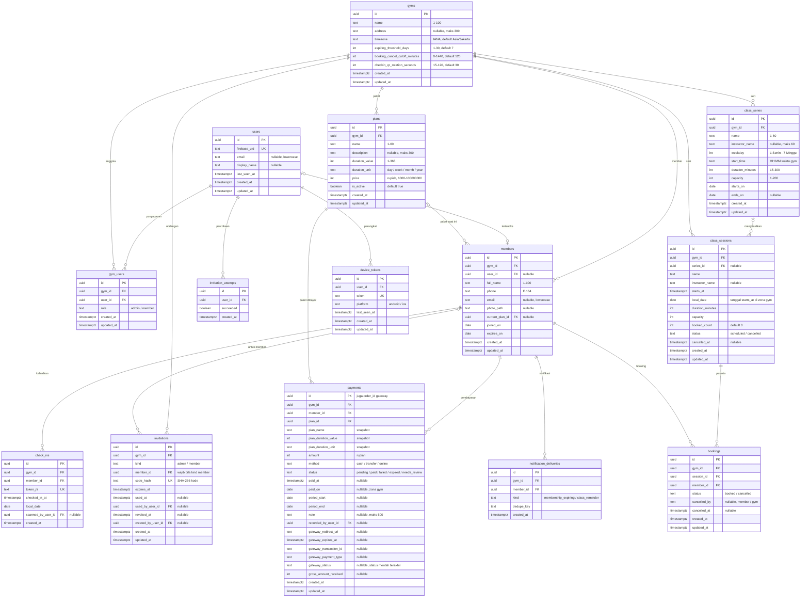

# Aplikasi Membership Gym

## 1. Context & Goal

Saat ini gym mencatat member, masa aktif, pembayaran, dan kehadiran secara manual. Akibatnya data sering berantakan: admin sulit tahu siapa yang masih aktif, kapan masa aktif seseorang habis, dan siapa yang sudah bayar. Member sendiri juga tidak bisa mengecek statusnya.

Aplikasi ini merapikan operasional **satu gym** dengan dua peran:

- **Admin** memakai versi web. Admin mengelola paket, menambahkan member baru beserta paketnya (aksi pertama di aplikasi), mencatat pembayaran, memindai QR check-in, mengelola jadwal kelas, dan mengekspor laporan.
- **Member** memakai aplikasi Android, iOS, atau web. Member melihat status dan tanggal kedaluwarsa, menampilkan QR untuk check-in, membayar perpanjangan secara online, booking kelas, dan menerima pengingat lewat push notification (khusus Android dan iOS).

Tujuan terukur versi pertama:

1. Admin bisa menambahkan member baru beserta paket dan pembayaran awalnya dalam satu form, dan status masa aktifnya langsung benar.
2. Status masa aktif (`active`, `expiring`, `expired`) dihitung di satu tempat di server memakai zona waktu gym. Hasilnya sama di semua layar, saat check-in, dan saat booking.
3. Setiap pembayaran lunas, baik manual maupun online, memperpanjang masa aktif tepat satu kali dengan aturan yang pasti (RV-07, RV2-01).
4. Check-in hanya bisa memakai QR dinamis berumur pendek yang sekali pakai, dan admin bisa memverifikasi wajah member dengan fotonya.
5. Booking kelas tidak pernah melebihi kapasitas, termasuk saat banyak member memesan slot terakhir secara bersamaan.

Data tetap disimpan dengan penanda gym (`gym_id`), supaya dukungan banyak gym bisa ditambahkan nanti tanpa merombak skema.

## 2. Scope

### In scope

Fitur MVP dan urutan fasenya. Sebuah fase baru dimulai setelah semua dependensinya selesai.

| Fase | Fitur | Isi | Bergantung pada |
| --- | --- | --- | --- |
| 0 Fondasi | F-01 Akun dan login | Daftar, login, dan logout lewat Firebase Auth. Data user dibuat otomatis di server. Halaman profil. Hapus akun dari dalam aplikasi (RV-10). | – |
| 0 Fondasi | F-02 Gym dan peran | Profil dan pengaturan gym. Peran admin dan member. Admin pertama dibuat lewat skrip CLI (RV-06). Undangan dan pencabutan admin, dijaga dari race condition (RV2-02). | F-01 |
| 1 Member dan paket | F-03 Paket membership | Membuat, mengubah, dan menonaktifkan paket (nama, durasi, harga). | F-02 |
| 1 Member dan paket | F-04 Data member | Tambah member beserta paket awal. Daftar, pencarian, detail, dan ubah member. Foto lewat API dengan signed URL (RV-05). Undangan member dan penautan akun dengan kode sekali pakai (RV-02, RV-03). | F-02, F-03 |
| 1 Member dan paket | F-05 Status masa aktif | Status dihitung di server dengan zona waktu gym. Ambang "hampir habis" 7 hari (RV-09). Tidak ada masa tenggang (RV-07). | F-04 |
| 2 Pembayaran | F-06 Pembayaran manual dan perpanjangan | Admin mencatat pembayaran tunai atau transfer. Aturan perpanjangan (RV-07) memakai snapshot durasi (RV2-01). Riwayat dan daftar pembayaran. | F-04, F-05 |
| 2 Pembayaran | F-11 Ekspor laporan (rekomendasi R-06) | Ekspor CSV untuk data member dan pembayaran. | F-06 |
| 2 Pembayaran | F-07 Pembayaran online | Midtrans Snap di balik port `PaymentGateway` (RV-08). Webhook terverifikasi, rekonsiliasi, dan status `needs_review` (RV2-06). | F-06 |
| 3 Check-in | F-08 Check-in QR | QR dinamis yang berganti tiap 30 detik dan hanya bisa dipakai sekali (RV-09). Admin memindai lewat web dengan verifikasi foto. Riwayat check-in. | F-05 |
| 4 Kelas | F-09 Jadwal kelas | Kelas satu kali dan seri mingguan. Sesi seri hanya boleh digeser di tanggal yang sama (RV2-03). GET per sesi dan per seri (RV2-05). | F-02 |
| 4 Kelas | F-10 Booking kelas | Booking atomik tanpa overbooking. Batal paling lambat 2 jam sebelum kelas (RV-09). Daftar peserta. | F-05, F-09 |
| 5 Notifikasi | F-12 Pengingat masa aktif (rekomendasi R-01) | Registrasi token perangkat FCM. Pengingat H-7 dan H-1 lewat job pg-boss yang idempoten (RV-04). | F-05, F-07 |
| 5 Notifikasi | F-13 Pengingat jadwal kelas (rekomendasi R-03) | Push 60 menit sebelum kelas untuk member yang sudah booking (RV-04). | F-10, F-12 |

Keputusan produk yang berlaku di semua fitur:

- Satu member hanya punya satu paket aktif dalam satu waktu. Semua paket mencakup semua kelas, tanpa kuota kelas per paket.
- Booking kelas tidak dihitung sebagai check-in. Member tetap harus scan QR saat datang.
- Halaman admin hanya tersedia di versi web. Admin yang login di Android atau iOS melihat pesan "Halaman admin hanya tersedia di versi web."

### Non-goals

- Dukungan untuk banyak gym atau cabang dalam satu aplikasi. Skema sudah disiapkan dengan `gym_id`, tapi fiturnya belum dibuat.
- Mode offline. Check-in, booking, dan pembayaran selalu butuh koneksi internet.
- Pembaruan data realtime. Data diambil ulang saat halaman dibuka atau di-refresh.
- Instruktur atau personal trainer sebagai pengguna dengan login sendiri. Nama instruktur hanya berupa teks.
- Penjualan produk atau kasir (suplemen, minuman, merchandise).
- Absensi dan penggajian staf.
- Check-in mandiri lewat perangkat atau kios tanpa admin.
- Refund otomatis lewat payment gateway.
- Pembayaran online dengan kartu kredit.
- Dashboard ringkasan untuk admin.
- Daftar tunggu kelas.
- Cuti atau pembekuan membership.
- Kode promo dan diskon paket.
- Lebih dari satu paket aktif per member, atau kuota kelas per paket.
- Masa tenggang setelah tanggal kedaluwarsa.
- Sanksi bagi member yang tidak datang setelah booking.
- Impor data member lama dari spreadsheet.
- Push notification di web.
- Halaman admin di aplikasi Android dan iOS.

## 3. Tech Constraints

**Stack**

- Monorepo pnpm workspaces tanpa Turborepo, berisi `apps/app` (Flutter untuk web, Android, iOS), `apps/api` (Hono + TypeScript), dan `packages/contract` (`openapi.json` dan package Dart `api_client` hasil generate, di-commit, tidak diedit manual).
- API: Hono dengan `@hono/zod-openapi`, Clean Architecture per fitur (`domain` → `usecases` → `infrastructure` Drizzle → `http`). Route Hono adalah satu-satunya sumber kontrak. Jalankan `pnpm contract:generate` setiap kali route berubah.
- Database: PostgreSQL 17 + Drizzle + drizzle-kit, lokal lewat Docker Compose. Migrasi dibuat dengan `pnpm --filter api db:generate --name <ringkas>`. Migrasi yang sudah di-commit tidak boleh diedit.
- Auth: Firebase Auth (email/password) di client. Middleware `authenticate` memverifikasi ID token di semua `/v1/*`. Tabel `users` tanpa password, dibuat lewat `syncUser` berdasarkan `firebase_uid`. Peran disimpan di PostgreSQL (`gym_users`).
- File: Cloud Storage for Firebase, diakses hanya lewat port `FileStorage` di API. `storage.rules` tetap menolak semua akses client (RV-05).
- Notifikasi: FCM lewat port `PushSender` (`PUSH_ADAPTER=fcm`), job terjadwal pg-boss di proses API (`RUN_WORKER=true`) (RV-04).
- Deploy: API berupa container yang selalu hidup (`apps/api/Dockerfile`, migrasi dijalankan sebagai perintah terpisah sebelum server), Flutter web di hosting statis, dan mobile lewat store.
- Testing: Vitest (unit dan integration) untuk API; flutter_test + bloc_test + mocktail untuk app; Firebase Auth Emulator dan Storage Emulator di lokal. `pnpm check` wajib hijau sebelum task dicentang.

**Konvensi yang wajib diikuti** (lengkapnya ada di `docs/conventions.md`, yang menjadi sumber kebenaran):

- Semua endpoint berada di bawah prefix `/v1`, kecuali `/health` dan `POST /webhooks/midtrans`. Webhook itu didaftarkan sebelum `authenticate` dan dimasukkan ke `PUBLIC_ROUTES`. JSON memakai camelCase, timestamp ISO 8601 UTC berakhiran `Z`, dan tanggal kalender `YYYY-MM-DD`.
- Format error mengikuti `{ error: { code, message, details? } }`. Kode baru ditambahkan ke `error-codes.ts`, lalu jalankan `pnpm contract:generate`, lalu petakan di `failureCodeOf` dan `failure_messages.dart`.
- Tenancy mengikuti pola "Organisasi dan tenancy": `gyms` menggantikan `organizations`, dan `gym_users` menggantikan `memberships`. Nama itu dipilih supaya tidak tertukar dengan istilah "membership" untuk paket. Path memakai `/v1/gyms/{gymId}/...`, dan middleware gym menaruh `c.var.gymUser` di context. Bukan anggota gym → `404`. Peran tidak cukup → `403`, dicek di use case. Implementasi pertamanya dicatat di `docs/conventions.md` sebagai file contoh.
- Pagination memakai cursor `{ items, nextCursor }` dengan urutan `created_at DESC, id DESC`. Pengecualian: daftar sesi kelas memakai rentang tanggal (lihat bagian 5).
- Constraint diberi nama `<tabel>_<kolom>_<jenis>`. Enum ditulis sebagai `text` + CHECK. Semua timestamp memakai `timestamptz(3)` lewat helper. Kolom `date` memakai `mode: 'string'`. Timestamp yang ditulis server memakai `now()` database.
- Keunikan dijaga constraint database. SQLSTATE `23505` diubah menjadi error domain, lalu use case mengubahnya menjadi `409`.
- Layanan luar baru mengikuti pola port + adapter `none` (default) + `fake` (ditolak di produksi) + adapter sungguhan + env `XXX_ADAPTER`.
- Flutter: Clean Architecture per fitur, go_router, get_it dengan registrasi manual, `Result` sealed, state Cubit sealed, teks UI Bahasa Indonesia, dan teks kegagalan hanya dari `failure_messages.dart` atau konstanta fitur yang dipilih dari `failure.code`.
- Library dipin ke versi pasti saat dipasang, lalu dicatat di tabel versi `docs/conventions.md`.
- Fitur contoh `notes` dihapus dalam satu task tersendiri setelah fitur pertama proyek (F-03 Paket) berdiri dan menggantikannya sebagai contoh.

**Tambahan khusus proyek**

- **Waktu dan zona waktu.** Setiap gym menyimpan zona waktu IANA (default `Asia/Jakarta`). "Hari ini" dihitung di domain dari `clock.now()` (dependency `now` di use case, `AppDeps.clock` di `createApp`) dan zona waktu gym, lewat helper `core/time` (`toLocalDate`, `localDateTimeToUtc`). Helper itu diuji dengan zona ber-DST (`Europe/Berlin`), tanpa dependency baru. Perbandingan waktu bisnis memakai nilai dari `clock` yang dikirim sebagai parameter query. Timestamp yang ditulis tetap memakai `now()` database.
- **Fungsi domain murni:** `membershipStatus(expiresOn, today, thresholdDays)`, `computeRenewalPeriod({ currentExpiresOn, paidOn, durationValue, durationUnit })`, dan `addDuration(date, value, unit)`. Setiap fungsi punya unit test sendiri dengan contoh batas.
- **Port `PaymentGateway`** (RV-08) di `core/ports/payment-gateway.ts`:
  - `createCharge({ orderId, amount, itemName, customer, expiryMinutes })` → `{ redirectUrl, gatewayToken }`.
  - `getStatus(orderId)` → `{ transactionStatus, fraudStatus?, grossAmount, transactionId?, paymentType?, settledAt? }` atau `null` bila tidak dikenal.
  - `verifyNotification(body)` → `boolean`.
  - Adapter: `none`, `fake` (menyimpan transaksi di memori, ditolak di produksi), dan `midtrans` (Snap API dan Status API dengan `fetch`, tanpa SDK). Gateway yang dipakai adalah **Midtrans Snap** dengan metode QRIS, GoPay, ShopeePay, dan Virtual Account BCA, BNI, BRI, serta Permata (`enabled_payments`). Transaksi berlaku 60 menit.
- **Port `FileStorage` ditambah** `signedReadUrl(path, { expiresInSeconds })` (RV-05). Adapter `firebase` memakai `getSignedUrl` v4 (di produksi butuh izin `iam.serviceAccounts.signBlob`), adapter `fake` mengembalikan `https://fake-storage.invalid/<path>`. Integration test terhadap Storage Emulator memastikan URL bisa di-`fetch`.
- **Port `IdentityAdmin`** (`deleteUser(firebaseUid)`, menganggap `auth/user-not-found` sebagai sukses) dipakai untuk hapus akun. Adapter `firebase` memakai firebase-admin dan Auth Emulator saat lokal.
- **Env baru** ditambahkan bersamaan ke `env.ts`, `.env.example`, dan `test/setup/env.ts`:
  - `PAYMENT_ADAPTER` (`none`/`fake`/`midtrans`).
  - `MIDTRANS_SERVER_KEY` dan `MIDTRANS_IS_PRODUCTION` (`true`/`false`), keduanya wajib bila `midtrans`.
  - `MIDTRANS_FINISH_URL`, URL halaman web `/payments` (wajib bila `midtrans`).
  - `CHECKIN_TOKEN_SECRET`, wajib, minimal 32 karakter.
  - `INVITE_BASE_URL`, URL web untuk tautan undangan, wajib.
- **Job pg-boss** didefinisikan di `features/<fitur>/jobs/` dan semuanya idempoten:

  | Queue | Cron (UTC) | Isi |
  | --- | --- | --- |
  | `payments.reconcile` | `*/10 * * * *` | Memeriksa status pembayaran `pending` ke gateway |
  | `classes.generate-sessions` | `0 * * * *` | Membuat sesi seri untuk 28 hari ke depan |
  | `memberships.expiry-reminder` | `0 * * * *` | Pengingat H-7 dan H-1 setelah pukul 09.00 waktu gym |
  | `classes.reminder` | `*/5 * * * *` | Pengingat 60 menit sebelum kelas |
  | `invitations.cleanup` | `0 3 * * *` | Menghapus `invitation_attempts` yang lebih tua dari 1 hari |

- **Skrip CLI admin pertama** (RV-06):
  - Sumbernya `apps/api/src/scripts/bootstrap-gym.ts`. Jalankan dengan `pnpm --filter api gym:bootstrap -- --name "<nama>" --timezone Asia/Jakarta --admin-email <email>`, atau di produksi `node dist/scripts/bootstrap-gym.js ...` dengan image yang sama.
  - Skrip hanya butuh `DATABASE_URL`, idempoten, dan mencetak id gym.
- **Push:** hanya Android dan iOS. Untuk iOS, kunci APNs (.p8) diunggah ke Firebase project dan capability Push Notifications diaktifkan di Xcode. Langkah ini manual sekali di awal dan ditulis di README. Build iOS diverifikasi lewat job CI macOS seperti di `docs/conventions.md`.
- **Package Flutter baru** dipin saat dipasang: `firebase_messaging` (push), `qr_flutter` (menampilkan QR), `mobile_scanner` (scan QR di web), `image_picker` (foto member), `url_launcher` (membuka halaman bayar Midtrans), dan `web` (unduh CSV di web).
- **Logger:** tambahkan `signature_key` dan `serverKey` ke `SENSITIVE_KEYS` beserta test-nya. Kode undangan, token check-in, dan token FCM tidak pernah dicatat.

## 4. Data Model

Constraint dan index penting:

- **Keunikan**
  - `users_firebase_uid_unique`
  - `gym_users_gym_id_user_id_unique`
  - `members_gym_id_user_id_unique` (partial, `user_id IS NOT NULL`)
  - `members_gym_id_phone_unique`
  - `plans_gym_id_name_unique`, unique index `(gym_id, lower(name))`
  - `invitations_code_hash_unique`
  - `check_ins_token_jti_unique`: QR hanya bisa dipakai sekali
  - `class_sessions_series_id_local_date_unique`: generator sesi idempoten (RV2-03)
  - `bookings_session_id_member_id_unique`: partial `WHERE status = 'booked'`, jadi member bisa booking ulang setelah batal
  - `device_tokens_token_unique`
  - `notification_deliveries_kind_dedupe_key_unique`: notifikasi tidak terkirim dua kali (RV-04)
- **CHECK**
  - `gym_users_role_check`
  - `members_phone_format_check`: `^\+[1-9][0-9]{7,14}$`
  - `members_email_lowercase_check`
  - `plans_duration_unit_check` dan `plans_duration_value_check`
  - `payments_plan_duration_unit_check` dan `payments_plan_duration_value_check`: sama dengan `plans`, keduanya NOT NULL (RV2-01)
  - `payments_method_check`
  - `payments_status_check`: termasuk `needs_review` (RV2-06)
  - `payments_paid_fields_check`: `status = 'paid'` ⇒ `paid_at`, `paid_on`, `period_start`, `period_end` tidak null
  - `payments_manual_paid_check`: `method <> 'online'` ⇒ `status = 'paid'`
  - `invitations_kind_member_check`: `kind = 'member'` ⇔ `member_id IS NOT NULL`
  - `class_sessions_booked_count_check`: `0 <= booked_count AND booked_count <= capacity`
  - `class_series_weekday_check` dan `class_series_start_time_check`: regex `^([01][0-9]|2[0-3]):[0-5][0-9]$`
  - `bookings_status_check`
  - `device_tokens_platform_check`
  - Batas panjang teks memakai `char_length` sesuai keterangan di diagram.
- **Foreign key** ditulis dengan `foreignKey({ name })`.
  - `ON DELETE CASCADE`: semua `gym_id` → `gyms.id`, `gym_users.user_id`, `device_tokens.user_id`, `invitation_attempts.user_id`, `bookings.session_id`, dan `class_sessions.series_id`.
  - `ON DELETE SET NULL`: `members.user_id`, `invitations.used_by_user_id`, `invitations.created_by_user_id`, `payments.recorded_by_user_id`, dan `check_ins.scanned_by_user_id`. Data bisnis tetap ada saat akun dihapus (RV-10).
  - `ON DELETE RESTRICT`: `payments.member_id`, `payments.plan_id`, `members.current_plan_id`, `check_ins.member_id`, dan `bookings.member_id`. Paket dan member tidak dihapus di MVP.
- **Index**
  - Index pagination `(gym_id, created_at DESC NULLS FIRST, id DESC NULLS FIRST)` untuk `members`, `plans`, `payments`, `check_ins`, dan `class_series`.
  - `(member_id, created_at DESC, id DESC)` untuk `payments`, `check_ins`, dan `bookings`.
  - `members_gym_id_expires_on_index`
  - `class_sessions_gym_id_starts_at_index`
  - `payments_status_created_at_index` (partial `WHERE status = 'pending'`) untuk rekonsiliasi.
- **Aturan integritas**
  - User dengan peran `member` di `gym_users` selalu punya tepat satu baris `members` yang tertaut di gym itu.
  - Setiap gym minimal punya satu admin. Aturan ini dijaga dengan mengunci baris `gyms` (`SELECT ... FOR UPDATE`) sebelum menghitung admin (RV2-02).
  - `members.expires_on` hanya diubah lewat pembuatan member dan perpanjangan dari pembayaran `paid`, di bawah kunci baris `members` (`FOR UPDATE`).
  - `class_sessions.booked_count` hanya diubah bersamaan dengan insert atau pembatalan booking dalam satu transaksi.

## 5. API Contract

**Aturan umum**

- Semua endpoint `/v1/*` wajib memakai `Authorization: Bearer <ID token>`. Tanpa header atau dengan token yang tidak valid → `401 UNAUTHENTICATED`.
- Endpoint `/v1/gyms/{gymId}/*`:
  - `gymId` bukan UUID → `422 details.gymId`.
  - User bukan anggota gym → `404 NOT_FOUND`.
  - Peran tidak cukup → `403 FORBIDDEN`.
  - Endpoint `/me/*` di bawah gym hanya untuk peran `member`. Admin yang memanggilnya → `403`.
- Path param UUID yang tidak valid → `422 details.<param>`. Body yang gagal validasi → `422 VALIDATION_ERROR` dengan `details` per field.
- Daftar berpagination memakai `?limit&cursor` dan merespons `{ items, nextCursor }`.

**ErrorCode baru** (ditambahkan ke `error-codes.ts`):

| Code | HTTP | Kapan |
| --- | --- | --- |
| `TOO_MANY_REQUESTS` | 429 | Terlalu banyak percobaan kode undangan |
| `INVITATION_INVALID` | 409 | Kode undangan tidak ada, kedaluwarsa, sudah dipakai, atau dicabut |
| `LAST_ADMIN` | 409 | Aksi akan membuat gym tanpa admin |
| `MEMBERSHIP_INACTIVE` | 409 | Member kedaluwarsa (check-in) atau tidak aktif pada tanggal kelas (booking) |
| `CHECKIN_TOKEN_INVALID` | 409 | Token QR rusak, kedaluwarsa, milik gym lain, atau sudah dipakai |
| `PAYMENT_PENDING` | 409 | Member masih punya pembayaran online `pending` |
| `CLASS_FULL` | 409 | Kuota sesi habis |
| `BOOKING_WINDOW_CLOSED` | 409 | Sesi sudah mulai, sudah lewat, atau batas waktu pembatalan terlewati |
| `CAPACITY_BELOW_BOOKED` | 409 | Kapasitas baru lebih kecil dari jumlah booking |

**Skema respons utama** (nama komponen OpenAPI):

- `Me`: `{ id, email, displayName, gyms: [{ gymId, gymName, role: 'admin'|'member', memberId|null }] }`
- `Gym`: `{ id, name, address|null, timezone, expiringThresholdDays, bookingCancelCutoffMinutes, checkinQrRotationSeconds, createdAt, updatedAt }`
- `Plan`: `{ id, name, description|null, durationValue, durationUnit: 'day'|'week'|'month'|'year', price, isActive, createdAt, updatedAt }`
- `Member`: `{ id, fullName, phone, email|null, photoUrl|null, currentPlanId|null, currentPlanName|null, joinedOn, expiresOn, status: 'active'|'expiring'|'expired', daysLeft, accountLinked, createdAt, updatedAt }`. `photoUrl` adalah signed URL yang berlaku 5 menit. `daysLeft` = `expiresOn − hariIni`, bisa negatif.
- `Payment`: `{ id, memberId, memberName, planId, planName, planDurationValue, planDurationUnit, amount, method: 'cash'|'transfer'|'online', status: 'pending'|'paid'|'failed'|'expired'|'needs_review', paidAt|null, paidOn|null, periodStart|null, periodEnd|null, note|null, redirectUrl|null, gatewayExpiresAt|null, createdAt, updatedAt }`. `redirectUrl` hanya terisi untuk member pemilik pembayaran `pending`.
- `Invitation`: `{ id, kind: 'admin'|'member', memberId|null, code, link, expiresAt }`. `code` hanya dikembalikan sekali, saat undangan dibuat.
- `Admin`: `{ userId, email|null, displayName|null, createdAt }`
- `CheckInToken`: `{ token, expiresAt, refreshAfterSeconds }`
- `CheckInPreview`: `{ member: { id, fullName, photoUrl|null, expiresOn, status }, allowed, reason: 'MEMBERSHIP_INACTIVE'|null }`
- `CheckIn`: `{ id, memberId, memberName, checkedInAt, localDate }`
- `ClassSeries`: `{ id, name, instructorName|null, weekday, startTime, durationMinutes, capacity, startsOn, endsOn|null, createdAt, updatedAt }`
- `ClassSession`: `{ id, seriesId|null, name, instructorName|null, startsAt, endsAt, localDate, durationMinutes, capacity, bookedCount, remaining, status: 'scheduled'|'cancelled', myBooking: { id }|null }`. `myBooking` hanya terisi untuk member.
- `Booking`: `{ id, session: { id, name, startsAt, localDate, status }, memberId, memberName, status: 'booked'|'cancelled', cancelledBy: 'member'|'gym'|null, cancelledAt|null, createdAt }`

### Akun

**GET /v1/me**
- Akses: semua user yang login.
- Request: –
- Response `200 Me`. User tanpa peran mendapat `gyms: []`.
- Error: `401`.

**DELETE /v1/me**
- Akses: semua user yang login.
- Request: –
- Response `204`.
- Error: `409 LAST_ADMIN` bila user adalah admin terakhir di salah satu gym.
- Efek: lihat FR-06.

**POST /v1/me/device-tokens**
- Akses: semua user yang login.
- Request `{ token: string 1-4096, platform: 'android'|'ios' }`.
- Response `204`. Token yang sama dipindahkan ke user ini (upsert berdasarkan `token`) dan `last_seen_at` diperbarui.
- Error: `422`.

**POST /v1/me/device-tokens/unregister**
- Akses: semua user yang login.
- Request `{ token }`.
- Response `204`, idempoten. Hanya menghapus token milik user ini.
- Error: `422`.

**POST /v1/invitations/accept**
- Akses: semua user yang login.
- Request `{ code: string }`. Kode di-trim, dijadikan huruf besar, dan tanda `-` dihapus.
- Response `200 { gymId, role, memberId|null }`.
- Error:
  - `409 INVITATION_INVALID`
  - `409 CONFLICT` bila user sudah punya peran di gym itu
  - `429 TOO_MANY_REQUESTS` setelah 5 percobaan gagal dalam 15 menit
  - `422`

### Gym dan admin

**GET /v1/gyms/{gymId}**
- Akses: admin dan member.
- Response `200 Gym`.

**PATCH /v1/gyms/{gymId}**
- Akses: admin.
- Request: field opsional, minimal satu: `name`, `address|null`, `timezone` (harus zona IANA yang dikenal `Intl`), `expiringThresholdDays`, `bookingCancelCutoffMinutes`, `checkinQrRotationSeconds`.
- Response `200 Gym`.
- Error: `422`, `403`.

**GET /v1/gyms/{gymId}/admins**
- Akses: admin.
- Response `200 { items: Admin[] }`, tanpa pagination.

**POST /v1/gyms/{gymId}/admin-invitations**
- Akses: admin.
- Request: –
- Response `201 Invitation` (`kind: 'admin'`).

**DELETE /v1/gyms/{gymId}/admins/{userId}**
- Akses: admin (termasuk mencabut dirinya sendiri).
- Response `204`.
- Error:
  - `404` bila `userId` bukan admin gym ini
  - `409 LAST_ADMIN`

### Paket

**GET /v1/gyms/{gymId}/plans**
- Akses: admin dan member.
- Query: `limit`, `cursor`, `status` (`active`|`inactive`|`all`, default `active`). Untuk member, nilainya selalu `active`.
- Response `200 PlanPage`.

**POST /v1/gyms/{gymId}/plans**
- Akses: admin.
- Request `{ name, description?, durationValue, durationUnit, price }`.
- Response `201 Plan`.
- Error: `409 CONFLICT` bila nama sudah dipakai (tanpa membedakan huruf besar-kecil), `422`.

**PATCH /v1/gyms/{gymId}/plans/{planId}**
- Akses: admin.
- Request: field opsional, minimal satu: `name`, `description|null`, `durationValue`, `durationUnit`, `price`, `isActive`.
- Response `200 Plan`.
- Error: `404`, `409 CONFLICT`, `422`.

### Member (admin)

**GET /v1/gyms/{gymId}/members**
- Akses: admin.
- Query: `limit`, `cursor`, `q` (2-100 karakter, mencocokkan nama atau nomor HP), `status` (`active`|`expiring`|`expired`).
- Response `200 MemberPage`.

**POST /v1/gyms/{gymId}/members**
- Akses: admin.
- Request:
  - `fullName`
  - `phone`: `08…`, `62…`, atau `+62…`, dinormalisasi ke E.164
  - `email?`
  - `planId`
  - `startOn`: hari ini sampai 30 hari ke belakang (RV2-04)
  - `paymentMethod`: `cash`|`transfer`
  - `amount?`: default harga paket, 0-100000000
  - `note?`
- Response `201 { member: Member, payment: Payment }`.
- Error:
  - `409 CONFLICT` bila nomor HP sudah dipakai
  - `422` (termasuk `details.startOn` dan `details.planId` bila paket nonaktif atau tidak ada)

**GET /v1/gyms/{gymId}/members/{memberId}**
- Akses: admin.
- Response `200 Member`.
- Error: `404`.

**PATCH /v1/gyms/{gymId}/members/{memberId}**
- Akses: admin.
- Request: field opsional, minimal satu: `fullName`, `phone`, `email|null`.
- Response `200 Member`.
- Error: `404`, `409 CONFLICT`, `422`.

**PUT /v1/gyms/{gymId}/members/{memberId}/photo**
- Akses: admin.
- Request `multipart/form-data` dengan field `file`: JPEG, PNG, atau WebP sesuai magic bytes, maksimal 2 MB.
- Response `200 Member`.
- Error: `404`, `422 details.file`.

**DELETE /v1/gyms/{gymId}/members/{memberId}/photo**
- Akses: admin.
- Response `204`, idempoten.
- Error: `404`.

**POST /v1/gyms/{gymId}/members/{memberId}/invitations**
- Akses: admin.
- Response `201 Invitation` (`kind: 'member'`). Undangan aktif sebelumnya untuk member ini dicabut.
- Error: `404`, `409 CONFLICT` bila member sudah tertaut ke akun.

**DELETE /v1/gyms/{gymId}/members/{memberId}/account-link**
- Akses: admin.
- Response `204`. Kolom `members.user_id` dikosongkan dan baris `gym_users` peran member dihapus.
- Error: `404`.

**GET /v1/gyms/{gymId}/members/{memberId}/payments**
- Akses: admin.
- Query: `limit`, `cursor`.
- Response `200 PaymentPage`.

**POST /v1/gyms/{gymId}/members/{memberId}/payments**
- Akses: admin.
- Request:
  - `planId`: paket aktif
  - `method`: `cash`|`transfer`
  - `amount?`: default harga paket
  - `paidOn?`: default hari ini, boleh hari ini sampai 30 hari ke belakang
  - `note?`
- Response `201 { payment: Payment, member: Member }`.
- Error: `404`, `422`.

**GET /v1/gyms/{gymId}/members/{memberId}/check-ins**
- Akses: admin.
- Query: `limit`, `cursor`.
- Response `200 CheckInPage`.

### Member (diri sendiri)

**GET /v1/gyms/{gymId}/me/member**
- Akses: member.
- Response `200 Member`.

**GET /v1/gyms/{gymId}/me/payments**
- Akses: member.
- Query: `limit`, `cursor`, `status?`.
- Response `200 PaymentPage`.

**GET /v1/gyms/{gymId}/me/payments/{paymentId}**
- Akses: member pemilik.
- Response `200 Payment`.
- Error: `404` (termasuk pembayaran milik member lain).

**POST /v1/gyms/{gymId}/me/payments**
- Akses: member.
- Request `{ planId }`.
- Response `201 Payment` dengan `status: 'pending'`, `redirectUrl`, dan `gatewayExpiresAt` = pembuatan + 60 menit.
- Error:
  - `409 PAYMENT_PENDING`
  - `422 details.planId` bila paket nonaktif
  - `500` bila gateway gagal; pembayaran tidak disimpan

**POST /v1/gyms/{gymId}/me/checkin-token**
- Akses: member.
- Response `200 CheckInToken`. Token berlaku `checkinQrRotationSeconds + 15` detik, dan `refreshAfterSeconds` = `checkinQrRotationSeconds`.

**GET /v1/gyms/{gymId}/me/check-ins**
- Akses: member.
- Query: `limit`, `cursor`.
- Response `200 CheckInPage`.

**GET /v1/gyms/{gymId}/me/bookings**
- Akses: member.
- Query: `scope` (`upcoming`|`past`, default `upcoming`), `limit`, `cursor`.
- Response `200 BookingPage`.

**POST /v1/gyms/{gymId}/me/bookings/{bookingId}/cancel**
- Akses: member pemilik.
- Response `200 Booking`.
- Error: `404`, `409 BOOKING_WINDOW_CLOSED`, `409 CONFLICT` bila booking sudah batal.

### Pembayaran (admin)

**GET /v1/gyms/{gymId}/payments**
- Akses: admin.
- Query: `limit`, `cursor`, `status?` (termasuk `needs_review`), `method?`, `from?`, `to?`. `from` dan `to` adalah tanggal dibuat di zona gym, inklusif, dengan rentang maksimal 366 hari.
- Response `200 PaymentPage`.
- Error: `422 details.to` bila `to < from` atau rentang terlalu panjang.

**POST /webhooks/midtrans** (publik, di luar `/v1`)
- Akses: Midtrans, diverifikasi lewat `signature_key`.
- Request: body notifikasi Midtrans.
- Response `200 { received: true }` (juga untuk `order_id` yang tidak dikenal; dicatat `warn`).
- Error: `401 UNAUTHENTICATED` bila signature tidak valid, `400` bila JSON rusak.

**POST /v1/dev/payments/{paymentId}/simulate**
- Hanya didaftarkan bila `PAYMENT_ADAPTER=fake`.
- Akses: admin gym pembayaran itu atau member pemiliknya.
- Request `{ transactionStatus: 'settlement'|'expire'|'deny', grossAmount? }`.
- Response `200 Payment`. Jalurnya sama dengan webhook.

### Check-in

**POST /v1/gyms/{gymId}/check-ins/verify**
- Akses: admin.
- Request `{ token }`.
- Response `200 CheckInPreview`. Token tidak ditandai terpakai.
- Error: `409 CHECKIN_TOKEN_INVALID`.

**POST /v1/gyms/{gymId}/check-ins**
- Akses: admin.
- Request `{ token }`.
- Response `201 CheckIn`.
- Error: `409 CHECKIN_TOKEN_INVALID` (termasuk token yang sudah dipakai), `409 MEMBERSHIP_INACTIVE`.

**GET /v1/gyms/{gymId}/check-ins**
- Akses: admin.
- Query: `limit`, `cursor`, `from?`, `to?` (`local_date`).
- Response `200 CheckInPage`.

### Kelas

**GET /v1/gyms/{gymId}/class-series**
- Akses: admin.
- Query: `limit`, `cursor`.
- Response `200 ClassSeriesPage`.

**POST /v1/gyms/{gymId}/class-series**
- Akses: admin.
- Request `{ name, instructorName?, weekday, startTime, durationMinutes, capacity, startsOn (≥ hari ini), endsOn? (≥ startsOn) }`.
- Response `201 ClassSeries`. Sesi untuk 28 hari ke depan dibuat langsung.
- Error: `422`.

**GET /v1/gyms/{gymId}/class-series/{seriesId}**
- Akses: admin.
- Response `200 ClassSeries`.
- Error: `404`.

**PATCH /v1/gyms/{gymId}/class-series/{seriesId}**
- Akses: admin.
- Request: field opsional, minimal satu: `name`, `instructorName|null`, `startTime`, `durationMinutes`, `capacity`, `endsOn|null` (≥ hari ini). `weekday` dan `startsOn` tidak bisa diubah.
- Response `200 ClassSeries`.
- Error: `404`, `409 CAPACITY_BELOW_BOOKED`, `422`.

**POST /v1/gyms/{gymId}/class-sessions**
- Akses: admin.
- Request `{ name, instructorName?, startsAt (> sekarang), durationMinutes, capacity }`.
- Response `201 ClassSession` (`seriesId: null`).
- Error: `422`.

**GET /v1/gyms/{gymId}/class-sessions**
- Akses: admin dan member.
- Query: `from`, `to` (`localDate`, inklusif, maksimal 31 hari).
- Response `200 { items: ClassSession[] }`, diurutkan `starts_at ASC`, maksimal 500 item, tanpa cursor. Member hanya melihat sesi `scheduled`.
- Error: `422`.

**GET /v1/gyms/{gymId}/class-sessions/{sessionId}**
- Akses: admin, dan member untuk sesi `scheduled` saja.
- Response `200 ClassSession`.
- Error: `404`, termasuk member yang membuka sesi `cancelled`.

**PATCH /v1/gyms/{gymId}/class-sessions/{sessionId}**
- Akses: admin.
- Request: field opsional, minimal satu: `name`, `instructorName|null`, `startsAt`, `durationMinutes`, `capacity`.
- Response `200 ClassSession`.
- Error:
  - `404`
  - `409 CONFLICT` bila sesi sudah mulai atau dibatalkan
  - `409 CAPACITY_BELOW_BOOKED`
  - `422 details.startsAt` bila sesi seri digeser ke tanggal lain atau waktunya di masa lalu

**POST /v1/gyms/{gymId}/class-sessions/{sessionId}/cancel**
- Akses: admin.
- Response `200 ClassSession`.
- Error: `404`, `409 CONFLICT` bila sudah dibatalkan atau sudah mulai.

**GET /v1/gyms/{gymId}/class-sessions/{sessionId}/bookings**
- Akses: admin.
- Query: `limit`, `cursor`.
- Response `200 BookingPage`.

**POST /v1/gyms/{gymId}/class-sessions/{sessionId}/bookings**
- Akses: member.
- Response `201 Booking`.
- Error:
  - `404`
  - `409 CLASS_FULL`
  - `409 MEMBERSHIP_INACTIVE`
  - `409 BOOKING_WINDOW_CLOSED`
  - `409 CONFLICT` bila sudah punya booking aktif di sesi itu

### Ekspor

**GET /v1/gyms/{gymId}/exports/members.csv**
- Akses: admin.
- Query: `status?`.
- Response `200 text/csv; charset=utf-8` dengan `Content-Disposition: attachment; filename="member-YYYY-MM-DD.csv"`.

**GET /v1/gyms/{gymId}/exports/payments.csv**
- Akses: admin.
- Query: `from`, `to` (`paid_on`, maksimal 366 hari).
- Response `200 text/csv` dengan nama file `pembayaran-<from>-<to>.csv`.
- Error: `422`.

## 6. Functional Requirements

### FR-01: Daftar, login, logout, dan sinkron user
Pengguna daftar dan login dengan email/password Firebase. API membuat atau memperbarui baris `users` pada setiap request terautentikasi, dan `GET /v1/me` mengembalikan peran user per gym. Setelah login, router mengarahkan user sesuai perannya:
- Tanpa peran → halaman "Masukkan kode undangan".
- Member → beranda member.
- Admin di web → beranda admin.
- Admin di Android/iOS → halaman "Halaman admin hanya tersedia di versi web." dengan tombol keluar.

Fitur: F-01

Acceptance criteria:
- [ ] Given akun Firebase baru, When request pertama ke `GET /v1/me`, Then baris `users` dibuat dengan email lowercase dan respons berisi `gyms: []`.
- [ ] Given user tanpa peran, When login di app, Then app menampilkan halaman input kode undangan beserta tombol keluar dan hapus akun.
- [ ] Given user dengan peran `member`, When login, Then app membuka beranda member yang berisi status masa aktif.
- [ ] Given admin login di Android, When beranda dimuat, Then app menampilkan "Halaman admin hanya tersedia di versi web." tanpa menu admin.
- [ ] Given user yang sudah login, When menekan "Keluar", Then token perangkat di-unregister (bila ada), sesi Firebase ditutup, dan router membuka halaman login.

Edge cases:
- Token kedaluwarsa → interceptor me-refresh token sekali. `401` kedua membuat user diarahkan ke login.
- Email berubah di Firebase → `users.email` ikut diperbarui pada request berikutnya, karena token adalah sumber kebenaran.

### FR-02: Admin pertama lewat skrip CLI
Gym dan admin pertama dibuat lewat skrip `gym:bootstrap` saat deploy. User baru tidak pernah otomatis menjadi admin (RV-06).

Fitur: F-02

Acceptance criteria:
- [ ] Given database tanpa gym dan user dengan email `owner@gym.id` sudah login sekali, When skrip dijalankan dengan `--name "Gym A" --timezone Asia/Jakarta --admin-email owner@gym.id`, Then gym dibuat, `gym_users` berperan `admin` dibuat untuk user itu, dan skrip mencetak id gym lalu keluar dengan kode 0.
- [ ] Given gym sudah ada dan user sudah admin, When skrip dijalankan ulang dengan argumen sama, Then tidak ada baris baru dan skrip keluar dengan kode 0.
- [ ] Given email belum pernah login, When skrip dijalankan, Then skrip keluar dengan kode 1 dan pesan "user with this email has not signed in yet".
- [ ] Given zona waktu tidak valid (`Asia/Nowhere`), When skrip dijalankan, Then skrip keluar dengan kode 1 tanpa menulis apa pun.
- [ ] Given user baru login pertama kali, When `GET /v1/me`, Then `gyms` kosong. Tidak ada peran default.

Edge cases:
- Sudah ada gym lain dengan nama berbeda → skrip menolak membuat gym kedua (versi pertama satu gym) dan menyarankan `--gym-id` untuk menambah admin ke gym yang ada.
- Skrip hanya membaca `DATABASE_URL`. Env server lain tidak dibutuhkan.

### FR-03: Akses per gym dan pembatasan peran
Semua data gym diakses lewat `/v1/gyms/{gymId}/...`. Middleware gym memuat peran user, use case memeriksa peran, dan member hanya bisa mengakses datanya sendiri.

Fitur: F-02

Acceptance criteria:
- [ ] Given user yang bukan anggota gym, When memanggil endpoint apa pun di `/v1/gyms/{gymId}/...`, Then respons `404 NOT_FOUND`.
- [ ] Given user dengan peran `member`, When memanggil `GET /v1/gyms/{gymId}/members`, Then respons `403 FORBIDDEN`.
- [ ] Given member A, When memanggil `GET /me/payments/{paymentId}` dengan id pembayaran member B, Then respons `404`.
- [ ] Given admin, When memanggil `GET /me/member`, Then respons `403`.
- [ ] Given route baru apa pun, When `all-routes-require-auth.int.test.ts` dijalankan, Then semua route `/v1/*` menolak request tanpa token. Hanya `/health` dan `/webhooks/midtrans` yang ada di `PUBLIC_ROUTES`.

Edge cases:
- `gymId` bukan UUID → `422 details.gymId`, bukan `404`.
- Integration test tiap fitur minimal mencakup: bukan anggota → `404`, peran kurang → `403`, dan data gym lain tidak terlihat.

### FR-04: Profil dan pengaturan gym
Admin mengubah nama, alamat, zona waktu, dan tiga pengaturan: ambang "hampir habis" (default 7 hari), batas pembatalan booking (default 120 menit), dan interval QR (default 30 detik) (RV-09). Halaman web admin: "Pengaturan gym".

Fitur: F-02

Acceptance criteria:
- [ ] Given gym baru, When `GET /v1/gyms/{gymId}`, Then `expiringThresholdDays` 7, `bookingCancelCutoffMinutes` 120, dan `checkinQrRotationSeconds` 30.
- [ ] Given admin, When `PATCH` dengan `{ expiringThresholdDays: 10 }`, Then respons `200` dan status member dihitung ulang dengan ambang 10 pada request berikutnya.
- [ ] Given admin, When `PATCH` dengan `{ timezone: 'Asia/Nowhere' }`, Then respons `422 details.timezone`.
- [ ] Given admin, When `PATCH` dengan body `{}`, Then respons `422 details._root`.
- [ ] Given member, When `PATCH`, Then respons `403`.

Edge cases:
- Mengubah zona waktu tidak mengubah `expires_on` atau `local_date` yang sudah tersimpan. Hanya perhitungan berikutnya yang memakai zona baru. Form menampilkan peringatan sebelum menyimpan.
- `checkinQrRotationSeconds` di luar 15-120 → `422`.

### FR-05: Undangan dan pencabutan admin
Admin membuat undangan admin berupa kode sekali pakai yang berlaku 72 jam, dan bisa mencabut admin lain atau dirinya sendiri. Gym tidak boleh tanpa admin, dan aturan ini dijaga dengan mengunci baris `gyms` (RV2-02).

Fitur: F-02

Acceptance criteria:
- [ ] Given admin, When `POST /admin-invitations`, Then respons `201` berisi `code` 8 karakter dari alfabet `ABCDEFGHJKLMNPQRSTUVWXYZ23456789`, `link` = `INVITE_BASE_URL/invite?code=<code>`, dan `expiresAt` = sekarang + 72 jam. Database hanya menyimpan hash SHA-256 kode itu.
- [ ] Given user tanpa peran memasukkan kode undangan admin yang valid, When `POST /v1/invitations/accept`, Then user mendapat peran `admin`, undangan ditandai `used_at`, dan pemakaian kedua → `409 INVITATION_INVALID`.
- [ ] Given gym dengan admin A dan B, When A mencabut B, Then respons `204` dan B kehilangan akses (`404` di endpoint gym).
- [ ] Given gym dengan satu admin, When admin itu mencabut dirinya, Then respons `409 LAST_ADMIN`.
- [ ] Given gym dengan admin A dan B, When A mencabut B dan B mencabut A secara bersamaan (integration test dengan dua transaksi paralel), Then tepat satu berhasil, yang lain mendapat `409 LAST_ADMIN` atau `404`, dan gym tetap punya satu admin.
- [ ] Given dua admin terakhir menghapus akun secara bersamaan, When kedua request selesai, Then tepat satu berhasil dan yang lain mendapat `409 LAST_ADMIN`.

Edge cases:
- Cabut admin dan hapus akun admin menjalankan `SELECT id FROM gyms WHERE id = $1 FOR UPDATE` sebelum menghitung admin, di transaksi yang sama.
- Undangan admin dipakai oleh user yang sudah menjadi member gym → `409 CONFLICT`. Satu user hanya punya satu peran per gym.

### FR-06: Hapus akun dari profil
Halaman profil (admin dan member) punya tombol "Hapus akun" dengan dialog konfirmasi (RV-10). Data yang dihapus: akun Firebase, baris `users`, peran (`gym_users`), token perangkat, dan percobaan undangan. Data yang tetap disimpan untuk pembukuan gym: data member (nama, nomor HP, riwayat pembayaran, riwayat check-in), yang tautannya ke akun dilepas (`members.user_id` menjadi `NULL`). Booking member yang akan datang dibatalkan.

Fitur: F-01

Acceptance criteria:
- [ ] Given member yang tertaut dengan dua booking akan datang, When `DELETE /v1/me`, Then respons `204`, akun Firebase terhapus, `users` terhapus, `members.user_id` menjadi `NULL`, kedua booking berstatus `cancelled` dengan `cancelledBy: 'member'`, `booked_count` sesi berkurang, dan riwayat pembayaran tetap ada.
- [ ] Given admin terakhir gym, When `DELETE /v1/me`, Then respons `409 LAST_ADMIN` dan tidak ada data yang dihapus (akun Firebase tetap ada).
- [ ] Given penghapusan Firebase berhasil tetapi transaksi database gagal, When client mengulang `DELETE /v1/me` dengan token yang masih berlaku, Then `deleteUser` menganggap `user-not-found` sebagai sukses dan penghapusan database selesai.
- [ ] Given akun sudah dihapus, When app menerima `204`, Then app logout dan membuka halaman login dengan pesan "Akun kamu sudah dihapus."
- [ ] Given dialog konfirmasi, When pengguna menekan "Batal", Then tidak ada request yang dikirim.

Edge cases:
- Dialog menjelaskan: "Data membership dan riwayat pembayaranmu tetap disimpan gym untuk pembukuan."
- Mendaftar ulang dengan email yang sama membuat user baru tanpa peran, jadi butuh undangan baru.

### FR-07: Paket membership
Admin membuat, mengubah, dan menonaktifkan paket. Paket tidak bisa dihapus. Hanya paket aktif yang bisa dipilih untuk member baru, pembayaran manual, dan pembayaran online. Halaman web admin "Paket" memakai pola daftar ↔ form dengan filter status.

Fitur: F-03

Acceptance criteria:
- [ ] Given admin, When membuat paket `{ name: 'Bulanan', durationValue: 1, durationUnit: 'month', price: 250000 }`, Then respons `201` dengan `isActive: true`.
- [ ] Given paket "Bulanan" sudah ada, When membuat paket bernama "bulanan", Then respons `409 CONFLICT` dan form menampilkan "Nama paket ini sudah dipakai." di field nama.
- [ ] Given `price: 500`, When membuat paket, Then respons `422 details.price`.
- [ ] Given paket dinonaktifkan, When member memanggil `GET /plans`, Then paket itu tidak ada di daftar.
- [ ] Given admin, When `GET /plans?status=all`, Then paket aktif dan nonaktif ditampilkan.

Edge cases:
- Mengubah durasi atau harga paket tidak mengubah pembayaran yang sudah dibuat, karena pembayaran menyimpan snapshot (RV2-01).
- Paket nonaktif yang masih menjadi `current_plan_id` member tetap tampil namanya di detail member.

### FR-08: Tambah member baru beserta paket
Ini aksi pertama admin. Satu form berisi data member, paket, tanggal mulai, metode bayar, dan jumlah. Server membuat member dan pembayaran manual `paid` dalam satu transaksi. `startOn` hanya boleh hari ini atau sampai 30 hari ke belakang (RV2-04).

Fitur: F-04

Acceptance criteria:
- [ ] Given hari ini 2026-10-14 (zona gym) dan paket 1 bulan, When admin menambah member dengan `startOn: '2026-10-14'`, Then `joinedOn` 2026-10-14, `expiresOn` 2026-11-13, status `active`, dan ada pembayaran `paid` dengan `periodStart` 2026-10-14, `periodEnd` 2026-11-13, `paidOn` 2026-10-14, serta snapshot nama, durasi, dan harga paket.
- [ ] Given hari ini 2026-10-14, When `startOn: '2026-09-14'`, Then member dibuat dengan `expiresOn` 2026-10-13 dan status `expired`.
- [ ] Given hari ini 2026-10-14, When `startOn: '2026-10-15'`, Then respons `422 details.startOn` dan tidak ada data yang dibuat.
- [ ] Given hari ini 2026-10-14, When `startOn: '2026-09-13'` (31 hari ke belakang), Then respons `422 details.startOn`.
- [ ] Given nomor `0812-3456-7890`, When member dibuat, Then `phone` disimpan sebagai `+6281234567890`.
- [ ] Given nomor HP yang sudah dipakai member lain di gym ini, When menambah member, Then respons `409 CONFLICT` dan form menampilkan "Nomor HP ini sudah terdaftar." di field nomor HP.
- [ ] Given `amount` tidak dikirim, When member dibuat, Then `payment.amount` sama dengan harga paket saat itu.
- [ ] Given member berhasil dibuat, When form tertutup, Then web membuka detail member dengan tombol "Buat undangan akun".

Edge cases:
- Paket nonaktif → `422 details.planId`.
- `email` opsional, disimpan lowercase. Email tidak dipakai untuk menautkan akun (RV-02).

### FR-09: Daftar, detail, dan ubah member
Admin melihat daftar member dengan pencarian nama atau nomor HP dan filter status, lalu membuka detail berisi paket, status, riwayat pembayaran, dan riwayat check-in, serta bisa mengubah data dasar.

Fitur: F-04

Acceptance criteria:
- [ ] Given 30 member, When membuka daftar, Then 20 member pertama tampil (`created_at DESC`) dan sisanya dimuat saat digulir.
- [ ] Given `q=081234`, When mencari, Then hanya member yang nomornya mengandung `81234` (setelah normalisasi) atau yang namanya mengandung teks itu yang tampil.
- [ ] Given filter `expiring`, When daftar dimuat, Then hanya member dengan `0 ≤ daysLeft ≤ expiringThresholdDays` yang tampil.
- [ ] Given detail member dibuka lewat URL langsung `/admin/members/<id>`, When halaman dimuat, Then data diambil lewat `GET /members/{memberId}`.
- [ ] Given admin mengubah `email` menjadi `null`, When disimpan, Then email member dikosongkan.
- [ ] Given `q` satu karakter, When mencari, Then respons `422 details.q` dan UI tidak mengirim pencarian sebelum 2 karakter.

Edge cases:
- `expiresOn` tidak bisa diubah lewat PATCH. Masa aktif hanya berubah lewat pembayaran.
- Perubahan filter memakai pola penghitung generasi supaya hasil filter lama yang datang belakangan tidak menimpa hasil baru.

### FR-10: Foto member lewat API dan signed URL
Admin mengunggah foto member lewat API. Storage tertutup penuh dari client, dan foto dibaca lewat signed URL berumur 5 menit yang dibuat API (RV-05).

Fitur: F-04

Acceptance criteria:
- [ ] Given JPEG 500 KB, When `PUT /members/{id}/photo`, Then file disimpan di `gyms/<gymId>/members/<memberId>/photo-<uuid>.jpg`, `members.photo_path` diperbarui, file lama dihapus, dan respons berisi `photoUrl` yang bisa di-`fetch` selama 5 menit.
- [ ] Given file 3 MB, When diunggah, Then respons `422 details.file`.
- [ ] Given file teks yang diberi nama `.jpg`, When diunggah, Then respons `422 details.file` (magic bytes tidak cocok).
- [ ] Given member, When `GET /me/member`, Then `photoUrl` adalah signed URL untuk fotonya sendiri.
- [ ] Given client mencoba membaca objek Storage langsung dengan SDK Firebase, When request dikirim, Then ditolak oleh `storage.rules`.
- [ ] Given `DELETE /members/{id}/photo`, When member tanpa foto, Then respons tetap `204`.

Edge cases:
- Signed URL tidak pernah disimpan di database dan selalu dibuat ulang per respons.
- Gagal menyimpan ke Storage → `500` dan `photo_path` tidak berubah. Gagal menghapus file lama hanya dicatat di log.

### FR-11: Undangan member dan penautan akun
Admin membuat kode undangan untuk member tertentu. Member login, lalu memasukkan kode itu untuk menautkan akunnya ke data member (RV-02). Fitur ini dikerjakan di fase 1 setelah data member tersedia (RV-03).

Fitur: F-04

Acceptance criteria:
- [ ] Given member belum tertaut, When admin menekan "Buat undangan akun", Then web menampilkan kode, tautan, tombol salin, dan masa berlaku 72 jam.
- [ ] Given undangan lama masih aktif, When admin membuat undangan baru, Then undangan lama berstatus `revoked_at` dan kodenya → `409 INVITATION_INVALID`.
- [ ] Given user tanpa peran memasukkan kode valid `ab3k-9pqz` (format bebas), When `POST /v1/invitations/accept`, Then `members.user_id` diisi, `gym_users` berperan `member` dibuat, dan app membuka beranda member.
- [ ] Given kode sudah kedaluwarsa atau sudah dipakai, When diterima, Then respons `409 INVITATION_INVALID` dan app menampilkan "Kode undangan tidak berlaku. Minta kode baru ke admin."
- [ ] Given 5 percobaan gagal dalam 15 menit, When percobaan ke-6 dikirim (walaupun kodenya benar), Then respons `429 TOO_MANY_REQUESTS`.
- [ ] Given member sudah tertaut, When admin membuat undangan, Then respons `409 CONFLICT`.
- [ ] Given admin menekan "Lepas tautan akun", When dikonfirmasi, Then user kehilangan peran member dan butuh undangan baru.
- [ ] Given web dibuka di `/invite?code=XXXX` oleh user yang belum login, When login selesai, Then halaman input kode terisi otomatis.

Edge cases:
- Penerimaan undangan berjalan dalam satu transaksi dengan kunci baris undangan, sehingga dua user yang memakai kode sama bersamaan menghasilkan tepat satu tautan.
- Kode undangan tidak pernah dicatat di log, dan percobaan dicatat tanpa kode.

### FR-12: Perhitungan status masa aktif
Status dihitung di domain dari `expires_on`, "hari ini" di zona gym, dan `expiringThresholdDays`. Member aktif sampai akhir hari `expires_on` (23:59:59 waktu gym), tanpa masa tenggang (RV-07). Aturannya: `daysLeft = expires_on − hariIni`, `expired` bila `daysLeft < 0`, `expiring` bila `0 ≤ daysLeft ≤ ambang`, dan `active` bila `daysLeft > ambang`.

Fitur: F-05

Acceptance criteria:
- [ ] Given hari ini 2026-10-14 dan ambang 7, When `expires_on` 2026-10-22, Then status `active` (`daysLeft` 8).
- [ ] Given hari ini 2026-10-14 dan ambang 7, When `expires_on` 2026-10-21, Then status `expiring` (`daysLeft` 7).
- [ ] Given hari ini 2026-10-14, When `expires_on` 2026-10-14, Then status `expiring` (`daysLeft` 0) dan member masih boleh check-in.
- [ ] Given hari ini 2026-10-14, When `expires_on` 2026-10-13, Then status `expired`.
- [ ] Given zona `Asia/Jakarta`, `expires_on` 2026-10-14, dan `clock` 2026-10-14T16:59:59Z, When status dihitung, Then `expiring`. Given `clock` 2026-10-14T17:00:00Z, Then `expired`.
- [ ] Given filter daftar member `status=expired`, When query dijalankan, Then SQL memakai `expires_on < $today`, dengan `$today` dari use case (bukan `CURRENT_DATE` database).

Edge cases:
- Semua layar (daftar member, detail, beranda member, check-in, booking) memakai fungsi yang sama. Tidak ada perhitungan status di Flutter.
- Unit test mencakup zona selain Jakarta (`Asia/Jayapura`, `Europe/Berlin` saat pergantian DST).

### FR-13: Member melihat status dan profil membership
Beranda member menampilkan kartu status (nama paket, tanggal kedaluwarsa, label "Aktif", "Hampir habis", atau "Kedaluwarsa", dan sisa hari), tombol "Tampilkan QR", "Perpanjang", "Jadwal kelas", dan "Booking saya". Halaman profil berisi foto, nama, nomor HP, email, dan tombol hapus akun.

Fitur: F-05

Acceptance criteria:
- [ ] Given member `expiring` dengan `daysLeft` 3, When beranda dibuka, Then kartu menampilkan "Hampir habis · 3 hari lagi" dan tanggal dalam format medium locale `id`.
- [ ] Given member `expired`, When beranda dibuka, Then kartu menampilkan "Kedaluwarsa" dan tombol "Perpanjang" ditonjolkan.
- [ ] Given beranda dibuka ulang atau ditarik untuk refresh, When selesai, Then data diambil ulang dari `GET /me/member` (tanpa realtime).
- [ ] Given gagal jaringan, When beranda dimuat, Then `FailureView` tampil dengan tombol "Coba lagi".

Edge cases:
- `daysLeft` 0 ditampilkan sebagai "Berakhir hari ini".
- Member tanpa foto melihat avatar inisial.

### FR-14: Catat pembayaran manual
Admin mencatat pembayaran tunai atau transfer dari detail member. Pembayaran langsung berstatus `paid` dan memperpanjang masa aktif lewat aturan FR-16.

Fitur: F-06

Acceptance criteria:
- [ ] Given member dan paket aktif "Bulanan" seharga 250000, When admin mencatat `{ planId, method: 'cash' }`, Then respons `201` dengan `status: 'paid'`, `amount` 250000, `paidOn` hari ini, snapshot durasi paket, serta member dengan `expiresOn` baru.
- [ ] Given `paidOn` 31 hari ke belakang atau di masa depan, When dicatat, Then respons `422 details.paidOn`.
- [ ] Given `note` 501 karakter, When dicatat, Then respons `422 details.note`.
- [ ] Given dua pembayaran manual untuk member yang sama dicatat bersamaan, When keduanya selesai, Then perpanjangan diterapkan berurutan (kunci baris member) dan `expiresOn` akhir sama dengan hasil penerapan berurutan.
- [ ] Given `recorded_by_user_id`, When admin pencatat kemudian menghapus akun, Then pembayaran tetap ada dengan `recorded_by_user_id` `NULL`.

Edge cases:
- `amount` boleh 0, misalnya untuk kompensasi, dan tetap memperpanjang.
- Paket yang dipilih menjadi `current_plan_id` member.

### FR-15: Riwayat dan daftar pembayaran
Admin melihat semua pembayaran dengan filter status (termasuk "Perlu diperiksa" untuk `needs_review`), metode, dan rentang tanggal. Admin juga melihat riwayat per member di detail member. Member melihat riwayat pembayarannya sendiri.

Fitur: F-06

Acceptance criteria:
- [ ] Given pembayaran dari tiga tanggal, When admin memfilter `from=2026-10-01&to=2026-10-07`, Then hanya pembayaran yang dibuat pada tanggal itu (zona gym) yang tampil.
- [ ] Given filter `status=needs_review`, When daftar dimuat, Then hanya pembayaran berstatus itu yang tampil dengan label "Perlu diperiksa".
- [ ] Given `to` lebih kecil dari `from`, When request dikirim, Then respons `422 details.to`.
- [ ] Given member, When membuka "Riwayat pembayaran", Then hanya pembayarannya sendiri yang tampil, dengan label status: "Lunas", "Menunggu pembayaran", "Gagal", "Kedaluwarsa", atau "Sedang diperiksa admin".

Edge cases:
- Daftar memakai pola filter dengan penghitung generasi.
- Pembayaran tanpa `paidOn` (belum lunas) menampilkan tanggal dibuat.

### FR-16: Aturan perpanjangan masa aktif
`computeRenewalPeriod` menentukan periode baru dari pembayaran `paid` (RV-07). Durasi dibaca dari **snapshot di pembayaran** (`plan_duration_value`, `plan_duration_unit`), bukan dari `plans` (RV2-01).
- Bila `paidOn ≤ expires_on` (masih aktif): `periodStart = expires_on + 1 hari`.
- Bila `paidOn > expires_on` (sudah lewat): `periodStart = paidOn`.
- `periodEnd = addDuration(periodStart, value, unit) − 1 hari`. Satuan `month` dan `year` dibulatkan ke akhir bulan bila tanggalnya tidak ada.
- Setelah itu `expires_on = periodEnd`.

Untuk member baru (FR-08), `periodStart = startOn`. Perpanjangan selalu berjalan dalam transaksi dengan `SELECT ... FROM members WHERE id = $1 FOR UPDATE`.

Fitur: F-06

Acceptance criteria:
- [ ] Given `expires_on` 2026-11-10, `paidOn` 2026-11-01, dan 1 bulan, When diperpanjang, Then periode 2026-11-11 s.d. 2026-12-10.
- [ ] Given `expires_on` 2026-10-01, `paidOn` 2026-10-14, dan 1 bulan, When diperpanjang, Then periode 2026-10-14 s.d. 2026-11-13.
- [ ] Given `expires_on` 2026-10-14 dan `paidOn` 2026-10-14, When diperpanjang 1 bulan, Then periode 2026-10-15 s.d. 2026-11-14.
- [ ] Given `periodStart` 2027-01-31 dan 1 bulan, When dihitung, Then `periodEnd` 2027-02-27 (2027-02-28 − 1 hari).
- [ ] Given satuan `week` dengan nilai 2 dan `periodStart` 2026-10-14, When dihitung, Then `periodEnd` 2026-10-27.
- [ ] Given pembayaran online dibuat untuk paket 1 bulan, lalu admin mengubah paket menjadi 3 bulan sebelum pembayaran lunas, When webhook settlement diproses, Then perpanjangan memakai 1 bulan dari snapshot.
- [ ] Given pembayaran sudah `paid`, When diproses ulang (webhook ganda), Then `expires_on` tidak berubah lagi.

Edge cases:
- Pembayaran online yang lunas memakai `paidOn` = tanggal `paid_at` di zona gym.
- Pembayaran lama yang dicatat dengan `paidOn` mundur saat member sudah diperpanjang setelahnya tetap memakai aturan yang sama terhadap `expires_on` saat ini.

### FR-17: Ekspor laporan CSV
Admin mengunduh CSV data member dan pembayaran dari web (R-06), untuk pembukuan dan pelaporan.

Fitur: F-11

Acceptance criteria:
- [ ] Given 3 member, When mengunduh `members.csv`, Then file UTF-8 dengan BOM berisi header `Nama,No HP,Email,Paket,Bergabung,Kedaluwarsa,Status` dan 3 baris, dengan status berbahasa Indonesia.
- [ ] Given pembayaran `paid` dengan `paid_on` di dalam dan di luar rentang, When mengunduh `payments.csv?from=2026-10-01&to=2026-10-31`, Then hanya pembayaran `paid` di rentang itu yang ada, dengan kolom `Tanggal bayar,Nama member,Paket,Durasi,Metode,Jumlah,Periode mulai,Periode akhir,Catatan`.
- [ ] Given nama member diawali `=SUM(`, When diekspor, Then sel ditulis dengan awalan `'` (pencegahan formula injection, juga untuk `+`, `-`, `@`).
- [ ] Given rentang lebih dari 366 hari, When request dikirim, Then respons `422`.
- [ ] Given admin menekan "Unduh" di web, When respons diterima, Then browser menyimpan file dengan nama dari `Content-Disposition`.

Edge cases:
- Nilai yang mengandung koma, kutip, atau baris baru di-escape sesuai RFC 4180.
- Bila client hasil generate tidak bisa membaca `text/csv` sebagai byte, data source memakai `Dio` yang sama (dengan `AuthInterceptor`) dan path dari kontrak, lalu polanya dicatat di `docs/conventions.md`.

### FR-18: Mulai pembayaran online
Member memilih paket aktif di halaman "Perpanjang". API membuat pembayaran `pending` dengan snapshot paket, lalu meminta transaksi Snap ke Midtrans (berlaku 60 menit). App membuka `redirectUrl`: tab baru di web, browser eksternal di mobile. Setelah kembali ke app, halaman status pembayaran memuat ulang data.

Fitur: F-07

Acceptance criteria:
- [ ] Given member tanpa pembayaran pending, When `POST /me/payments { planId }`, Then respons `201` dengan `status: 'pending'`, `amount` = harga paket, `redirectUrl`, dan `gatewayExpiresAt` = dibuat + 60 menit. Midtrans dipanggil dengan `order_id` = id pembayaran dan `enabled_payments` sesuai bagian 3.
- [ ] Given member punya pembayaran `pending` yang belum kedaluwarsa, When membuat lagi, Then respons `409 PAYMENT_PENDING` dan app membuka pembayaran yang masih pending.
- [ ] Given gateway gagal (`createCharge` melempar), When membuat pembayaran, Then respons `500` dan tidak ada baris `pending` yang tersisa.
- [ ] Given app kembali ke foreground di halaman status pembayaran, When `AppLifecycleState.resumed`, Then app memanggil `GET /me/payments/{id}` dan menampilkan status terbaru.
- [ ] Given `PAYMENT_ADAPTER=none`, When membuat pembayaran, Then respons `500` dan log menyebut `PaymentGateway is not configured`.

Edge cases:
- Pembayaran `pending` yang sudah lewat `gatewayExpiresAt` tidak menghalangi pembayaran baru.
- Member `expired` tetap boleh membayar.

### FR-19: Webhook Midtrans
`POST /webhooks/midtrans` memverifikasi `signature_key` = SHA-512(`order_id` + `status_code` + `gross_amount` + server key) dengan perbandingan waktu-konstan. Setelah itu API memanggil `getStatus(order_id)` dan memakai hasilnya sebagai sumber kebenaran. Pemrosesan berjalan dalam transaksi dengan kunci baris pembayaran dan idempoten.

Pemetaan status:

| Status Midtrans | Status pembayaran |
| --- | --- |
| `settlement`, atau `capture` dengan `fraud_status=accept` | `paid` |
| `pending` | `pending` |
| `deny`, `cancel`, `failure` | `failed` |
| `expire` | `expired` |

Fitur: F-07

Acceptance criteria:
- [ ] Given pembayaran `pending` dan notifikasi `settlement` dengan signature valid serta `gross_amount` sama, When diproses, Then status `paid`, `paid_at` dari waktu settlement, `paidOn` di zona gym, periode dari FR-16, dan `expires_on` member diperbarui.
- [ ] Given notifikasi yang sama dikirim dua kali, When diproses, Then perpanjangan hanya terjadi sekali dan kedua respons `200`.
- [ ] Given signature tidak valid, When diterima, Then respons `401` dan tidak ada perubahan.
- [ ] Given `gross_amount` dari gateway 200000 sedangkan `payments.amount` 250000, When diproses, Then status `needs_review`, `gross_amount_received` 200000, masa aktif tidak berubah, dan peringatan dicatat di log (RV2-06).
- [ ] Given pembayaran `expired` lalu datang `settlement` dengan jumlah sama, When diproses, Then status menjadi `paid` dan masa aktif diperpanjang.
- [ ] Given pembayaran `needs_review` atau `paid`, When notifikasi apa pun datang, Then status tidak berubah dan notifikasi dicatat di log.
- [ ] Given `order_id` tidak dikenal, When diterima, Then respons `200` dengan log `warn`.

Edge cases:
- `gross_amount` Midtrans berupa string desimal (`"250000.00"`) dan dibandingkan sebagai rupiah bulat.
- Route webhook didaftarkan sebelum `authenticate` dan dimasukkan ke `PUBLIC_ROUTES`.

### FR-20: Rekonsiliasi pembayaran pending
Job `payments.reconcile` (setiap 10 menit) memeriksa pembayaran `pending` yang dibuat lebih dari 5 menit lalu lewat `getStatus`, lalu menerapkan transisi yang sama dengan FR-19. Pembayaran `needs_review` dikecualikan (RV2-06).

Fitur: F-07

Acceptance criteria:
- [ ] Given pembayaran `pending` yang sebenarnya sudah `settlement` di gateway tetapi webhook-nya hilang, When job berjalan, Then status `paid` dan masa aktif diperpanjang.
- [ ] Given pembayaran `pending` yang sudah lewat `gateway_expires_at` + 15 menit dan gateway menjawab `null` atau `pending`, When job berjalan, Then status `expired`.
- [ ] Given pembayaran `needs_review`, When job berjalan, Then gateway tidak dipanggil untuk pembayaran itu.
- [ ] Given webhook dan job memproses pembayaran yang sama bersamaan, When keduanya selesai, Then perpanjangan hanya terjadi sekali.

Edge cases:
- Kegagalan gateway untuk satu pembayaran dicatat di log dan tidak menghentikan pemrosesan pembayaran lain.
- Job memproses maksimal 200 pembayaran per run, yang terlama lebih dulu.

### FR-21: Status pembayaran online di app
Halaman `/payments/:id` menampilkan status pembayaran member. Bila `pending`, halaman menampilkan tombol "Lanjutkan pembayaran" (membuka `redirectUrl`) dan batas waktunya.

Fitur: F-07

Acceptance criteria:
- [ ] Given pembayaran `paid`, When halaman dibuka, Then tampil "Pembayaran berhasil" beserta periode baru.
- [ ] Given pembayaran `needs_review`, When halaman dibuka, Then tampil "Pembayaran sedang diperiksa admin. Hubungi admin gym bila ada pertanyaan."
- [ ] Given pembayaran `expired`, When halaman dibuka, Then tampil "Waktu pembayaran habis" dan tombol "Bayar lagi".
- [ ] Given halaman dibuka lewat URL langsung (`MIDTRANS_FINISH_URL` di web), When dimuat, Then data diambil lewat `GET /me/payments/{id}`.

Edge cases:
- Pembayaran milik member lain → `404` dan `FailureView`.
- Di lingkungan `PAYMENT_ADAPTER=fake`, verifikasi manual memakai `POST /v1/dev/payments/{id}/simulate`.

### FR-22: QR check-in dinamis di app member
Halaman "QR check-in" menampilkan QR berisi token bertanda tangan HMAC-SHA256 (`CHECKIN_TOKEN_SECRET`) dengan payload `{ gymId, memberId, jti, exp }`. Token diminta ulang setiap `checkinQrRotationSeconds` (default 30 detik, RV-09) dan berlaku interval itu + 15 detik.

Fitur: F-08

Acceptance criteria:
- [ ] Given member membuka halaman QR, When halaman tampil, Then QR muncul beserta hitungan mundur, dan setiap 30 detik token baru diminta lalu QR berganti.
- [ ] Given halaman ditinggalkan atau app masuk background, When dilanjutkan, Then app langsung meminta token baru, dan timer dihentikan saat halaman ditutup.
- [ ] Given member `expired`, When membuka QR, Then QR tetap tampil dengan peringatan "Masa aktif kamu sudah habis. Perpanjang untuk check-in."
- [ ] Given gagal jaringan, When token diminta, Then QR lama disembunyikan setelah kedaluwarsa dan tombol "Coba lagi" tampil.

Edge cases:
- Kecerahan layar tidak diubah otomatis.
- Token tidak pernah dicatat di log app maupun API.

### FR-23: Scan QR dan check-in oleh admin
Halaman web "Scan check-in" memakai kamera (`mobile_scanner`). Setelah QR terbaca, web memanggil `verify` dan menampilkan foto besar, nama, status, dan tanggal kedaluwarsa. Admin membandingkan wajah lalu menekan "Konfirmasi check-in" (memanggil `POST /check-ins`) atau "Tolak".

Fitur: F-08

Acceptance criteria:
- [ ] Given token valid dari member `active`, When `verify`, Then respons `200` dengan `allowed: true`, foto (`photoUrl`), dan nama, dan token belum terpakai.
- [ ] Given admin menekan "Konfirmasi", When `POST /check-ins`, Then `201`, baris `check_ins` dibuat dengan `token_jti`, `local_date` zona gym, dan `scanned_by_user_id`, lalu layar kembali ke mode scan setelah 2 detik dengan pesan "Check-in berhasil".
- [ ] Given token yang sama dikirim lagi ke `POST /check-ins`, When diproses, Then `409 CHECKIN_TOKEN_INVALID` (unik `token_jti`).
- [ ] Given token lebih tua dari masa berlakunya, When `verify`, Then `409 CHECKIN_TOKEN_INVALID` dan web menampilkan "QR sudah kedaluwarsa. Minta member membuka ulang QR."
- [ ] Given member `expired`, When `verify`, Then `allowed: false` dan `reason: 'MEMBERSHIP_INACTIVE'`, tombol konfirmasi dinonaktifkan, dan `POST /check-ins` → `409 MEMBERSHIP_INACTIVE`.
- [ ] Given token dengan signature diubah atau milik gym lain, When `verify`, Then `409 CHECKIN_TOKEN_INVALID`.

Edge cases:
- `POST /check-ins` memvalidasi ulang semuanya (signature, `exp`, status), tidak bergantung pada hasil `verify`.
- Member boleh check-in lebih dari sekali sehari dengan token berbeda.
- Kamera tanpa izin → pesan "Izinkan akses kamera di browser untuk memindai QR."

### FR-24: Riwayat check-in
Member melihat riwayat check-in miliknya. Admin melihat riwayat seluruh gym dengan filter tanggal dan riwayat per member di detail member.

Fitur: F-08

Acceptance criteria:
- [ ] Given 25 check-in, When member membuka riwayat, Then 20 terbaru tampil dan sisanya dimuat saat digulir.
- [ ] Given admin memfilter `from`/`to`, When daftar dimuat, Then hanya check-in dengan `local_date` dalam rentang itu yang tampil.
- [ ] Given waktu `checkedInAt`, When ditampilkan, Then dikonversi ke waktu lokal perangkat dengan format tanggal dan jam.

Edge cases:
- Check-in milik member lain tidak pernah terlihat oleh member.

### FR-25: Membuat kelas satu kali dan seri mingguan
Admin membuat kelas satu kali (satu sesi) atau seri mingguan. Job `classes.generate-sessions` membuat sesi seri untuk 28 hari ke depan secara idempoten (`ON CONFLICT (series_id, local_date) DO NOTHING`), dengan `starts_at` dari `local_date` + `start_time` di zona gym.

Fitur: F-09

Acceptance criteria:
- [ ] Given hari ini Rabu 2026-10-14, When admin membuat seri `{ weekday: 5, startTime: '18:00', startsOn: '2026-10-14' }`, Then sesi dibuat untuk Jumat 16, 23, 30 Oktober dan 6 November 2026 (dalam 28 hari), masing-masing `starts_at` 11:00Z untuk `Asia/Jakarta`.
- [ ] Given job berjalan dua kali di hari yang sama, When selesai, Then tidak ada sesi duplikat.
- [ ] Given seri dengan `endsOn` 2026-10-23, When job berjalan, Then tidak ada sesi setelah 2026-10-23.
- [ ] Given kelas satu kali dengan `startsAt` di masa lalu, When dibuat, Then `422 details.startsAt`.
- [ ] Given kelas satu kali dibuat, When disimpan, Then `local_date` dihitung dari `startsAt` di zona gym.

Edge cases:
- `capacity` di luar 1-200 atau `durationMinutes` di luar 15-300 → `422`.
- Generator memakai nilai seri saat sesi dibuat. Perubahan seri berikutnya diterapkan lewat FR-26.

### FR-26: Ubah dan batalkan sesi atau seri
Admin mengubah atau membatalkan sesi dan mengubah seri. Sesi dari seri hanya boleh digeser di `local_date` yang sama. Kelas satu kali bebas digeser dan `local_date`-nya dihitung ulang (RV2-03).

Fitur: F-09

Acceptance criteria:
- [ ] Given sesi seri dengan `local_date` 2026-10-16, When `PATCH { startsAt: '2026-10-16T12:00:00Z' }` (19:00 WIB), Then `200` dan `local_date` tetap 2026-10-16.
- [ ] Given sesi seri dengan `local_date` 2026-10-16, When `PATCH { startsAt: '2026-10-17T11:00:00Z' }`, Then `422 details.startsAt`.
- [ ] Given kelas satu kali pada 2026-10-16, When digeser ke 2026-10-18T02:00:00Z, Then `local_date` menjadi 2026-10-18.
- [ ] Given sesi dengan `booked_count` 8, When `PATCH { capacity: 5 }`, Then `409 CAPACITY_BELOW_BOOKED` dan tidak ada perubahan.
- [ ] Given seri diubah `startTime` menjadi `19:00`, When disimpan, Then semua sesi seri yang `scheduled` dan belum mulai mendapat `starts_at` baru di `local_date` yang sama, dan sesi yang sudah lewat tidak berubah.
- [ ] Given seri diubah `capacity` lebih kecil dari `booked_count` salah satu sesi mendatang, When disimpan, Then `409 CAPACITY_BELOW_BOOKED` dan seri maupun sesinya tidak berubah.
- [ ] Given seri diberi `endsOn` 2026-10-20, When disimpan, Then sesi setelah tanggal itu `cancelled` dan booking-nya `cancelled` dengan `cancelledBy: 'gym'`.
- [ ] Given admin membatalkan sesi dengan 3 booking, When `POST /cancel`, Then sesi `cancelled`, ketiga booking `cancelled` dengan `cancelledBy: 'gym'`, dan `booked_count` 0.

Edge cases:
- Sesi yang sudah mulai atau sudah dibatalkan tidak bisa diubah → `409 CONFLICT`.
- Perubahan seri menimpa perubahan manual pada sesi mendatang dari seri itu. Form seri menampilkan peringatan ini.

### FR-27: Detail sesi admin dan daftar peserta
Halaman web admin `/admin/classes/sessions/:id` menampilkan info sesi, "N / kapasitas", dan daftar peserta. Data diambil lewat `GET /class-sessions/{sessionId}` dan `GET /class-sessions/{sessionId}/bookings`, sehingga halaman bisa dibuka lewat URL langsung atau di-refresh (RV2-05). Form ubah seri `/admin/classes/series/:id` memakai `GET /class-series/{seriesId}`.

Fitur: F-09, F-10

Acceptance criteria:
- [ ] Given sesi dengan 3 booking aktif dan kapasitas 10, When halaman dibuka lewat URL langsung, Then tampil "3 / 10" dan tiga nama peserta.
- [ ] Given form ubah seri dibuka lewat URL langsung, When dimuat, Then nilai form terisi dari `GET /class-series/{seriesId}`.
- [ ] Given member, When `GET /class-sessions/{id}` untuk sesi `scheduled`, Then `200` dengan `myBooking` bila ada.
- [ ] Given member, When `GET /class-sessions/{id}` untuk sesi `cancelled`, Then `404`.
- [ ] Given member, When `GET /class-sessions/{id}/bookings`, Then `403`.

Edge cases:
- Daftar peserta hanya menampilkan booking `booked`. Booking yang dibatalkan tidak dihitung.
- `remaining` = `capacity − bookedCount`, tidak pernah negatif.

### FR-28: Member melihat jadwal kelas
Halaman "Jadwal kelas" menampilkan sesi `scheduled` per hari untuk 7 hari ke depan (bisa digeser per minggu, maksimal 28 hari), berisi nama, instruktur, jam, sisa kuota, dan penanda "Sudah booking".

Fitur: F-09

Acceptance criteria:
- [ ] Given minggu ini, When halaman dibuka, Then app memanggil `GET /class-sessions?from=<hari ini>&to=<hari ini+6>` dan mengelompokkan sesi per `localDate`.
- [ ] Given sesi penuh, When ditampilkan, Then tertulis "Penuh" dan tombol booking dinonaktifkan.
- [ ] Given rentang lebih dari 31 hari, When request dikirim, Then `422 details.to`.
- [ ] Given halaman di-refresh, When selesai, Then sisa kuota diperbarui dari server.

Edge cases:
- Sisa kuota di layar bisa usang. Kebenarannya tetap dicek saat booking (FR-29).

### FR-29: Booking kelas atomik
Member yang aktif pada tanggal kelas bisa booking. Dalam satu transaksi, API menjalankan `UPDATE class_sessions SET booked_count = booked_count + 1 WHERE id = $1 AND gym_id = $2 AND status = 'scheduled' AND starts_at > $now AND booked_count < capacity RETURNING ...`, lalu insert booking. Pelanggaran unik me-rollback transaksi.

Fitur: F-10

Acceptance criteria:
- [ ] Given sesi kapasitas 5 dan 20 member aktif booking bersamaan (integration test paralel), When semua selesai, Then tepat 5 berhasil (`201`), 15 mendapat `409 CLASS_FULL`, dan `booked_count` 5.
- [ ] Given member dengan `expires_on` 2026-10-20 dan sesi `local_date` 2026-10-21, When booking, Then `409 MEMBERSHIP_INACTIVE` dan app menampilkan "Masa aktifmu berakhir sebelum tanggal kelas ini."
- [ ] Given member `expires_on` 2026-10-21 dan sesi `local_date` 2026-10-21, When booking, Then `201`.
- [ ] Given sesi sudah mulai, When booking, Then `409 BOOKING_WINDOW_CLOSED`.
- [ ] Given member sudah punya booking aktif di sesi itu, When booking lagi, Then `409 CONFLICT` dan `booked_count` tidak berubah.
- [ ] Given member pernah membatalkan booking sesi itu, When booking lagi, Then `201`.

Edge cases:
- Cek status memakai `local_date` sesi, bukan hari ini (RV2-03).
- Sesi `cancelled` → `404` untuk member.

### FR-30: Batal booking dan daftar booking saya
Member membatalkan booking paling lambat `bookingCancelCutoffMinutes` (default 120 menit) sebelum `starts_at` (RV-09), dan melihat daftar booking mendatang serta yang sudah lewat.

Fitur: F-10

Acceptance criteria:
- [ ] Given kelas mulai 18:00 dan sekarang 15:59, When membatalkan, Then `200`, booking `cancelled` dengan `cancelledBy: 'member'`, dan `booked_count` berkurang 1 dalam transaksi yang sama.
- [ ] Given kelas mulai 18:00 dan sekarang 16:00:01, When membatalkan, Then `409 BOOKING_WINDOW_CLOSED` dan app menampilkan "Pembatalan hanya bisa paling lambat 2 jam sebelum kelas."
- [ ] Given booking sudah dibatalkan, When dibatalkan lagi, Then `409 CONFLICT`.
- [ ] Given `scope=upcoming`, When daftar dimuat, Then hanya booking `booked` dengan sesi yang belum mulai yang tampil.
- [ ] Given booking dibatalkan gym, When daftar `past` dimuat, Then tertulis "Dibatalkan oleh gym".

Edge cases:
- Pembatalan memakai dialog konfirmasi.
- Teks batas waktu memakai nilai pengaturan gym, bukan angka tetap.

### FR-31: Registrasi token perangkat
Setelah member login di Android atau iOS, app meminta izin notifikasi, mengambil token FCM, dan mendaftarkannya. Token diperbarui saat `onTokenRefresh` dan di-unregister saat logout (RV-04). Web tidak mendaftarkan token.

Fitur: F-12

Acceptance criteria:
- [ ] Given member login di Android dan izin diberikan, When app siap, Then `POST /me/device-tokens { platform: 'android' }` terkirim sekali.
- [ ] Given token yang sama sebelumnya milik user lain di perangkat yang sama, When didaftarkan, Then token pindah ke user baru.
- [ ] Given izin ditolak, When app siap, Then tidak ada token yang dikirim dan app tidak meminta izin lagi di sesi itu.
- [ ] Given `PushSender` mengembalikan `invalid-token`, When pengiriman, Then token itu dihapus dari `device_tokens`.
- [ ] Given aplikasi berjalan di web, When login, Then tidak ada permintaan izin notifikasi.

Edge cases:
- Token tidak pernah dicatat di log.
- Konfigurasi APNs untuk iOS dilakukan manual sekali dan didokumentasikan di README.

### FR-32: Pengingat masa aktif hampir habis
Job `memberships.expiry-reminder` (setiap jam) memproses gym yang waktu lokalnya sudah ≥ 09:00. Member yang tertaut dengan `daysLeft` 7 atau 1 mendapat push: "Masa aktif membership kamu berakhir dalam N hari (<tanggal>). Perpanjang sekarang di aplikasi." Data push `{ type: 'membership_expiring' }` membuka beranda member. Sebelum mengirim, job menulis `notification_deliveries` dengan `dedupe_key` = `<memberId>:<expiresOn>:<7|1>` lewat `ON CONFLICT DO NOTHING`, dan hanya mengirim bila barisnya baru (R-01, RV-04).

Fitur: F-12

Acceptance criteria:
- [ ] Given hari ini 2026-10-14 pukul 09:00 WIB dan member `expires_on` 2026-10-21 dengan satu token, When job berjalan, Then satu push terkirim dan satu baris `notification_deliveries` dibuat.
- [ ] Given job berjalan lagi pukul 10:00 di hari yang sama, When selesai, Then tidak ada push tambahan.
- [ ] Given pukul 08:00 WIB, When job berjalan, Then tidak ada push.
- [ ] Given member memperpanjang sehingga `expires_on` berubah, When tanggal pengingat baru tiba, Then pengingat baru terkirim karena `dedupe_key` berbeda.
- [ ] Given member tidak tertaut atau tanpa token, When job berjalan, Then tidak ada push, dan baris `notification_deliveries` tidak dibuat untuk member tanpa token.

Edge cases:
- Server mati pukul 09:00 lalu hidup pukul 13:00 → pengingat tetap terkirim hari itu.
- Satu member dengan beberapa perangkat → dikirim ke semua token, dengan satu baris dedupe.

### FR-33: Pengingat jadwal kelas
Job `classes.reminder` (setiap 5 menit) mengirim push 60 menit sebelum kelas untuk booking `booked` di sesi `scheduled` yang mulai dalam 60 menit ke depan, kecuali booking yang dibuat kurang dari 60 menit sebelum kelas. Isinya: "Kelas <nama> mulai pukul <HH:mm>." Data push `{ type: 'class_reminder', sessionId }` membuka detail sesi. Dedupe memakai `dedupe_key` = `<bookingId>` (R-03, RV-04).

Fitur: F-13

Acceptance criteria:
- [ ] Given kelas pukul 18:00 dan booking dibuat kemarin, When job berjalan pukul 17:00-17:05, Then satu push terkirim ke perangkat member.
- [ ] Given job berjalan lagi pukul 17:10, When selesai, Then tidak ada push tambahan.
- [ ] Given booking dibatalkan atau sesi dibatalkan sebelum 17:00, When job berjalan, Then tidak ada push.
- [ ] Given booking dibuat pukul 17:30 untuk kelas 18:00, When job berjalan, Then tidak ada push.

Edge cases:
- Jam di teks memakai zona waktu gym.
- Sesi yang digeser setelah pengingat terkirim tidak memicu pengingat kedua.

## 7. Non-Functional Requirements

- **NFR-01 Keamanan akses.** 100% route `/v1/*` lolos `all-routes-require-auth.int.test.ts`. Setiap fitur punya integration test untuk "bukan anggota → `404`", "peran kurang → `403`", dan "member tidak melihat data member lain".
- **NFR-02 Tanpa overbooking.** Integration test dengan 20 booking paralel untuk kapasitas 5 menghasilkan tepat 5 booking dalam 10 kali run berturut-turut. CHECK `class_sessions_booked_count_check` tidak pernah dilanggar.
- **NFR-03 Idempotensi pembayaran.** Webhook yang sama yang diproses N kali (N ≤ 5), serta webhook yang berjalan bersamaan dengan job rekonsiliasi, menghasilkan tepat satu perpanjangan. Dibuktikan integration test.
- **NFR-04 Ketepatan waktu.** Unit test `membershipStatus`, `computeRenewalPeriod`, dan helper zona waktu mencakup batas 23:59:59/00:00:00 di `Asia/Jakarta`, `Asia/Jayapura`, dan `Europe/Berlin` (DST), serta akhir bulan dan tahun kabisat, dengan cakupan cabang 100% untuk ketiga fungsi itu.
- **NFR-05 Keamanan QR.** Token check-in kedaluwarsa paling lama `checkinQrRotationSeconds + 15` detik setelah dibuat dan hanya bisa dipakai sekali (unik `token_jti`). Token dengan satu byte signature diubah selalu ditolak.
- **NFR-06 Kinerja API.** Dengan 5.000 member, 50.000 pembayaran, dan 100.000 check-in di database lokal, p95 latensi `GET /members` (dengan `q` dan `status`), `GET /payments`, dan `GET /class-sessions` di bawah 300 ms. `POST /check-ins` dan `POST .../bookings` di bawah 200 ms, tidak termasuk panggilan ke gateway.
- **NFR-07 Waktu check-in di meja admin.** Dari QR terbaca sampai foto member tampil di web tidak lebih dari 2 detik di jaringan 10 Mbps.
- **NFR-08 Notifikasi.** Pengingat masa aktif terkirim paling lambat pukul 10:00 waktu gym pada hari H-7 dan H-1. Pengingat kelas terkirim antara 65 dan 55 menit sebelum kelas. Tidak ada notifikasi ganda untuk `dedupe_key` yang sama.
- **NFR-09 Privasi file.** Bucket Storage menolak 100% akses client (`storage.rules`). Signed URL foto berlaku maksimal 300 detik. Foto maksimal 2 MB dan hanya JPEG, PNG, atau WebP.
- **NFR-10 Privasi log.** Log tidak pernah memuat token ID, token FCM, token check-in, kode undangan, `signature_key`, server key Midtrans, email, atau nomor HP. Dibuktikan test `captureLogger().raw()` untuk endpoint undangan, check-in, webhook, dan device token.
- **NFR-11 Batas percobaan undangan.** Maksimal 5 percobaan gagal per user per 15 menit. Percobaan ke-6 selalu `429`.
- **NFR-12 Ketersediaan dan pemulihan.** Container API memakai `HEALTHCHECK /health`, shutdown bertahap menyelesaikan job dan request yang berjalan dalam 30 detik, dan migrasi dijalankan sebelum server. Database dibackup harian oleh penyedia hosting dengan RPO ≤ 24 jam, dan langkah restore ditulis di README.
- **NFR-13 Kualitas kode.** `pnpm check` (Biome, typecheck, unit dan integration test API, `contract:check`, `flutter analyze`, `flutter test`) hijau di CI `ubuntu-24.04` pada setiap push. Setiap use case API dan Cubit punya unit test.
- **NFR-14 Platform.** Fitur member berjalan di Chrome versi stabil terbaru, Android 8.0 (API 26) ke atas, dan iOS 15 ke atas. Build iOS simulator lulus di job CI macOS. Halaman admin berjalan di Chrome dan Edge desktop terbaru dengan lebar layar minimal 1280 px.
- **NFR-15 Ekspor.** Ekspor 5.000 member atau 50.000 pembayaran selesai dalam 5 detik dan bisa dibuka benar di Microsoft Excel dan Google Sheets (karakter Indonesia dan nomor HP tidak rusak).

## 8. Assumptions & Decisions

Bagian ini disusun aplikasi dari keputusan dan jawaban yang tersimpan, bukan ditulis AI.

### Keputusan

- **RV-01** (consistency): Tiga fitur rekomendasi yang sudah kamu pilih (pengingat masa aktif, pengingat jadwal kelas, ekspor laporan) belum masuk ke daftar fitur MVP maupun ke fase mana pun. Kalau dibiarkan, fitur ini bisa hilang saat PRD ditulis, atau dikerjakan tanpa urutan yang jelas.
  - Diputuskan: Jadikan fitur MVP dan tempatkan sesuai dependensinya
  - Konsekuensi: R-06 masuk setelah F-06 (fase 2), R-01 setelah F-05 dan F-07 (akhir fase 2 atau fase baru), R-03 setelah F-10 (fase 4 atau fase 5 khusus notifikasi). Rencana lengkap dan urutannya aman, tapi scope MVP bertambah.
- **RV-02** (security): Cara menautkan akun login ke data member belum diputuskan, padahal ini menentukan siapa yang bisa melihat data pribadi dan QR check-in seorang member. Kalau penautan otomatis memakai email yang belum diverifikasi, orang lain bisa mendaftar dengan email member lalu mengambil alih datanya.
  - Diputuskan: Penautan lewat kode undangan sekali pakai dari admin
  - Konsekuensi: Paling aman dan eksplisit: admin membuat undangan (kode/link berumur pendek), member login lalu memasukkan kodenya. Perlu tambahan alur undangan di F-04.
- **RV-03** (dependency_order): F-01 di fase 0 mencakup penautan akun ke data member, padahal data member baru dibuat di F-04 pada fase 1. Penautan ini belum bisa diuji atau selesai di fase 0.
  - Diputuskan: Pindahkan sub-fitur penautan ke F-04 (fase 1)
  - Konsekuensi: Fase 0 cukup berisi login, pembuatan user, dan peran. Penautan dibuat setelah data member tersedia, dan depends_on tetap rapi.
- **RV-04** (stack_deploy): Keputusan teknis belum menyebut infrastruktur notifikasi dan job terjadwal yang dibutuhkan pengingat masa aktif dan pengingat kelas: registrasi token perangkat FCM, job terjadwal di server, kunci APNs untuk iOS, dan pencegahan notifikasi terkirim dua kali.
  - Diputuskan: Tambahkan keputusan: FCM untuk push dan job terjadwal pg-boss di dalam API container
  - Konsekuensi: Butuh tabel token perangkat per user, setup APNs untuk iOS, dan job harian/per-kelas yang idempoten. Cocok dengan server yang selalu hidup.
- **RV-05** (security): Foto member disimpan di Cloud Storage for Firebase, tapi peran admin/member ada di PostgreSQL. Aturan keamanan Storage tidak bisa membaca peran dari database, jadi kalau app meng-upload atau membaca foto langsung ke Storage, pembatasan "member hanya melihat datanya sendiri" bisa jebol.
  - Diputuskan: Akses foto lewat signed URL berumur pendek yang dibuat API
  - Konsekuensi: Otorisasi tetap di server dan Storage dikunci penuh dari client. API perlu endpoint untuk upload dan baca.
- **RV-06** (security): Belum jelas bagaimana admin pertama dibuat. Karena user dibuat otomatis saat request pertama, peran default dan cara menaikkan seseorang jadi admin harus ditetapkan, supaya tidak ada user baru yang otomatis mendapat akses admin.
  - Diputuskan: Admin pertama dibuat lewat seed/skrip CLI saat deploy, user baru default tanpa peran
  - Konsekuensi: Aman dan bisa diaudit. Butuh langkah setup manual sekali di awal.
- **RV-07** (testability): Aturan perpanjangan dan masa tenggang belum diputuskan, padahal F-05, F-06, F-07, dan F-08 bergantung padanya. Acceptance criteria seperti "masa aktif diperpanjang dengan benar" atau "check-in ditolak kalau kedaluwarsa" belum bisa ditulis secara pasti.
  - Diputuskan: Tetapkan default sekarang: lanjut dari tanggal kedaluwarsa kalau masih aktif, dari tanggal bayar kalau sudah lewat, tanpa masa tenggang
  - Konsekuensi: Acceptance criteria bisa langsung ditulis dan diuji. Kalau gym punya aturan lain, cukup ubah satu use case.
- **RV-08** (testability): Payment gateway dan metode bayarnya belum dipilih, padahal F-07 dijadwalkan di fase 2. Detail webhook, status pembayaran, dan masa berlaku transaksi berbeda di tiap gateway, jadi acceptance criteria F-07 belum bisa dipastikan dan fase 2 berisiko tertahan.
  - Diputuskan: Putuskan gateway dan metode bayar sebelum PRD, lalu bungkus di balik interface PaymentGateway
  - Konsekuensi: Acceptance criteria F-07 jadi konkret dan bisa diuji di sandbox. Ganti gateway nanti tetap mudah.
- **RV-09** (testability): Beberapa batas masih kabur, jadi sulit diberi acceptance criteria: ambang status "hampir habis", batas waktu pembatalan booking, dan interval pergantian QR.
  - Diputuskan: Tetapkan nilai default: hampir habis = 7 hari, batal paling lambat 2 jam sebelum kelas, QR berganti tiap 30 detik
  - Konsekuensi: Semua bisa langsung diuji, dan nilainya bisa disimpan sebagai pengaturan gym.
- **RV-10** (stack_deploy): Aplikasi mobile yang dirilis lewat store dan punya akun login wajib menyediakan cara menghapus akun dari dalam aplikasi (aturan App Store dan Google Play). Ini belum ada di fitur akun.
  - Diputuskan: Tambahkan permintaan hapus akun di halaman profil
  - Konsekuensi: Lolos review store. Perlu aturan apa yang dihapus dan apa yang tetap disimpan, misalnya riwayat pembayaran untuk pembukuan.
- **RV2-01** (data_model): Pembayaran online bisa lunas sampai 60 menit setelah dibuat, atau bahkan setelah statusnya `expired`. Admin juga boleh mengubah `durationValue`/`durationUnit` paket kapan saja. FR-16 bilang perpanjangan memakai "durasi paket saat itu", tapi tabel `payments` cuma menyimpan snapshot `plan_name` dan `amount`, tanpa durasi. Akibatnya `computeRenewalPeriod` akan membaca durasi terbaru dari `plans`. Member yang bayar paket 1 bulan bisa dapat 3 bulan atau malah 1 minggu, tergantung kapan admin mengedit paketnya.
  - Diputuskan: Tambah snapshot durasi di payments
  - Konsekuensi: Tambah kolom `plan_duration_value` dan `plan_duration_unit` (NOT NULL, dengan CHECK yang sama seperti `plans`) yang diisi saat pembayaran dibuat. `computeRenewalPeriod` membaca dari snapshot ini. Hasil perpanjangan jadi pasti dan bisa diuji, dan cuma butuh dua kolom plus satu AC tambahan.
- **RV2-02** (business_rule): Aturan "gym tidak boleh tanpa admin" belum dijaga dari race condition. Contohnya, admin A mencabut B bersamaan dengan B mencabut A, atau dua admin terakhir menghapus akunnya bersamaan. Masing-masing transaksi menghitung masih ada 2 admin, lalu keduanya lolos dan gym jadi tanpa admin. Padahal admin baru hanya bisa dibuat lewat undangan atau CLI.
  - Diputuskan: Kunci baris gyms saat mengubah admin
  - Konsekuensi: Cabut admin dan hapus akun admin menjalankan `SELECT ... FROM gyms WHERE id=$1 FOR UPDATE` sebelum menghitung admin, di transaksi yang sama. Tambah integration test cabut-silang bersamaan. Perubahannya kecil dan konsisten dengan pola keputusan 9.
- **RV2-03** (business_rule): Admin boleh mengubah `startsAt` sesi apa pun, termasuk sesi dari seri berulang, tapi PRD tidak bilang apakah `local_date` ikut berubah. Kalau ikut berubah ke tanggal lain, job `classes.generate-sessions` akan membuat ulang sesi di tanggal asli karena kunci `(series_id, local_date)` sudah kosong, jadi kelasnya dobel. Kalau tidak ikut berubah, `local_date` tidak cocok lagi dengan `starts_at`, padahal cek `MEMBERSHIP_INACTIVE` booking dan filter `from`/`to` memakai `localDate`.
  - Diputuskan: Sesi seri hanya boleh digeser di tanggal yang sama
  - Konsekuensi: Untuk sesi dengan `series_id`, `startsAt` baru wajib berada di `local_date` yang sama (dihitung dengan zona gym). Kalau tidak, hasilnya `422 details.startsAt`. Kelas satu kali bebas digeser, dan `local_date`-nya selalu dihitung ulang. Aturannya sederhana dan generator tetap idempoten.
- **RV2-04** (business_rule): Member baru boleh dibuat dengan `startOn` sampai 30 hari ke depan. Tapi status, check-in, dan booking hanya melihat `expires_on`. Akibatnya member yang paketnya baru mulai bulan depan sudah berstatus `active` dan bisa check-in serta booking kelas hari ini. Aturan "belum mulai" tidak dijaga di mana pun.
  - Diputuskan: Batasi startOn tidak boleh di masa depan
  - Konsekuensi: `startOn` hanya boleh hari ini atau sampai 30 hari ke belakang. Kalau member mau mulai nanti, admin cukup menambahkannya di hari mulai. Tidak ada status baru, cukup ubah validasi dan AC FR-08.
- **RV2-05** (ui_endpoint): Halaman detail sesi admin (FR-27: daftar peserta + "N / kapasitas") dan form ubah sesi atau seri butuh data satu sesi atau satu seri. Endpoint yang ada hanya `GET /class-sessions/{sessionId}/bookings`, yang tidak memuat kapasitas atau info sesi, plus endpoint daftar berdasarkan rentang tanggal. Kalau halaman dibuka lewat URL langsung atau di-refresh, datanya tidak bisa diisi tanpa menebak rentang tanggal.
  - Diputuskan: Tambah GET per sesi dan per seri
  - Konsekuensi: Tambah `GET /v1/gyms/{gymId}/class-sessions/{sessionId}` (admin dan member, member hanya untuk sesi `scheduled`) dan `GET /v1/gyms/{gymId}/class-series/{seriesId}` (admin). Halaman detail dan form edit jadi bisa di-deep-link dengan pola yang sama seperti member.
- **RV2-06** (business_rule): Kalau `gross_amount` dari gateway tidak sama dengan `payments.amount`, PRD hanya bilang "tidak diperpanjang dan dicatat di log". Status akhirnya tidak ditentukan. Kalau tetap `pending`, job `payments.reconcile` akan memeriksanya tiap 10 menit tanpa henti, dan member melihat "Menunggu pembayaran" padahal uangnya sudah masuk.
  - Diputuskan: Tambah status needs_review
  - Konsekuensi: Status `needs_review` dikecualikan dari rekonsiliasi dan tampil di daftar pembayaran admin dengan filter status, supaya admin bisa menindaklanjuti secara manual (misalnya mencatat pembayaran manual). Ini butuh perubahan CHECK, enum API, dan teks UI.

### Asumsi

- Versi pertama dibuat untuk kebutuhan operasional satu gym, jadi belum perlu pembeda khusus dibanding aplikasi membership lain; nilai utamanya adalah merapikan pengelolaan member.
- Versi pertama dipakai untuk satu gym saja, bukan layanan untuk banyak gym.
- Meskipun hanya satu gym, data tetap disimpan dengan penanda gym sehingga pemisahan data per organisasi bisa ditambahkan nanti tanpa merombak skema.
- Ada dua peran: admin mengelola member, paket, pembayaran, dan jadwal kelas, sedangkan member melihat status masa aktifnya, check-in, dan booking kelas.
- Aplikasi menyimpan data pribadi member seperti nama dan nomor HP, jadi akses dibatasi dengan login, HTTPS, dan otorisasi per akun.
- Aplikasi selalu online. Check-in dan booking tidak bisa dilakukan tanpa koneksi internet.

### Open Questions

- Payment gateway mana yang mau dipakai (misalnya Midtrans atau Xendit), dan metode bayar apa saja yang perlu didukung (VA, QRIS, e-wallet, kartu)?
- Bagaimana member yang ditambahkan admin bisa mendapatkan akun: ditautkan lewat email, lewat nomor HP (login OTP), atau lewat undangan dari admin?
- Saat perpanjangan, masa aktif baru dihitung dari tanggal kedaluwarsa lama atau dari tanggal pembayaran, terutama kalau member sudah telat memperpanjang?
- Apakah ada masa tenggang setelah tanggal kedaluwarsa, sehingga member masih boleh check-in beberapa hari?
- Apakah setiap kelas bisa diikuti semua paket, atau ada paket yang tidak termasuk kelas atau punya batas jumlah kelas per bulan?
- Sampai kapan member boleh membatalkan booking, dan apakah ada sanksi kalau tidak datang?
- Apakah booking kelas otomatis dihitung sebagai check-in, atau member tetap harus scan QR saat datang?
- Seberapa sering QR berganti (misalnya setiap 30 atau 60 detik)?
- Apakah satu member bisa punya lebih dari satu paket aktif sekaligus, misalnya paket gym dan paket kelas?
- Apakah ada data member lama dari catatan manual atau spreadsheet yang perlu diimpor saat aplikasi mulai dipakai?
