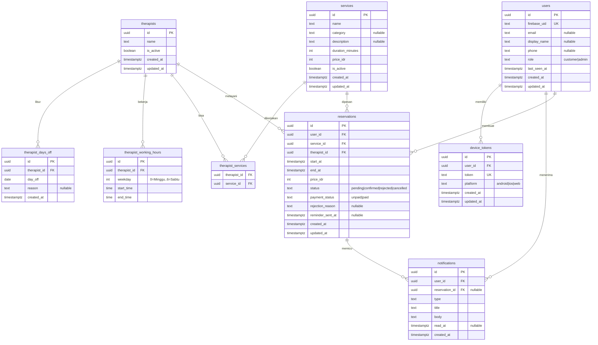

# Reservasi Massage & Spa

## 1. Context & Goal

Tempat massage/spa masih mencatat reservasi secara manual, sehingga jadwal sering bentrok. Aplikasi ini melayani **satu tempat** dengan dua peran:

- **Pelanggan** melihat layanan (jenis pijat, durasi, harga), memilih terapis, melihat slot kosong, memesan, membatalkan, dan mengubah jadwal.
- **Admin** mengatur layanan, terapis, dan jam kerja, lalu mengonfirmasi atau menolak reservasi.

Pembeda produk: pelanggan memilih terapis sendiri dan hanya melihat slot yang benar-benar kosong. Server menghitung slot dan mencegah pemesanan ganda. Layar tidak boleh menjadi satu-satunya penjaga.

**Tujuan terukur:** tidak ada dua reservasi aktif yang tumpang tindih pada satu terapis, bahkan saat banyak request bersamaan (NFR-01). Pelanggan dan admin mendapat notifikasi dalam aplikasi dan push untuk setiap kejadian reservasi.

**Platform:** HP (Android dan iOS) dan web, dari satu codebase Flutter. Pembayaran dilakukan di luar aplikasi, aplikasi hanya mencatat status pembayaran.

## 2. Scope

### In scope

Urutan fase mengikuti dependensi fitur:

| Fase | Fitur |
| --- | --- |
| 0 Fondasi | F-01 Akun, login, dan peran |
| 1 Data master | F-02 Layanan (admin), F-03 Terapis dan jam kerja (admin), F-04 Daftar layanan pelanggan |
| 2 Jadwal dan reservasi | F-05 Pilih terapis dan slot kosong, F-06 Pembuatan reservasi |
| 3 Pengelolaan reservasi | F-07 Konfirmasi/tolak/pembayaran oleh admin, F-08 Pembatalan oleh pelanggan, F-09 Ubah jadwal oleh pelanggan |
| 4 Notifikasi | F-10 Notifikasi dalam aplikasi dan push, R-01 Pengingat reservasi otomatis (`depends_on` F-10, RV-01) |

Rincian:

- Daftar dan login (Firebase Auth), profil dasar (telepon), peran pelanggan dan admin (RV-04, RV2-02).
- CRUD layanan oleh admin, termasuk menonaktifkan layanan.
- Terapis: data, layanan yang dikerjakan, jam kerja mingguan, hari libur.
- Daftar dan detail layanan aktif untuk pelanggan.
- Slot kosong per terapis, layanan, dan tanggal, dihitung di server.
- Reservasi dengan status awal `pending`, riwayat reservasi pelanggan, dan daftar reservasi admin dengan filter.
- Konfirmasi, penolakan, dan pencatatan status pembayaran oleh admin.
- Pembatalan dan ubah jadwal oleh pelanggan dengan batas waktu 24 jam yang dapat dikonfigurasi (RV-02).
- Notifikasi dalam aplikasi (tersimpan di database) dan push FCM.
- Pengingat reservasi otomatis lewat job terjadwal (R-01).

### Non-goals

- Pembayaran online di dalam aplikasi.
- Notifikasi lewat email, WhatsApp, SMS, atau Telegram.
- Banyak cabang atau banyak tempat, termasuk konsep organisasi.
- Sinkronisasi jadwal realtime dan mode offline.
- Optimasi SEO.
- Kalender jadwal harian admin, ulasan dan rating, foto layanan dan terapis, laporan ringkas reservasi.
- Jeda antar reservasi, batas kapasitas ruangan, dan pemesanan tanpa memilih terapis (RV-05).
- Pengelolaan admin lewat aplikasi, seperti menambah atau mencabut admin (RV-04).

## 3. Tech Constraints

- Monorepo pnpm: `apps/app` (Flutter web/Android/iOS), `apps/api` (Hono + TypeScript + Zod OpenAPI), `packages/contract` (OpenAPI + client Dart hasil generate).
- PostgreSQL + Drizzle + drizzle-kit, lokal lewat Docker Compose. Auth lewat Firebase Auth, backend memverifikasi ID token. Peran disimpan di PostgreSQL.
- Push lewat port `PushSender` (FCM). Job terjadwal memakai pg-boss (`RUN_WORKER=true`).
- Test: Vitest (API), flutter_test + bloc_test + mocktail (app), Firebase Auth Emulator.
- Semua pola (struktur fitur, format error, pagination, constraint bernama, timestamp, kontrak Dart, job, port) mengikuti `docs/conventions.md`. PRD ini hanya menulis keputusan khusus produk.

**Konfigurasi khusus produk** (env di API, nilai default):

| Env | Default | Arti |
| --- | --- | --- |
| `BOOKING_CHANGE_CUTOFF_HOURS` | `24` | Batas pembatalan dan ubah jadwal sebelum jam reservasi (RV-02) |
| `SLOT_INTERVAL_MINUTES` | `30` | Kelipatan menit untuk awal slot, dihitung dari jam mulai kerja |
| `VENUE_TIMEZONE` | `Asia/Jakarta` | Zona waktu jam kerja, hari libur, dan parameter `date` |
| `BOOKING_HORIZON_DAYS` | `60` | Reservasi paling jauh sekian hari ke depan |
| `REMINDER_LEAD_HOURS` | `3` | Pengingat dikirim saat jam mulai tinggal sekian jam |
| `ADMIN_FIREBASE_UIDS` | kosong | Daftar `firebase_uid` (dipisah koma) yang dijadikan admin oleh seed |

Kode error baru tidak diperlukan. Kasus bisnis memakai `CONFLICT`, `VALIDATION_ERROR`, `NOT_FOUND`, dan `FORBIDDEN` dengan pesan yang berbeda. Lihat docs/conventions.md bagian Format error.

## 4. Data Model

**Constraint penting** (nama eksplisit sesuai docs/conventions.md bagian Database):

- `users_firebase_uid_unique`, `users_email_lowercase_check`. `users_role_check` membatasi `role` ke `customer`/`admin`, default `customer`. `syncUser` tidak pernah mengubah `role`.
- `services_name_unique`: unique index pada `lower(name)` (RV2-01). Pelanggaran 23505 dipetakan repository ke error domain, lalu use case ke `409 CONFLICT` (pola Pelanggaran keunikan).
- `therapist_services_pk` pada `(therapist_id, service_id)`, `therapist_working_hours_therapist_id_weekday_unique`, `therapist_days_off_therapist_id_day_off_unique`, `device_tokens_token_unique`. Semua FK `ON DELETE CASCADE`, kecuali `reservations` ke `services`/`therapists`/`users`, yang `RESTRICT`. Layanan dan terapis dinonaktifkan, tidak dihapus.
- CHECK enum (text + check, RV2-03):
  - `reservations_status_check`, `reservations_payment_status_check`.
  - `notifications_type_check`: `reservation_created`, `reservation_confirmed`, `reservation_rejected`, `reservation_cancelled`, `reservation_rescheduled`, `reservation_reminder`.
  - `device_tokens_platform_check`: `android`, `ios`, `web`.
- CHECK `char_length` (RV2-03), dengan batas Zod yang sama:

| Kolom | Maks |
| --- | --- |
| `services.name`, `services.category`, `therapists.name`, `users.display_name` | 100 |
| `services.description` | 1000 |
| `users.phone` | 20 |
| `therapist_days_off.reason`, `reservations.rejection_reason` | 500 |
| `notifications.title` | 100 |
| `notifications.body` | 500 |
| `device_tokens.token` | 4096 |

  Teks wajib minimal 1 karakter setelah `trim`. Kolom opsional yang dikosongkan dengan string kosong disimpan `NULL`.
- Nilai: `services_duration_minutes_check` 15–480, `services_price_idr_check` 0–100000000, `therapist_working_hours_weekday_check` 0–6, `therapist_working_hours_time_check` (`start_time < end_time`), `reservations_time_check` (`start_at < end_at`).
- Anti-bentrok (RV-05): `reservations_therapist_time_exclude`, exclusion constraint `(therapist_id WITH =, tstzrange(start_at, end_at) WITH &&) WHERE status IN ('pending','confirmed')` (butuh `btree_gist`, lewat migrasi SQL kustom). Pelanggaran (SQLSTATE 23P01) dipetakan ke `409 CONFLICT`.
- Index pagination `(user_id, created_at DESC NULLS FIRST, id DESC NULLS FIRST)` pada `reservations` dan `notifications`. Daftar admin (`services`, `therapists`, `reservations`) memakai index `(created_at, id)`. Index `reservations(therapist_id, start_at)` untuk perhitungan slot.
- `reservations.price_idr` menyalin harga saat dipesan. `end_at` = `start_at` + durasi layanan saat dipesan.

## 5. API Contract

Semua route di bawah `/v1` dilindungi `authenticate` (401 `UNAUTHENTICATED`). Path `{id}` bukan UUID → `422`. "Admin" berarti `users.role = admin`. Pelanggan yang memanggil route admin mendapat `403 FORBIDDEN` (pemeriksaan di use case). Daftar paginasi memakai `?limit&cursor` dan respons `{ items, nextCursor }` (docs/conventions.md bagian Pagination). Waktu memakai ISO 8601 UTC. Field opsional yang kosong tidak dikirim, dan tidak ada `null` di body request.

| Endpoint | Request | Response | Error | Akses |
| --- | --- | --- | --- | --- |
| GET /v1/users/me | - | `User` {id, email, displayName, phone, role} | 401 | Semua pengguna login |
| PATCH /v1/users/me | Body strict `{ phone }`, string 0–20 (`""` mengosongkan). Field lain termasuk `role` ditolak | `User` | 401, 422 (field tak dikenal, `role`, body kosong) | Semua pengguna login |
| GET /v1/services | Query: limit, cursor | `ServicePage` (hanya layanan aktif) | 401, 422 | Semua pengguna login |
| GET /v1/services/{serviceId} | - | `Service` {id, name, category, description, durationMinutes, priceIdr, isActive} | 401, 404 (tidak ada atau nonaktif), 422 | Semua pengguna login |
| GET /v1/admin/services | Query: limit, cursor | `ServicePage` (aktif dan nonaktif) | 401, 403, 422 | Admin |
| GET /v1/admin/services/{serviceId} | - | `Service` (termasuk nonaktif, RV2-04) | 401, 403, 404, 422 | Admin |
| POST /v1/admin/services | `CreateServiceInput` {name, category?, description?, durationMinutes, priceIdr} | 201 `Service` (aktif) | 401, 403, 409 (nama sudah ada, tanpa beda huruf), 422 | Admin |
| PATCH /v1/admin/services/{serviceId} | `UpdateServiceInput`: salah satu dari name, category, description (`""` mengosongkan), durationMinutes, priceIdr, isActive | `Service` | 401, 403, 404, 409, 422 | Admin |
| GET /v1/therapists | Query: limit, cursor, serviceId? | `TherapistPage` (terapis aktif; dengan `serviceId` hanya yang mengerjakan layanan itu) | 401, 422 | Semua pengguna login |
| GET /v1/admin/therapists | Query: limit, cursor | `TherapistPage` (aktif dan nonaktif) | 401, 403, 422 | Admin |
| GET /v1/admin/therapists/{therapistId} | - | `TherapistDetail` {id, name, isActive, serviceIds, workingHours[{weekday, startTime, endTime}], daysOff[{id, dayOff, reason}]} | 401, 403, 404, 422 | Admin |
| POST /v1/admin/therapists | `{ name }` | 201 `Therapist` {id, name, isActive} | 401, 403, 422 | Admin |
| PATCH /v1/admin/therapists/{therapistId} | Salah satu dari name, isActive | `Therapist` | 401, 403, 404, 422 | Admin |
| PUT /v1/admin/therapists/{therapistId}/services | `{ serviceIds: uuid[] }` (mengganti seluruh daftar, boleh kosong) | `TherapistDetail` | 401, 403, 404, 422 (layanan tidak ada atau duplikat) | Admin |
| PUT /v1/admin/therapists/{therapistId}/working-hours | `{ hours: [{weekday, startTime "HH:MM", endTime "HH:MM"}] }` (mengganti seluruh jadwal, boleh kosong, maks satu entri per hari) | `TherapistDetail` | 401, 403, 404, 422 | Admin |
| POST /v1/admin/therapists/{therapistId}/days-off | `{ dayOff "YYYY-MM-DD", reason? }` | 201 `DayOff` {id, dayOff, reason} | 401, 403, 404, 409 (tanggal sudah libur), 422 | Admin |
| DELETE /v1/admin/therapists/{therapistId}/days-off/{dayOffId} | - | 204 | 401, 403, 404, 422 | Admin |
| GET /v1/slots | Query wajib: therapistId, serviceId, date `YYYY-MM-DD`. Opsional: excludeReservationId (RV2-05) | `SlotList` {slots: [{startAt, endAt}]} urut naik | 401, 404 (terapis/layanan tidak ada atau nonaktif, atau excludeReservationId bukan milik pemanggil), 422 (terapis tidak mengerjakan layanan, tanggal di luar rentang) | Semua pengguna login |
| POST /v1/reservations | `{ serviceId, therapistId, startAt }` | 201 `Reservation` (status `pending`) | 401, 404, 409 (slot terisi), 422 (`startAt` bukan slot valid) | Semua pengguna login (atas nama pemanggil) |
| GET /v1/reservations | Query: limit, cursor, status? | `ReservationPage` milik pemanggil | 401, 422 | Semua pengguna login |
| GET /v1/reservations/{reservationId} | - | `Reservation` | 401, 404 (bukan milik pemanggil), 422 | Pemilik |
| POST /v1/reservations/{reservationId}/cancel | - | `Reservation` (status `cancelled`) | 401, 404, 409 (status bukan pending/confirmed, atau lewat batas waktu) | Pemilik |
| POST /v1/reservations/{reservationId}/reschedule | `{ startAt }` | `Reservation` (status `pending`, jam baru) | 401, 404, 409 (status tidak valid, lewat batas waktu, atau slot terisi), 422 | Pemilik |
| GET /v1/admin/reservations | Query: limit, cursor, date?, therapistId?, status? | `ReservationPage` semua reservasi | 401, 403, 422 | Admin |
| POST /v1/admin/reservations/{reservationId}/confirm | - | `Reservation` (status `confirmed`) | 401, 403, 404, 409 (status bukan `pending`), 422 | Admin |
| POST /v1/admin/reservations/{reservationId}/reject | `{ reason? }` (1–500) | `Reservation` (status `rejected`) | 401, 403, 404, 409 (status bukan `pending`), 422 | Admin |
| PATCH /v1/admin/reservations/{reservationId}/payment | `{ paymentStatus: "unpaid" \| "paid" }` | `Reservation` | 401, 403, 404, 409 (status bukan `confirmed`), 422 | Admin |
| GET /v1/notifications | Query: limit, cursor | `NotificationPage` milik pemanggil, item {id, type, title, body, reservationId, readAt, createdAt} | 401, 422 | Semua pengguna login |
| POST /v1/notifications/{notificationId}/read | - | `Notification` (idempoten) | 401, 404, 422 | Pemilik |
| POST /v1/notifications/read-all | - | `ReadAllNotificationsResult` {updatedCount}, `200` walau 0 | 401 | Semua pengguna login |
| POST /v1/device-tokens | `{ token, platform }` (upsert per token; kepemilikan pindah ke pemanggil) | 204 | 401, 422 | Semua pengguna login |
| POST /v1/device-tokens/unregister | `{ token }` | `200` `UnregisterDeviceTokenResult` {deletedCount}, idempoten | 401, 422 | Semua pengguna login |

`Reservation` = {id, service {id, name, durationMinutes}, therapist {id, name}, customer {id, displayName, phone}, startAt, endAt, priceIdr, status, paymentStatus, rejectionReason, createdAt, updatedAt}.

## 6. Functional Requirements

### FR-01: Akun, login, dan profil
Pengguna daftar dan login lewat Firebase Auth. Baris `users` dibuat saat request pertama (`syncUser`). Pelanggan mengelola profil dasar (telepon). Pelanggan hanya mengakses datanya sendiri. Flutter punya layar login/daftar dan profil, serta guard rute per peran lewat go_router.
Fitur: F-01
Acceptance criteria:
- [ ] Given pengguna baru dengan token valid When memanggil GET /v1/users/me Then baris `users` dibuat dengan `role=customer` dan respons 200.
- [ ] Given tanpa header Authorization When memanggil route `/v1/*` Then 401 `Missing bearer token`.
- [ ] Given pelanggan When PATCH /v1/users/me `{ "phone": "0812345678" }` Then telepon tersimpan.
- [ ] Given pelanggan When PATCH /v1/users/me `{ "phone": "" }` Then telepon menjadi NULL dan respons memuat `phone: null`.
- [ ] Given body berisi `{ "role": "admin" }` atau field tak dikenal (skema strict, RV2-06) When PATCH /v1/users/me Then 422 dan peran tidak berubah.
- [ ] Given telepon lebih dari 20 karakter When PATCH /v1/users/me Then 422.
Edge cases:
- Body `{}` → 422 pada `_root`.
- Email token berubah huruf besar-kecil → disimpan lowercase.
- Pengguna tanpa email di token → `email` null.

### FR-02: Penetapan peran admin
Akun baru selalu `customer`. Admin hanya ditetapkan lewat seed atau perubahan langsung di database, tidak ada endpoint untuk mengubah peran (RV-04). Seed mengenali admin lewat `firebase_uid`, bukan email (RV2-02), agar akun yang mendaftar dengan email admin tidak naik peran.
Fitur: F-01
Acceptance criteria:
- [ ] Given `ADMIN_FIREBASE_UIDS=uidA,uidB` When seed admin dijalankan (`pnpm --filter api db:seed-admin`) Then baris `users` untuk kedua UID memiliki `role=admin` (dibuat bila belum ada dengan email null, atau diperbarui, `ON CONFLICT (firebase_uid)`).
- [ ] Given seed dijalankan dua kali When dicek Then tidak ada baris duplikat.
- [ ] Given akun admin dari seed login pertama kali When `syncUser` berjalan Then email dan nama terisi dan `role` tetap `admin`.
- [ ] Given akun pelanggan dengan email yang sama dengan admin tetapi UID berbeda When login Then `role=customer`.
- [ ] Given pelanggan When memanggil endpoint `/v1/admin/*` mana pun Then 403 `FORBIDDEN` (satu test per route admin).
Edge cases:
- UID di seed belum pernah login → baris dibuat dan dilengkapi saat login pertama.
- `ADMIN_FIREBASE_UIDS` kosong → seed tidak mengubah apa pun dan tidak error.
- Mencabut admin dilakukan manual di database.

### FR-03: Pengelolaan layanan oleh admin
Admin menambah, mengubah, dan menonaktifkan layanan (nama, kategori/jenis, deskripsi, durasi, harga). Layar admin punya daftar paginasi dan form tambah/ubah. Form ubah memuat data lewat GET /v1/admin/services/{serviceId}, sehingga deep link dan refresh web tetap berfungsi, termasuk untuk layanan nonaktif.
Fitur: F-02
Acceptance criteria:
- [ ] Given admin When POST /v1/admin/services dengan data valid Then 201 dan layanan aktif.
- [ ] Given layanan bernama "Pijat Thai" When admin menambah atau mengubah nama menjadi "pijat thai" Then 409 `CONFLICT` (dijaga `services_name_unique`).
- [ ] Given dua request bersamaan dengan nama sama When keduanya diproses Then satu 201 dan satu 409.
- [ ] Given layanan nonaktif When admin GET /v1/admin/services/{serviceId} Then 200, sedangkan pelanggan GET /v1/services/{serviceId} mendapat 404.
- [ ] Given durasi 10 atau harga negatif When disimpan Then 422.
- [ ] Given admin menonaktifkan layanan When ada reservasi aktif atas layanan itu Then reservasi tetap utuh dan layanan tidak muncul di daftar pelanggan.
Edge cases:
- Mengubah durasi tidak mengubah `end_at` reservasi yang sudah ada.
- `category: ""` dikosongkan menjadi NULL.
- Nama hanya spasi → 422.

### FR-04: Pengelolaan terapis dan jam kerja
Admin menambah dan mengubah terapis, menetapkan layanan yang dikerjakan, jam kerja mingguan (satu rentang per hari, zona `VENUE_TIMEZONE`), dan hari libur.
Fitur: F-03
Acceptance criteria:
- [ ] Given admin When POST /v1/admin/therapists `{ name }` Then 201 dan terapis aktif.
- [ ] Given admin When PUT .../services dengan `serviceIds` valid Then daftar lama diganti seluruhnya.
- [ ] Given PUT .../working-hours dengan `startTime >= endTime` atau dua entri pada hari yang sama Then 422.
- [ ] Given PUT .../working-hours dengan `hours: []` Then semua jam kerja terhapus dan terapis tidak punya slot.
- [ ] Given tanggal libur yang sudah terdaftar When POST .../days-off Then 409.
- [ ] Given terapis dinonaktifkan When pelanggan GET /v1/therapists Then terapis itu tidak muncul, dan reservasi yang sudah ada tidak berubah.
Edge cases:
- Menghapus layanan dari terapis tidak membatalkan reservasi yang ada.
- Hari libur yang diisi saat sudah ada reservasi pada hari itu tidak membatalkannya otomatis, admin menanganinya manual.
- `serviceIds` berisi UUID tak dikenal → 422.

### FR-05: Daftar layanan untuk pelanggan
Pelanggan melihat daftar layanan aktif (jenis, durasi, harga), membuka detail, lalu memilih layanan untuk dipesan. Ini layar pertama setelah login pelanggan.
Fitur: F-04
Acceptance criteria:
- [ ] Given layanan aktif dan nonaktif When pelanggan GET /v1/services Then hanya yang aktif dikembalikan, dengan paginasi dan `nextCursor` null di halaman terakhir.
- [ ] Given layanan aktif When GET /v1/services/{serviceId} Then 200 dengan durasi dan harga.
- [ ] Given pelanggan memilih layanan di layar Then aplikasi menuju pemilihan terapis untuk layanan itu.
- [ ] Given daftar kosong Then layar menampilkan keadaan kosong, dan gagal muat menampilkan teks error dengan tombol coba lagi.
Edge cases:
- Layanan dinonaktifkan saat layar terbuka → 404 saat dipilih, tampilkan teks kegagalan.
- Refresh menarik data terbaru (tanpa realtime).
- Harga ditampilkan dalam format Rupiah.

### FR-06: Pilih terapis dan lihat slot kosong
Pelanggan memilih terapis (daftar terfilter layanan, terapis wajib dipilih, RV-05) lalu memilih tanggal dan melihat slot kosong. Server menghitung slot dari jam kerja pada hari itu, hari libur, durasi layanan, dan reservasi yang ada. Hanya reservasi berstatus `pending` atau `confirmed` yang memblokir slot (RV-06). Reservasi `rejected` dan `cancelled` membuat slot kosong lagi. Satu terapis melayani satu pelanggan per waktu, tanpa jeda dan tanpa batas ruangan.
Fitur: F-05
Acceptance criteria:
- [ ] Given terapis bekerja 09:00–12:00 dan layanan 60 menit When GET /v1/slots Then slot mulai 09:00, 09:30, 10:00, 10:30, 11:00 (awal pada kelipatan `SLOT_INTERVAL_MINUTES`, selesai ≤ jam tutup).
- [ ] Given reservasi `pending` atau `confirmed` 10:00–11:00 When GET /v1/slots Then slot yang tumpang tindih (09:30, 10:00, 10:30) tidak muncul.
- [ ] Given reservasi `rejected` atau `cancelled` di jam yang sama When GET /v1/slots Then slot itu muncul lagi.
- [ ] Given tanggal hari libur terapis, hari tanpa jam kerja, atau slot yang sudah lewat Then slot tidak muncul.
- [ ] Given terapis tidak mengerjakan layanan atau `date` melewati `BOOKING_HORIZON_DAYS` Then 422.
- [ ] Given `excludeReservationId` milik pemanggil When GET /v1/slots Then reservasi itu tidak ikut memblokir (slot yang tumpang tindih dengan jadwal lamanya tampil). Jika bukan milik pemanggil, 404.
Edge cases:
- Tanggal ditafsirkan di `VENUE_TIMEZONE`, termasuk batas tengah malam.
- Layanan lebih panjang dari jendela kerja → daftar slot kosong, bukan error.
- `excludeReservationId` bukan UUID → 422.

### FR-07: Pembuatan reservasi
Pelanggan memesan slot kosong. Reservasi baru berstatus `pending` dan `payment_status=unpaid`. Server memvalidasi ulang slot dan mencegah bentrok di database (`reservations_therapist_time_exclude`), bukan hanya saat menghitung slot. Pelanggan melihat riwayat dan status reservasinya.
Fitur: F-06
Acceptance criteria:
- [ ] Given slot kosong When POST /v1/reservations Then 201, status `pending`, `endAt` = `startAt` + durasi, `priceIdr` disalin dari layanan.
- [ ] Given `startAt` bukan slot valid (tidak selaras interval, di luar jam kerja, hari libur, sudah lewat, atau melewati horizon) Then 422 pada `details.startAt`.
- [ ] Given slot sudah dipegang reservasi `pending` atau `confirmed` Then 409 `CONFLICT`.
- [ ] Given 20 request bersamaan untuk terapis dan waktu yang sama Then tepat satu 201 dan sisanya 409.
- [ ] Given layanan atau terapis nonaktif atau tidak ada Then 404, dan terapis tidak mengerjakan layanan itu Then 422.
- [ ] Given pelanggan GET /v1/reservations Then hanya reservasinya sendiri yang muncul (terbaru dulu, filter `status`), dan reservasi pelanggan lain pada `/{reservationId}` mendapat 404.
Edge cases:
- Dua pelanggan memesan slot yang tumpang tindih sebagian → satu gagal 409.
- Pelanggan boleh memiliki banyak reservasi, termasuk waktu bersamaan dengan terapis berbeda.
- Setelah 409 di layar, aplikasi memuat ulang slot.

### FR-08: Konfirmasi, penolakan, dan pembayaran oleh admin
Admin melihat semua reservasi (filter tanggal, terapis, status), mengonfirmasi atau menolak reservasi `pending`, dan mencatat status pembayaran yang dilakukan di luar aplikasi.
Fitur: F-07
Acceptance criteria:
- [ ] Given reservasi `pending` When admin confirm Then status `confirmed`.
- [ ] Given reservasi `pending` When admin reject dengan alasan Then status `rejected`, alasan tersimpan, dan slot kembali tersedia di FR-06.
- [ ] Given reservasi bukan `pending` When confirm atau reject Then 409.
- [ ] Given reservasi `confirmed` When admin PATCH payment `paid` Then `paymentStatus` menjadi `paid` (dan bisa kembali `unpaid`). Pada status lain 409.
- [ ] Given filter `date`, `therapistId`, atau `status` When GET /v1/admin/reservations Then hanya yang cocok yang dikembalikan (tanggal menurut `VENUE_TIMEZONE`).
- [ ] Given pelanggan memanggil salah satu endpoint ini Then 403.
Edge cases:
- Risiko diterima (RV2-07): kondisi hanya `status = pending`, sehingga admin yang menekan confirm berdasarkan jam lama bisa tanpa sadar mengonfirmasi jam baru setelah ubah jadwal. Admin tetap menerima notifikasi `reservation_rescheduled`.
- Dua admin menekan confirm/reject bersamaan → satu berhasil, satu 409.
- Alasan penolakan dikosongkan → tersimpan NULL.

### FR-09: Pembatalan reservasi oleh pelanggan
Pelanggan membatalkan reservasinya sendiri selama status `pending` atau `confirmed` dan masih di luar batas `BOOKING_CHANGE_CUTOFF_HOURS` (default 24 jam, RV-02) sebelum `start_at`. Status menjadi `cancelled` dan slot otomatis kosong lagi.
Fitur: F-08
Acceptance criteria:
- [ ] Given reservasi `pending` atau `confirmed` dengan `start_at` ≥ 24 jam lagi When cancel Then status `cancelled`.
- [ ] Given `start_at` kurang dari 24 jam lagi When cancel Then 409 dan status tidak berubah.
- [ ] Given reservasi `rejected` atau `cancelled` When cancel Then 409.
- [ ] Given reservasi milik pelanggan lain When cancel Then 404.
- [ ] Given pembatalan berhasil When GET /v1/slots untuk slot itu Then slot tersedia.
- [ ] Given `BOOKING_CHANGE_CUTOFF_HOURS=2` When cancel pada 3 jam sebelum Then berhasil (batas dibaca dari konfigurasi).
Edge cases:
- Tepat pada batas (selisih = batas) diterima.
- Cancel dua kali bersamaan → satu berhasil, satu 409.
- Layar menyembunyikan tombol bila lewat batas, tetapi keputusan akhir ada di server.

### FR-10: Ubah jadwal reservasi oleh pelanggan
Pelanggan memindahkan reservasi `pending` atau `confirmed` ke slot lain pada terapis dan layanan yang sama. Aturan batas waktu sama dengan FR-09, dihitung dari jadwal lama. Setelah ubah jadwal status selalu kembali `pending` (RV-03). Layar memuat slot lewat `excludeReservationId`.
Fitur: F-09
Acceptance criteria:
- [ ] Given reservasi `confirmed` dengan jadwal lama ≥ 24 jam lagi When reschedule ke slot kosong Then `startAt`/`endAt` baru dan status `pending`.
- [ ] Given reservasi `pending` When reschedule Then status tetap `pending`.
- [ ] Given jadwal lama kurang dari 24 jam lagi When reschedule Then 409.
- [ ] Given slot baru dipegang reservasi lain Then 409 dan jadwal lama tidak berubah.
- [ ] Given slot baru tumpang tindih dengan jadwal lama sendiri (geser 30 menit) Then diterima.
- [ ] Given `startAt` bukan slot valid Then 422. Status `rejected` atau `cancelled` Then 409. Bukan pemilik Then 404.
Edge cases:
- Jadwal lama dibebaskan dan jadwal baru diambil dalam satu transaksi, sehingga tidak ada celah kosong.
- Reschedule ke jam yang sama persis diperlakukan sebagai perubahan valid dan status tetap kembali `pending`.
- Pelanggan harus menunggu konfirmasi ulang.

### FR-11: Notifikasi dalam aplikasi dan push
Setiap kejadian reservasi menyimpan notifikasi di database dan mengirim push FCM (best-effort). Penerima:
- admin (semua akun admin): `reservation_created`, `reservation_cancelled`, `reservation_rescheduled`;
- pelanggan pemilik: `reservation_confirmed`, `reservation_rejected`.
Pengiriman push memakai port `PushSender` (docs/conventions.md bagian Port push dan storage). Klien mendaftarkan token perangkat (Android, iOS, web). Layar notifikasi menampilkan daftar, penanda belum dibaca, dan tombol tandai semua dibaca.
Fitur: F-10
Acceptance criteria:
- [ ] Given reservasi dibuat, dibatalkan, atau diubah jadwalnya When aksi sukses Then satu notifikasi tersimpan untuk setiap admin dengan `type` sesuai.
- [ ] Given admin confirm atau reject When sukses Then pelanggan pemilik menerima notifikasi `reservation_confirmed` atau `reservation_rejected`.
- [ ] Given token perangkat terdaftar When notifikasi dibuat Then `PushSender.send` dipanggil dengan judul dan isi yang sama. Hasil `invalid-token` menghapus token itu.
- [ ] Given push gagal (error selain token tidak valid) Then aksi reservasi tetap sukses dan error dicatat di log.
- [ ] Given pengguna When GET /v1/notifications Then hanya notifikasinya sendiri (terbaru dulu). POST .../read pada milik orang lain → 404.
- [ ] Given POST /v1/notifications/read-all When ada 3 belum dibaca Then `updatedCount` 3, dan ulangan mengembalikan 0.
Edge cases:
- Tidak ada admin terdaftar → tidak ada notifikasi admin, tidak error.
- Token yang sama didaftarkan akun lain → kepemilikan berpindah ke pemanggil.
- `PUSH_ADAPTER` tidak diatur (`none`) → aksi reservasi tetap sukses, notifikasi dalam aplikasi tetap tersimpan.

### FR-12: Pengingat reservasi otomatis
Job terjadwal mengirim pengingat ke pelanggan untuk reservasi `confirmed` yang jam mulainya tinggal `REMINDER_LEAD_HOURS` (default 3 jam). Setiap reservasi diingatkan paling banyak sekali per jadwal. Berjalan di pg-boss (docs/conventions.md bagian Job): queue `reservations.send-reminders`, cron `*/5 * * * *`, hanya bila `RUN_WORKER=true`.
Fitur: R-01 (depends_on F-10)
Acceptance criteria:
- [ ] Given reservasi `confirmed`, `reminder_sent_at` NULL, dan `start_at` dalam 3 jam ke depan When job berjalan Then notifikasi `reservation_reminder` tersimpan untuk pelanggan, push terkirim, dan `reminder_sent_at` terisi.
- [ ] Given job berjalan dua kali berurutan Then pelanggan tidak menerima pengingat kedua (penandaan atomik sebelum kirim).
- [ ] Given reservasi `pending`, `rejected`, atau `cancelled` Then tidak ada pengingat.
- [ ] Given reservasi dengan `start_at` di luar jendela atau sudah lewat Then tidak ada pengingat.
- [ ] Given reservasi diubah jadwalnya Then `reminder_sent_at` direset NULL, dan pengingat baru terkirim bila kembali `confirmed` dan masuk jendela.
- [ ] Given `RUN_WORKER=false` Then job tidak terdaftar dan tidak ada koneksi pg-boss.
Edge cases:
- Reservasi dikonfirmasi saat sudah di dalam jendela → tetap diingatkan pada putaran job berikutnya selama belum mulai.
- Push gagal → notifikasi dalam aplikasi tetap tersimpan dan error dicatat.
- Job terlambat atau mati sebentar → catch-up pada putaran berikutnya tanpa duplikat.

## 7. Non-Functional Requirements

- **NFR-01 (anti-bentrok):** test integrasi mengirim 20 POST /v1/reservations paralel untuk terapis dan waktu sama. Hasilnya tepat satu 201 dan 19 respons 409, tanpa baris `pending`/`confirmed` yang tumpang tindih di database. Test serupa untuk reschedule paralel.
- **NFR-02 (performa):** GET /v1/slots p95 ≤ 500 ms untuk satu terapis dan satu tanggal dengan 500 reservasi tersimpan. Endpoint daftar p95 ≤ 300 ms dengan 10.000 baris.
- **NFR-03 (keamanan):** 100% route `/v1/*` lolos `all-routes-require-auth.int.test.ts`. Setiap route `/v1/admin/*` punya test 403 untuk pelanggan. Tidak ada kode yang mengubah `users.role` selain seed.
- **NFR-04 (isolasi data):** test integrasi memastikan pelanggan A mendapat 404 pada reservasi dan notifikasi pelanggan B, dan tidak melihatnya di daftar.
- **NFR-05 (konsistensi validasi):** setiap batas panjang dan nilai di bagian 4 ada di Zod dan CHECK dengan angka sama. Test integrasi memastikan input melebihi batas → 422 (bukan 500), dan test skema memastikan CHECK menolak insert langsung.
- **NFR-06 (kontrak):** `pnpm contract:check`, `pnpm lint`, dan `pnpm check` bersih pada setiap perubahan route. Semua skema punya nama `.openapi()`.
- **NFR-07 (ketahanan push dan job):** kegagalan FCM tidak pernah menggagalkan aksi reservasi (test dengan `PushSender` yang melempar error). Job pengingat idempoten: dua kali eksekusi berurutan menghasilkan satu notifikasi per reservasi.
- **NFR-08 (waktu):** semua penghitungan hari dan jam kerja memakai `VENUE_TIMEZONE`. Test unit mencakup batas tengah malam dan pergantian hari. Semua timestamp mengikuti presisi milidetik dan jam database (docs/conventions.md bagian Database).
- **NFR-09 (UI):** layar utama pelanggan dan admin dapat dipakai pada lebar 360 px hingga desktop. Setiap layar daftar punya keadaan memuat, kosong, dan gagal dengan teks dari `code` error API. Semua aksi yang bisa gagal (409/422) menampilkan pesan yang bisa dipahami, dan 422 ditampilkan per field.
- **NFR-10 (cakupan test):** setiap acceptance criteria FR-01 sampai FR-12 punya minimal satu test otomatis (Vitest untuk API, bloc_test untuk Cubit/Bloc yang relevan). Seluruh test lolos di CI sebelum merge.

## 8. Assumptions & Decisions

Bagian ini disusun aplikasi dari keputusan dan jawaban yang tersimpan, bukan ditulis AI.

### Keputusan

- **RV-01** (dependency_order): Pengingat reservasi otomatis (R-01) sudah kamu pilih, tapi belum masuk ke fitur atau fase mana pun, jadi tidak ada yang mengerjakannya. Padahal fitur ini butuh notifikasi, status konfirmasi reservasi, dan job terjadwal.
  - Diputuskan: Jadikan R-01 fitur terpisah di fase 4 dengan depends_on F-10
  - Konsekuensi: Lingkup lebih jelas dan mudah diuji sendiri, tapi menambah satu fitur dan satu daftar task.
- **RV-02** (testability): Batas waktu pembatalan dan perubahan jadwal belum ditentukan, padahal jadi inti F-08 dan F-09. Tanpa angka, acceptance criteria tidak bisa ditulis dan validasi di server tidak bisa diuji.
  - Diputuskan: Tetapkan batas default 24 jam sebelum jam reservasi, bisa diubah lewat konfigurasi
  - Konsekuensi: Kriteria jelas dan bisa diuji. Kalau ternyata tidak cocok, cukup ubah nilai konfigurasi.
- **RV-03** (consistency): Aturan status setelah ubah jadwal belum konsisten. Asumsi produk bilang reservasi masuk berstatus menunggu, F-09 bilang status kembali menunggu 'bila perlu', dan pertanyaan terbuka masih belum menjawab apakah perlu konfirmasi ulang. Kata 'bila perlu' juga terlalu kabur untuk diuji.
  - Diputuskan: Selalu kembali ke status menunggu setelah ubah jadwal
  - Konsekuensi: Aturan sederhana dan mudah diuji, admin selalu punya kendali. Pelanggan harus menunggu konfirmasi lagi.
- **RV-04** (security): Cara seseorang menjadi admin belum ditentukan. Pendaftaran terbuka untuk pelanggan, dan peran disimpan di PostgreSQL, jadi tanpa mekanisme jelas ada risiko akun biasa naik jadi admin atau endpoint admin terbuka.
  - Diputuskan: Akun baru selalu pelanggan; admin ditetapkan lewat seed atau perubahan langsung di database
  - Konsekuensi: Aman dan sederhana untuk satu tempat. Menambah admin butuh akses teknis.
- **RV-05** (testability): Aturan penghitungan slot masih terbuka: kapasitas terapis, jeda antar reservasi, ruangan, dan pemesanan tanpa memilih terapis. Ini menentukan hasil F-05 dan pencegahan bentrok di F-06, jadi acceptance criteria belum bisa pasti.
  - Diputuskan: Tetapkan aturan MVP: satu terapis satu pelanggan per waktu, tanpa jeda, tanpa batas ruangan, terapis wajib dipilih
  - Konsekuensi: Aturan jelas dan sesuai pembeda produkmu. Kasus ruangan atau jeda bersih-bersih belum tercakup.
- **RV-06** (dependency_order): Pembatalan dan ubah jadwal ada di fase 3, tapi hasilnya (slot kembali kosong) baru terasa utuh kalau pelanggan sudah melihat riwayat dan status reservasi. Selain itu, penolakan oleh admin dan pembatalan juga perlu menjaga slot kembali tersedia di F-05. Aturan status akhir (ditolak, dibatalkan) belum tertulis jelas.
  - Diputuskan: Tegaskan di F-05 bahwa hanya reservasi berstatus menunggu atau terkonfirmasi yang memblokir slot
  - Konsekuensi: Slot dari reservasi ditolak atau dibatalkan otomatis kembali kosong, dan aturan mudah diuji.
- **RV2-01** (business_rule): FR-02 dan API Contract mewajibkan nama layanan unik tanpa membedakan huruf besar-kecil (409 CONFLICT). Tapi daftar constraint di bagian 4 tidak punya unique index untuk `services`. Kalau keunikan hanya dicek di use case (ambil dulu, baru insert), dua admin yang menyimpan nama sama secara bersamaan bisa sama-sama lolos. Konvensi proyek mewajibkan keunikan dijaga constraint database bernama.
  - Diputuskan: Tambah unique index services_name_unique pada lower(name)
  - Konsekuensi: Keunikan aman dari balapan. Repository memetakan SQLSTATE 23505 ke error domain lalu ke 409 sesuai pola konvensi. Perlu satu baris tambahan di bagian 4 dan integration test beda huruf.
- **RV2-02** (business_rule): RV-04 menetapkan admin lewat seed, tapi PRD tidak menyebut seed itu mengenali akun lewat apa. Edge case "tidak membuat duplikat" mengisyaratkan seed bisa membuat atau mencocokkan baris `users` lewat email. Kalau seed memberi `role=admin` berdasarkan email, orang lain bisa mendaftar di Firebase dengan email admin yang belum diverifikasi sebelum admin asli login, lalu mendapat peran admin. `syncUser` mengambil email langsung dari token tanpa syarat verifikasi.
  - Diputuskan: Seed menetapkan admin berdasarkan firebase_uid
  - Konsekuensi: Peran admin hanya melekat ke akun Firebase tertentu. Operator harus tahu UID-nya dulu (misalnya dari konsol Firebase). Seed tetap idempoten lewat ON CONFLICT (firebase_uid).
- **RV2-03** (data_model): Beberapa kolom belum punya aturan yang dijaga database. Kolom bernilai enum, yaitu `notifications.type` (reservation_created, confirmed, rejected, cancelled, rescheduled, reminder) dan `device_tokens.platform` (android, ios, web), tidak dicantumkan sebagai text + CHECK. Kolom teks bebas (`services.name`, `category`, `description`, `therapists.name`, `users.phone`, `therapist_days_off.reason`, `reservations.rejection_reason`) tidak punya batas panjang. Konvensi mewajibkan CHECK char_length yang selaras dengan Zod, jadi tanpa angka di PRD batasnya akan ditebak saat implementasi.
  - Diputuskan: Tambahkan CHECK enum untuk notifications.type dan device_tokens.platform, serta batas panjang per kolom teks
  - Konsekuensi: Skema, Zod, dan test punya angka yang sama, dan input berlebihan ditolak 422 secara konsisten. Butuh keputusan angka, misalnya nama 100, deskripsi 1000, telepon 20, alasan 500.
- **RV2-04** (ui_endpoint): Form edit layanan di admin butuh data lama per item. Satu-satunya GET per item adalah `GET /v1/services/{serviceId}`, padahal endpoint itu mengembalikan 404 untuk layanan nonaktif. Akibatnya admin tidak bisa membuka form edit, misalnya untuk mengaktifkan kembali, dari deep link atau setelah refresh di web. Daftar admin terpaginasi, jadi item yang dicari belum tentu ada di halaman yang sudah dimuat.
  - Diputuskan: Tambah GET /v1/admin/services/{serviceId} yang juga mengembalikan layanan nonaktif
  - Konsekuensi: Form edit selalu bisa diisi data terbaru, termasuk layanan nonaktif. Menambah satu route, satu use case, dan test 403 untuk pelanggan.
- **RV2-05** (ui_endpoint): Layar ubah jadwal memakai endpoint slot untuk menampilkan pilihan waktu. Endpoint itu memblokir semua reservasi pending atau confirmed, termasuk reservasi yang sedang dipindahkan. Akibatnya slot yang tumpang tindih dengan jadwal lama (misalnya geser 30 menit) tidak pernah tampil, padahal FR-09 menyatakan slot itu diterima. Client tidak punya cara meminta slot tanpa menghitung reservasi itu sendiri.
  - Diputuskan: Tambah query opsional excludeReservationId pada endpoint slot
  - Konsekuensi: Layar reschedule menampilkan semua slot yang benar-benar bisa dipilih. Server wajib memastikan reservasi itu milik pemanggil (bila bukan, 404 atau diabaikan) agar tidak membocorkan data. Perlu tambahan test.
- **RV2-06** (business_rule): Perlakuan field `role` di PATCH /v1/users/me tidak konsisten. Narasi FR-01 bilang "mengabaikan atau menolak", sedangkan acceptance criteria bilang role tetap customer sekaligus field tidak dikenal ditolak 422. Ini dua perilaku berbeda (strip atau strict) yang menentukan cara menulis skema Zod dan isi test.
  - Diputuskan: Tetapkan skema strict: field tidak dikenal termasuk role → 422
  - Konsekuensi: Perilaku tegas dan mudah diuji. Kalau ada client lama yang mengirim field ekstra, request-nya akan gagal.
- **RV2-07** (business_rule): Konfirmasi admin hanya bersyarat `status = pending`. Ini bisa balapan dengan ubah jadwal reservasi yang masih pending, karena status tetap pending setelah reschedule. Admin bisa menekan confirm berdasarkan jam lama yang ia lihat, padahal jamnya sudah dipindah, sehingga waktu baru ikut terkonfirmasi tanpa pernah dilihat admin. Ini bertentangan dengan maksud RV-03 bahwa admin selalu mengonfirmasi jadwal yang berlaku.
  - Diputuskan: Terima risikonya
  - Konsekuensi: API lebih sederhana. Kasusnya jarang terjadi, tapi admin bisa mengonfirmasi waktu baru tanpa sadar. Notifikasi reservation_rescheduled tetap masuk ke admin.

### Asumsi

- Pengguna utamanya adalah pelanggan tempat massage/spa dan admin tempat tersebut.
- Aksi pertama pelanggan adalah melihat daftar layanan lalu memilih layanan untuk dipesan.
- Pembeda utama produk adalah pelanggan bisa memilih terapis dan melihat jadwal yang masih kosong.
- Setiap reservasi masuk berstatus menunggu sampai dikonfirmasi admin.
- Versi pertama melayani satu tempat massage/spa saja.
- Data tiap pengguna dipisahkan lewat otorisasi per akun: pelanggan hanya melihat reservasinya sendiri, admin melihat semua reservasi di tempatnya.
- Versi pertama melayani satu tempat massage/spa saja, jadi belum ada pengelolaan banyak cabang atau organisasi.
- Ada dua peran: pelanggan dan admin. Hanya admin yang mengatur layanan, terapis, jam kerja, dan mengonfirmasi reservasi.
- Reservasi baru berstatus menunggu sampai dikonfirmasi admin.
- Aplikasi selalu online dan data jadwal diperbarui saat layar dibuka atau di-refresh, tanpa sinkronisasi realtime.
- Konten layanan dan jadwal diakses setelah login, jadi optimasi SEO tidak menjadi prioritas.

### Open Questions

- Berapa batas waktu pembatalan dan perubahan jadwal sebelum jam reservasi (misalnya 2 atau 24 jam)? Sementara ini masih tebakan.
- Apakah ubah jadwal perlu dikonfirmasi ulang oleh admin, atau tetap terkonfirmasi kalau sebelumnya sudah dikonfirmasi?
- Apakah satu terapis bisa melayani lebih dari satu pelanggan di waktu yang sama? Asumsi sementara: tidak.
- Apakah perlu jeda antar reservasi (misalnya waktu bersih-bersih ruangan)?
- Apakah ruangan atau kapasitas tempat juga membatasi jumlah reservasi bersamaan, atau cukup ketersediaan terapis?
- Apakah admin hanya satu orang atau bisa beberapa akun admin?
- Apakah pelanggan boleh memesan tanpa memilih terapis tertentu (dipilihkan otomatis)?
- Bagaimana admin menangani reservasi saat terapis mendadak berhalangan?
