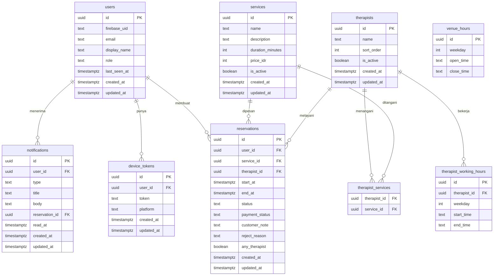

# Reservasi Massage & Spa

## 1. Context & Goal

Aplikasi reservasi untuk satu tempat massage/spa. Pelanggan melihat layanan (jenis pijat, durasi, harga), memilih terapis atau "terapis siapa saja", lalu memesan jadwal kosong. Admin mengatur layanan, terapis, dan jam kerja, lalu mengonfirmasi atau menolak reservasi.

Masalah yang diselesaikan: pemesanan lewat chat atau telepon sering berantakan dan bentrok jadwal. Tujuan versi pertama: reservasi berjalan baik tanpa jadwal bentrok, divalidasi di server.

Platform: HP (Android, iOS) dan web, satu codebase Flutter dengan API terpisah. Pembayaran di luar aplikasi; aplikasi hanya mencatat status pembayaran. Data diperbarui saat aplikasi dibuka atau di-refresh.

Dua peran: `admin` dan `customer`. Terapis tidak punya akun; mereka hanya data yang dikelola admin.

Fase pengerjaan:
- Fase 0 Fondasi: FR-01, FR-02
- Fase 1 Katalog: FR-03, FR-04
- Fase 2 Jadwal dan pemesanan: FR-05, FR-06
- Fase 3 Pengelolaan reservasi: FR-07, FR-08
- Fase 4 Notifikasi serta ekspor dan hapus data (RV-01, RV-02): FR-09, FR-10

## 2. Scope

### In scope
- F-01 Akun dan login (Firebase Auth, data pengguna dibuat saat request pertama).
- F-02 Peran admin dan pelanggan, admin pertama lewat seed (RV-04).
- F-03 Pengelolaan layanan.
- F-04 Pengelolaan terapis (beserta daftar layanan yang bisa ditangani, RV-06) dan jam kerja.
- F-05 Pencarian jadwal kosong, termasuk "terapis siapa saja" (RV-07).
- F-06 Pemesanan dengan catatan khusus, riwayat reservasi pelanggan, dan status pembayaran.
- F-07 Pengelolaan reservasi oleh admin: daftar, konfirmasi, tolak, tandai pembayaran (RV-08).
- F-08 Pembatalan dan perubahan jadwal oleh pelanggan (RV-05).
- R-01 Notifikasi dalam aplikasi dan push (FCM), fase 4, setelah F-07 dan F-08 (RV-01).
- R-03 Ekspor dan hapus data akun, fase 4 (RV-02).

### Non-goals
- Pembayaran online di dalam aplikasi.
- Lebih dari satu tempat massage/spa.
- Mode offline dan pembaruan realtime.
- Notifikasi lewat email, WhatsApp, SMS, atau Telegram.
- Halaman promosi dan optimasi SEO.
- Pengingat reservasi terjadwal.
- Blokir jadwal manual oleh admin.

## 3. Tech Constraints

- Monorepo pnpm: `apps/app` (Flutter web/Android/iOS), `apps/api` (Hono + TypeScript), `packages/contract` (OpenAPI + client Dart hasil generate).
- PostgreSQL + Drizzle; Firebase Auth (backend memverifikasi ID token); FCM lewat port `PushSender`; pg-boss hanya bila diperlukan.
- Satu tempat, jadi tanpa tabel organisasi/keanggotaan; peran disimpan di kolom `users.role`.
- Detail arsitektur, error, pagination, database, auth, dan port: lihat docs/conventions.md (bagian Clean Architecture API, Format error, Pagination, Database, Autentikasi, Port push dan storage).
- Zona waktu tempat: `Asia/Jakarta`, dikonfigurasi lewat env `VENUE_TIMEZONE`. Semua timestamp disimpan UTC.
- Konfigurasi baru: `ADMIN_EMAILS` (seed admin), `CANCEL_CUTOFF_HOURS` (default 6).

## 4. Data Model

Constraint penting:
- `users`: unik `firebase_uid`; email lowercase; `role` ∈ `admin|customer` (CHECK), default `customer`.
- `services`: `duration_minutes` > 0 dan kelipatan 15; `price_idr` ≥ 0; nama unik tanpa membedakan huruf besar-kecil (→ `409 CONFLICT`).
- `therapist_services`: PK `(therapist_id, service_id)`.
- `therapist_working_hours` dan `venue_hours`: `weekday` 0–6 (0 = Minggu), `start_time < end_time`, format `HH:mm`; boleh banyak rentang per hari.
- `reservations.status` ∈ `pending|confirmed|rejected|cancelled` (CHECK); `payment_status` ∈ `unpaid|paid`, default `unpaid`; `end_at > start_at`; `customer_note` maks 500 karakter; `reject_reason` wajib saat `rejected`, maks 300.
- Anti-bentrok: exclusion constraint `reservations_therapist_time_exclude` pada `(therapist_id, tstzrange(start_at, end_at))` hanya untuk status `pending|confirmed`; pelanggaran → `409 CONFLICT`.
- Index pagination `(user_id, created_at DESC, id DESC)` pada `reservations` dan `notifications`; index `(status, start_at)` pada `reservations`.
- `device_tokens`: unik `token`. `notifications.reservation_id` FK `ON DELETE SET NULL`.
- `reservations.user_id` FK ke `users.id` tanpa CASCADE otomatis; penghapusan akun ditangani use case (FR-10). `therapist_id` dan `service_id` FK `ON DELETE RESTRICT`; layanan/terapis hanya dinonaktifkan, tidak dihapus.

## 5. API Contract

Semua path di bawah `/v1`, memakai Bearer ID token. Format error mengikuti docs/conventions.md bagian Format error; `401` berlaku untuk semua endpoint dan tidak diulang. Respons list memakai `{ items, nextCursor }` bila disebut "page".

| Endpoint | Request | Response | Error | Akses |
| --- | --- | --- | --- | --- |
| GET /v1/me | - | `200` User (id, email, displayName, role) | - | Terautentikasi |
| GET /v1/services | query `includeInactive` (hanya admin) | `200` `{ items: Service[] }` | `403` jika `includeInactive` oleh non-admin | Terautentikasi |
| POST /v1/services | `{ name, description?, durationMinutes, priceIdr }` | `201` Service | `403`, `409` nama kembar, `422` | Admin |
| PATCH /v1/services/{id} | field opsional + `isActive`, minimal satu | `200` Service | `403`, `404`, `409`, `422` | Admin |
| GET /v1/therapists | query `serviceId?`, `includeInactive` (admin) | `200` `{ items: Therapist[] }` (dengan `serviceIds`) | `403`, `422` | Terautentikasi |
| POST /v1/therapists | `{ name, sortOrder?, serviceIds[] }` | `201` Therapist | `403`, `422` (serviceId tidak ada) | Admin |
| PATCH /v1/therapists/{id} | `{ name?, sortOrder?, isActive?, serviceIds? }` | `200` Therapist | `403`, `404`, `422` | Admin |
| GET /v1/venue-hours | - | `200` `{ items: HourRange[] }` | - | Terautentikasi |
| PUT /v1/venue-hours | `{ items: [{ weekday, openTime, closeTime }] }` | `200` `{ items }` | `403`, `422` | Admin |
| GET /v1/therapists/{id}/working-hours | - | `200` `{ items: HourRange[] }` | `404`, `403` bagi non-admin | Admin |
| PUT /v1/therapists/{id}/working-hours | `{ items: [{ weekday, startTime, endTime }] }` | `200` `{ items }` | `403`, `404`, `422` | Admin |
| GET /v1/availability | query `serviceId`, `date` (YYYY-MM-DD), `therapistId?` | `200` `{ slots: [{ startAt, endAt, therapistIds[] }] }` | `404` layanan/terapis tidak ada atau nonaktif, `422` (termasuk tanggal lampau) | Terautentikasi |
| POST /v1/reservations | `{ serviceId, startAt, therapistId?, customerNote? }` | `201` Reservation (`status=pending`) | `404`, `409` slot tidak tersedia, `422` | Customer atau admin |
| GET /v1/reservations/mine | page (`limit`, `cursor`, `status?`) | `200` ReservationPage (milik sendiri) | `422` | Terautentikasi |
| GET /v1/reservations/{id} | - | `200` Reservation | `404` bukan milik sendiri (kecuali admin) | Pemilik atau admin |
| GET /v1/reservations | page + `status?`, `date?` | `200` ReservationPage (semua) | `403`, `422` | Admin |
| POST /v1/reservations/{id}/confirm | - | `200` Reservation (`confirmed`) | `403`, `404`, `409` status bukan pending | Admin |
| POST /v1/reservations/{id}/reject | `{ reason }` | `200` Reservation (`rejected`) | `403`, `404`, `409`, `422` | Admin |
| PATCH /v1/reservations/{id}/payment | `{ paymentStatus }` | `200` Reservation | `403`, `404`, `409` bila `rejected`/`cancelled`, `422` | Admin |
| POST /v1/reservations/{id}/cancel | - | `200` Reservation (`cancelled`) | `404`, `409` status tidak boleh atau lewat batas | Pemilik |
| POST /v1/reservations/{id}/reschedule | `{ startAt, therapistId? }` | `200` Reservation (`pending`) | `404`, `409` slot/lewat batas/status, `422` | Pemilik |
| POST /v1/device-tokens | `{ token, platform }` | `200` `{ ok: true }` (upsert) | `422` | Terautentikasi |
| DELETE /v1/device-tokens | `{ token }` | `204` | `422` | Terautentikasi |
| GET /v1/notifications | page + `unreadOnly?` | `200` NotificationPage | `422` | Terautentikasi |
| POST /v1/notifications/{id}/read | - | `200` Notification | `404` | Pemilik |
| POST /v1/notifications/read-all | - | `200` `{ updatedCount }` | - | Terautentikasi |
| GET /v1/me/export | - | `200` JSON `{ user, reservations[], notifications[] }` | - | Terautentikasi |
| DELETE /v1/me | - | `204` | `409` bila ada reservasi aktif yang berlangsung dalam batas (lihat FR-10) | Terautentikasi |

Catatan: `customerNote` pada Reservation hanya dikembalikan ke pemilik dan admin (RV-03). Tidak ada endpoint yang menampilkan catatan ke pihak lain.

## 6. Functional Requirements

### FR-01: Akun dan login
Pengguna masuk lewat Firebase Auth; backend membuat/menyinkronkan `users` saat request pertama (lihat bagian Autentikasi di conventions). Aplikasi Flutter punya layar daftar/masuk dan menyimpan sesi.

Fitur: F-01

Acceptance criteria:
- [ ] Given token valid dari akun baru When memanggil GET /v1/me Then `users` dibuat dengan role `customer` dan respons berisi data pengguna.
- [ ] Given tanpa header Authorization When memanggil endpoint `/v1` apa pun Then `401 UNAUTHENTICATED`.
- [ ] Given pengguna A When mengakses reservasi milik B Then `404 NOT_FOUND`.
- [ ] Given pengguna belum login When membuka aplikasi Then diarahkan ke layar masuk.

Edge cases:
- Token kedaluwarsa → `401`, aplikasi meminta login ulang.
- Email berubah di token → disinkronkan.

### FR-02: Peran admin dan pelanggan
Dua peran di `users.role`. Admin pertama ditetapkan lewat seed di server (RV-04): skrip `seed-admin` atau env `ADMIN_EMAILS` yang dijalankan manual per lingkungan; tidak ada endpoint untuk mengangkat admin.

Fitur: F-02

Acceptance criteria:
- [ ] Given email ada di `ADMIN_EMAILS` dan pengguna sudah/pernah login When skrip seed dijalankan Then `role` menjadi `admin`; skrip idempoten.
- [ ] Given customer When memanggil endpoint khusus admin Then `403 FORBIDDEN`.
- [ ] Given klien mengirim field `role` di request apa pun When diproses Then diabaikan/ditolak `422`.
- [ ] Given seed dijalankan sebelum pengguna login pertama Then admin dibuat saat sinkronisasi pertama berdasarkan email token.

Edge cases:
- Email di seed tak pernah login → tidak ada efek, tidak error.
- Pemeriksaan peran ada di use case (teruji unit test).

### FR-03: Pengelolaan layanan
Admin menambah, mengubah, dan menonaktifkan layanan; pelanggan melihat layanan aktif beserta jenis, durasi, dan harga.

Fitur: F-03

Acceptance criteria:
- [ ] Given admin When POST /v1/services valid Then `201`.
- [ ] Given nama sudah ada (beda huruf besar-kecil) When tambah/ubah Then `409 CONFLICT`.
- [ ] Given customer When GET /v1/services Then hanya layanan aktif.
- [ ] Given layanan dinonaktifkan When pelanggan mencari jadwal atau memesannya Then `404`.
- [ ] Given durasi bukan kelipatan 15 When disimpan Then `422`.

Edge cases:
- Menonaktifkan layanan tidak membatalkan reservasi yang sudah ada.
- Nama hanya spasi → `422`.

### FR-04: Pengelolaan terapis, layanan terapis, dan jam kerja
Admin mengelola terapis, daftar layanan yang bisa ditangani tiap terapis (RV-06), jam kerja tempat, dan jadwal kerja tiap terapis. Pelanggan melihat terapis aktif, dapat difilter per layanan.

Fitur: F-04

Acceptance criteria:
- [ ] Given admin When membuat terapis dengan `serviceIds` Then relasi tersimpan; `serviceIds` tak valid → `422`.
- [ ] Given GET /v1/therapists?serviceId=X When dipanggil Then hanya terapis aktif yang menangani X.
- [ ] Given jam kerja terapis di luar jam tempat When disimpan Then diterima, tetapi slot efektif adalah irisan keduanya (FR-05).
- [ ] Given rentang jam tumpang tindih pada hari sama When PUT Then `422`.
- [ ] Given terapis dinonaktifkan Then tidak muncul untuk pelanggan dan tidak bisa dipilih.

Edge cases:
- Terapis tanpa layanan tidak muncul di slot mana pun.
- Terapis nonaktif tetap terlihat pada reservasi lama.

### FR-05: Pencarian jadwal kosong
Slot dihitung server dari irisan jam tempat dan jam kerja terapis, durasi layanan, terapis yang menangani layanan, dikurangi reservasi `pending|confirmed`. Slot dimulai pada kelipatan 15 menit di zona `VENUE_TIMEZONE`. Untuk "terapis siapa saja" slot muncul bila minimal satu terapis kosong (RV-07).

Fitur: F-05

Acceptance criteria:
- [ ] Given layanan, tanggal, dan `therapistId` When GET /v1/availability Then slot hanya milik terapis itu.
- [ ] Given tanpa `therapistId` Then slot gabungan, tiap slot menyertakan `therapistIds` yang kosong.
- [ ] Given reservasi `pending` atau `confirmed` menempati rentang Then slot tumpang tindih tidak muncul.
- [ ] Given reservasi `rejected` atau `cancelled` Then slotnya muncul kembali.
- [ ] Given tanggal lampau Then `422`; slot yang sudah lewat hari ini tidak muncul.
- [ ] Given terapis tidak menangani layanan When dipilih Then `422`.

Edge cases:
- Layanan melewati jam tutup → slot tidak muncul.
- Hari tanpa jam kerja → `slots: []`.

### FR-06: Pemesanan reservasi dengan catatan khusus
Pelanggan memesan slot; reservasi dibuat berstatus `pending` menunggu konfirmasi admin (RV-05). Bila `therapistId` kosong, server memilih terapis kosong pertama menurut urutan tetap `sort_order`, lalu `id` (RV-07), saat pemesanan, bukan saat pencarian. Catatan (`customerNote`) hanya dapat dilihat pemilik dan admin (RV-03). Pelanggan melihat riwayat reservasi dan status (RV-08). `payment_status` awal `unpaid`.

Fitur: F-06

Acceptance criteria:
- [ ] Given slot kosong When POST /v1/reservations Then `201`, `status=pending`, `paymentStatus=unpaid`, `end_at = start_at + durasi`.
- [ ] Given `therapistId` kosong dan beberapa terapis kosong Then terapis dengan urutan tetap pertama dipilih; `anyTherapist=true`.
- [ ] Given dua pemesanan bersamaan untuk slot dan terapis yang sama Then tepat satu `201` dan satu `409 CONFLICT` (ditegakkan constraint database).
- [ ] Given "terapis siapa saja" dan dua permintaan bersamaan, terapis pertama terambil Then permintaan kedua dialihkan ke terapis kosong berikutnya, atau `409` bila tidak ada.
- [ ] Given GET /v1/reservations/mine Then hanya reservasi milik sendiri, urut terbaru, dengan pagination.
- [ ] Given `startAt` lampau atau bukan kelipatan 15 menit Then `422`.

Edge cases:
- `customerNote` lebih dari 500 karakter → `422`; catatan disimpan setelah `trim`.
- Slot sudah diambil antara pencarian dan pemesanan → `409`, aplikasi menawarkan cari ulang.
- Terapis dipilih tetapi tidak menangani layanan → `422`.

### FR-07: Pengelolaan reservasi oleh admin
Admin melihat semua reservasi (termasuk catatan), mengonfirmasi, menolak dengan alasan, dan menandai status pembayaran. Penolakan melepas slot (RV-08).

Fitur: F-07

Acceptance criteria:
- [ ] Given reservasi `pending` When admin confirm Then status `confirmed`.
- [ ] Given reservasi `pending` When admin reject dengan `reason` Then status `rejected`, `reject_reason` tersimpan, dan slot kembali tersedia di FR-05.
- [ ] Given reject tanpa alasan/hanya spasi Then `422`.
- [ ] Given status bukan `pending` When confirm/reject Then `409 CONFLICT`.
- [ ] Given reservasi `pending` atau `confirmed` When admin set `paymentStatus` Then tersimpan; pada `rejected|cancelled` → `409`.
- [ ] Given customer When memanggil GET /v1/reservations Then `403`.

Edge cases:
- Dua admin mengonfirmasi bersamaan → satu sukses, satu `409`.
- Filter `date` memakai zona `VENUE_TIMEZONE`.

### FR-08: Pembatalan dan perubahan jadwal oleh pelanggan
Pemilik dapat membatalkan atau mengubah jadwal reservasi berstatus `pending|confirmed` sampai `CANCEL_CUTOFF_HOURS` (default 6 jam) sebelum `start_at` (RV-05). Ubah jadwal memvalidasi ulang slot, lalu status kembali `pending`. Pembatalan melepas slot.

Fitur: F-08

Acceptance criteria:
- [ ] Given reservasi `confirmed` dan sekarang < `start_at − batas` When cancel Then status `cancelled` dan slot kembali tersedia.
- [ ] Given sisa waktu ≤ batas When cancel/reschedule Then `409 CONFLICT`.
- [ ] Given reservasi `confirmed` When reschedule ke slot kosong Then `start_at/end_at` berubah dan status `pending`.
- [ ] Given slot baru bentrok When reschedule Then `409` dan jadwal lama tetap utuh.
- [ ] Given reservasi `rejected|cancelled` When cancel/reschedule Then `409`.
- [ ] Given reservasi milik orang lain When cancel Then `404`.

Edge cases:
- Reschedule ke slot yang tumpang tindih dengan jadwal lamanya sendiri diperbolehkan.
- `therapistId` tidak dikirim pada reschedule → terapis lama dipertahankan bila reservasi bukan `anyTherapist`; bila `anyTherapist`, dipilih ulang dengan aturan RV-07.

### FR-09: Notifikasi dalam aplikasi dan push
Fase 4, setelah FR-07 dan FR-08 (RV-01). Notifikasi dibuat saat: reservasi baru (ke admin), dikonfirmasi, ditolak (dengan alasan), diubah jadwal (ke admin), dan dibatalkan (ke admin). Disimpan di `notifications` dan dikirim push lewat port `PushSender` (adapter `fcm`) ke `device_tokens` penerima. Aplikasi mendaftarkan token setelah login dan menghapusnya saat keluar. Penerima admin = semua pengguna role `admin`.

Fitur: R-01

Acceptance criteria:
- [ ] Given admin mengonfirmasi atau menolak When selesai Then pelanggan menerima notifikasi dalam aplikasi dan push ke semua tokennya.
- [ ] Given pelanggan memesan, mengubah, atau membatalkan Then semua admin menerima notifikasi.
- [ ] Given `PushSender` mengembalikan `invalid-token` Then token itu dihapus.
- [ ] Given push gagal (error lain) Then aksi reservasi tetap berhasil dan kegagalan dicatat di log.
- [ ] Given GET /v1/notifications Then hanya notifikasi milik sendiri; menandai dibaca milik orang lain → `404`.
- [ ] Given token yang sama didaftarkan akun lain Then token dipindah ke akun terbaru.

Edge cases:
- Notifikasi tidak memuat `customerNote`.
- Tanpa token terdaftar → hanya notifikasi dalam aplikasi.
- Setup FCM dan `PUSH_ADAPTER` per lingkungan; di dev memakai adapter `fake`.

### FR-10: Ekspor dan hapus data akun
Fase 4 (RV-02). Ekspor berisi data pengguna, reservasi (termasuk catatan), dan notifikasi milik sendiri. Hapus akun menghapus data pengguna, token perangkat, notifikasi, dan reservasi miliknya, serta akun Firebase.

Fitur: R-03

Acceptance criteria:
- [ ] Given pengguna login When GET /v1/me/export Then JSON hanya berisi datanya sendiri.
- [ ] Given pengguna punya reservasi `pending|confirmed` dengan `start_at` di masa depan When DELETE /v1/me Then `409 CONFLICT` dan pesan meminta dibatalkan dulu (atau tidak bisa dibatalkan karena lewat batas, hubungi admin).
- [ ] Given tidak ada reservasi aktif mendatang When DELETE /v1/me Then data database dihapus dalam satu transaksi, akun Firebase dihapus, `204`.
- [ ] Given penghapusan Firebase gagal Then dicatat di log dan dapat diulang; data database tidak dikembalikan.
- [ ] Given akun role `admin` When DELETE /v1/me Then `409` bila ia satu-satunya admin.

Edge cases:
- Riwayat reservasi lampau ikut terhapus; slot tidak terpengaruh.
- Setelah dihapus, token lama ditolak dan login baru membuat pengguna baru.

## 7. Non-Functional Requirements

- NFR-01: Keamanan akses: semua route `/v1/*` wajib auth; `all-routes-require-auth` lulus; tes otorisasi mencakup customer vs admin dan pemilik vs bukan pemilik di setiap endpoint reservasi dan notifikasi, termasuk bahwa `customerNote` tidak pernah muncul untuk pihak lain (RV-03).
- NFR-02: Integritas jadwal: 50 permintaan pemesanan bersamaan ke slot dan terapis yang sama menghasilkan tepat 1 reservasi aktif; tes integrasi Vitest ke PostgreSQL nyata.
- NFR-03: Performa: GET /v1/availability p95 ≤ 500 ms untuk 20 terapis dan 500 reservasi per hari; list endpoint p95 ≤ 300 ms pada 10.000 reservasi dengan index.
- NFR-04: Determinisme: pemilihan "terapis siapa saja" selalu mengikuti `sort_order, id`; dijaga unit test dengan jam palsu.
- NFR-05: Ketergantungan layanan luar: kegagalan push tidak menggagalkan request (0 error 5xx akibat FCM); semua adapter port memakai pola `none`/`fake`/sungguhan sesuai conventions.
- NFR-06: Privasi: transportasi HTTPS saja di produksi; log tidak memuat token, `customerNote`, atau email penuh; ekspor dan hapus selesai ≤ 10 detik per akun.
- NFR-07: Cakupan test: setiap use case punya unit test; setiap endpoint punya integration test; Flutter memiliki bloc_test untuk alur login, pemesanan, dan pembatalan.
- NFR-08: Kontrak: `pnpm contract:check` lulus di CI; kode error baru terdaftar di `error-codes.ts` dan dipetakan di Flutter.
- NFR-09: Zona waktu: semua perhitungan slot dan batas pembatalan konsisten di `VENUE_TIMEZONE`, termasuk tes untuk pergantian hari.
- NFR-10: Operasional: seed admin terdokumentasi di README/`.env.example` dan dijalankan manual per lingkungan; server menolak start bila adapter `fake` dipakai di `NODE_ENV=production`.

## 8. Assumptions & Decisions

Bagian ini disusun aplikasi dari keputusan dan jawaban yang tersimpan, bukan ditulis AI.

### Keputusan

- **RV-01** (dependency_order): Notifikasi dalam aplikasi dan push (R-01) sudah dipilih, tapi tidak ada fitur atau fase yang mengerjakannya. Padahal notifikasi bergantung pada alur konfirmasi, tolak, ubah, dan batal reservasi, plus pendaftaran token perangkat.
  - Diputuskan: Tambah fitur notifikasi di fase 4
  - Konsekuensi: Dependensi jelas (setelah F-07 dan F-08), tapi menambah satu fase kerja dan perlu setup FCM serta penyimpanan token perangkat.
- **RV-02** (dependency_order): Ekspor dan hapus data akun (R-03) sudah dipilih, tapi belum ditempatkan di fitur atau fase mana pun. Fitur ini bergantung pada data reservasi dan akun yang baru lengkap setelah fase 2-3, dan penghapusan harus menangani reservasi yang masih aktif.
  - Diputuskan: Tambah fitur ekspor dan hapus data di fase 4
  - Konsekuensi: Semua data yang diekspor atau dihapus sudah ada, dan aturan untuk reservasi aktif bisa ditentukan jelas. Akun Firebase juga perlu ikut dihapus.
- **RV-03** (security): Catatan khusus pelanggan (area sakit, alergi) adalah data kesehatan ringan, tapi belum ada aturan siapa yang boleh melihatnya. Admin melihat semua catatan, sedangkan terapis tidak punya akun. Tidak ada pembatasan atau perlindungan tambahan.
  - Diputuskan: Batasi catatan hanya untuk pemilik dan admin
  - Konsekuensi: Jelas dan mudah diuji lewat tes otorisasi. Terapis tidak melihat catatan di aplikasi.
- **RV-04** (security): Cara menetapkan admin pertama belum jelas. Karena pengguna dibuat otomatis saat permintaan pertama, tanpa mekanisme aman, admin bisa tidak ada, atau malah ada yang bisa mengaku admin.
  - Diputuskan: Seed admin lewat konfigurasi atau skrip di server
  - Konsekuensi: Aman dan sederhana, tapi butuh langkah manual saat setup tiap lingkungan.
- **RV-05** (consistency): Status reservasi belum didefinisikan dan dua pertanyaan kuncinya masih terbuka: apakah langsung terkonfirmasi atau menunggu admin, dan batas waktu batal/ubah. Padahal F-07 mengasumsikan konfirmasi admin dan F-08 butuh aturan batas waktu. Ubah jadwal setelah dikonfirmasi juga belum jelas apakah perlu konfirmasi ulang.
  - Diputuskan: Tetapkan: reservasi berstatus menunggu konfirmasi admin; batal/ubah sampai batas jam tertentu
  - Konsekuensi: Sesuai alur F-07 dan bisa diberi kriteria penerimaan. Perlu menentukan batas jam, dan ubah jadwal mengembalikan status ke menunggu.
- **RV-06** (consistency): Relasi terapis dan layanan belum diputuskan (pertanyaan terbuka), padahal F-04 dan F-05 sudah mengandalkannya untuk menghitung slot dan pilihan 'terapis siapa saja'.
  - Diputuskan: Tetapkan terapis punya daftar layanan yang bisa ditangani
  - Konsekuensi: Sesuai F-04, perhitungan slot akurat, tapi admin harus mengisi relasi tiap terapis.
- **RV-07** (testability): Perilaku 'terapis siapa saja' kabur: tidak jelas bagaimana terapis dipilih (urutan, acak, beban paling sedikit) dan apa yang terjadi bila beberapa terapis kosong di jam yang sama atau slot diambil bersamaan.
  - Diputuskan: Tetapkan aturan: server memilih terapis kosong pertama menurut urutan tetap saat pemesanan
  - Konsekuensi: Deterministik dan mudah diuji, termasuk tes pemesanan bersamaan.
- **RV-08** (scope_creep): F-07 menyertakan fitur menolak reservasi, dan F-06 menyertakan riwayat reservasi pelanggan. Keduanya tidak disebut jelas dalam jawaban user, dan penolakan butuh alasan serta pelepasan slot.
  - Diputuskan: Pertahankan, dengan definisi jelas
  - Konsekuensi: Alur konfirmasi lengkap dan pelanggan bisa melihat status, tapi perlu aturan slot dilepas saat ditolak.

### Asumsi

- Pengguna utamanya adalah pelanggan tempat massage/spa dan admin tempat tersebut.
- Aksi pertama pelanggan adalah melihat daftar layanan lalu memilih layanan untuk dipesan.
- Admin bisa mengatur layanan, terapis, dan jam kerja, serta melihat dan mengonfirmasi reservasi yang masuk.
- Versi pertama melayani satu tempat massage/spa saja.
- Pembeda produk belum menjadi prioritas, fokus versi pertama adalah reservasi yang berjalan dengan baik.
- Data tiap pengguna dipisahkan dan diotorisasi per akun, dan hanya admin tempat yang bisa melihat semua reservasi.
- Versi pertama melayani satu tempat massage/spa saja.
- Ada dua peran: admin tempat dan pelanggan; hanya admin yang mengatur layanan, terapis, dan jam kerja.
- Ketersediaan jadwal dihitung dari jam kerja, durasi layanan, dan jadwal terapis, lalu divalidasi di server saat pemesanan.
- Aplikasi selalu online dan data diperbarui saat dibuka atau di-refresh, tanpa fitur offline atau realtime.

### Open Questions

- Apakah platform HP (Android dan iOS) dan web memang yang kamu butuhkan? Ini masih asumsi karena ide belum menyebutnya.
- Sampai kapan sebelum jadwal pelanggan boleh membatalkan atau mengubah reservasi?
- Apakah reservasi langsung terkonfirmasi atau harus menunggu konfirmasi admin dulu?
- Apakah satu terapis bisa menangani semua layanan, atau ada layanan yang hanya bisa dilakukan terapis tertentu?
- Apakah pelanggan perlu menemukan tempat ini lewat Google? Jika ya, perlu halaman promosi terpisah.
