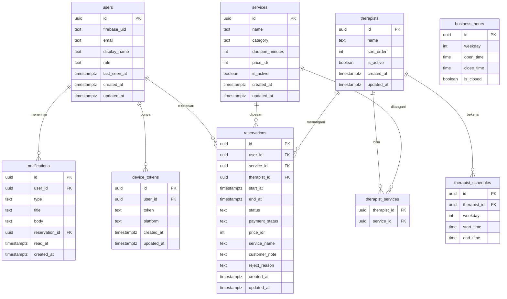

# Reservasi Massage & Spa

## 1. Context & Goal

Aplikasi reservasi untuk satu tempat massage/spa. Pelanggan melihat layanan (jenis pijat, durasi, harga), memilih terapis atau "terapis siapa saja", lalu memesan jadwal kosong. Admin mengatur layanan, terapis, dan jam kerja, lalu mengonfirmasi atau menolak reservasi. Masalah yang diselesaikan: pemesanan lewat chat/telepon yang berantakan dan sering bentrok jadwal.

Platform: Flutter untuk web, Android, dan iOS, dengan backend API terpisah. Pembayaran dilakukan di luar aplikasi; aplikasi hanya mencatat status pembayaran. Data diperbarui saat aplikasi dibuka atau di-refresh (tanpa offline/realtime).

Tujuan versi pertama: reservasi berjalan baik, tanpa bentrok jadwal (divalidasi di server), dengan alur konfirmasi admin, pembatalan/perubahan oleh pelanggan, notifikasi, serta ekspor/hapus data akun.

Keputusan kunci: reservasi berstatus `pending` (menunggu konfirmasi admin) saat dibuat (RV-05); terapis punya daftar layanan yang bisa ditangani (RV-06); "terapis siapa saja" dipilih server secara deterministik (RV-07).

Peran: `admin` dan `customer`. Terapis tidak punya akun.

## 2. Scope

### In scope

- F-01 Akun dan login (Firebase Auth, pengguna dibuat saat permintaan pertama).
- F-02 Peran admin/pelanggan; admin pertama lewat seed server (RV-04).
- F-03 Pengelolaan layanan (admin) dan daftar layanan (pelanggan).
- F-04 Pengelolaan terapis, relasi terapis-layanan, jam kerja tempat, jadwal kerja terapis.
- F-05 Pencarian slot kosong, termasuk "terapis siapa saja".
- F-06 Pemesanan dengan catatan khusus, riwayat reservasi pelanggan, snapshot harga.
- F-07 Pengelolaan reservasi oleh admin: daftar, konfirmasi, tolak (dengan alasan), status pembayaran.
- F-08 Pembatalan dan perubahan jadwal oleh pelanggan sampai batas jam tertentu.
- R-01 Notifikasi dalam aplikasi dan push (FCM), fase 4 (RV-01).
- R-03 Ekspor dan hapus data akun, fase 4 (RV-02).

Fase: 0 (F-01, F-02), 1 (F-03, F-04), 2 (F-05, F-06), 3 (F-07, F-08), 4 (R-01, R-03).

### Non-goals

- Pembayaran online di dalam aplikasi.
- Lebih dari satu tempat massage/spa.
- Mode offline dan pembaruan realtime.
- Notifikasi lewat email, WhatsApp, SMS, atau Telegram.
- Halaman promosi dan optimasi SEO.
- Pengingat reservasi terjadwal.
- Blokir jadwal manual oleh admin.
- Endpoint untuk mengangkat admin (hanya seed server).

## 3. Tech Constraints

- Monorepo pnpm: `apps/app` (Flutter web/Android/iOS), `apps/api` (Hono + TypeScript, Zod OpenAPI), `packages/contract` (OpenAPI + client Dart hasil generate).
- PostgreSQL + Drizzle + drizzle-kit; Firebase Auth (backend memverifikasi ID token); FCM lewat port `PushSender`; pg-boss tersedia tetapi tidak dipakai fitur produk ini.
- Testing: Vitest (API), flutter_test + bloc_test + mocktail (app); Firebase Auth Emulator lokal.
- Detail wajib diikuti dari `docs/conventions.md`: bagian Autentikasi, Format error, Pagination, Database, Clean Architecture API, Port push dan storage, Aturan bisnis: API vs client.
- Keputusan khusus produk ini:
  - Tenancy bukan organisasi: satu tempat; akses ditentukan kolom `users.role` (`admin`/`customer`, text + CHECK). Pemeriksaan peran di use case (`FORBIDDEN`). Resource milik pelanggan lain → `404` (D-07).
  - Admin pertama di-seed lewat skrip/konfigurasi server (env `ADMIN_EMAILS` atau skrip `seed-admin`), dijalankan manual per lingkungan (RV-04). Tidak ada endpoint pengangkatan admin.
  - Migrasi SQL kustom diperlukan untuk `CREATE EXTENSION btree_gist` dan exclusion constraint (Drizzle tidak bisa menuliskannya di skema) (RV2-01).
  - Adapter push: `PUSH_ADAPTER=fcm` produksi, `fake` untuk dev/test.

## 4. Data Model

Constraint dan aturan integritas penting:

- `users`: `users_firebase_uid_unique`; email lowercase (`users_email_lowercase_check`); `role` IN (`admin`,`customer`).
- `services`: `duration_minutes` > 0, `price_idr` ≥ 0 (CHECK); panjang `name` dibatasi CHECK `char_length`.
- `therapist_services`: PK `(therapist_id, service_id)`, FK ON DELETE CASCADE.
- `business_hours`: unik per `weekday` (0-6); `open_time` < `close_time`. `therapist_schedules`: `start_time` < `end_time`, tidak boleh di luar jam tempat (divalidasi di use case).
- `reservations.status` IN (`pending`,`confirmed`,`rejected`,`cancelled`); `payment_status` IN (`unpaid`,`paid`), default `unpaid`; `end_at` > `start_at`.
- Snapshot (RV2-02): `reservations.price_idr` (CHECK ≥ 0) dan `service_name` diisi dari layanan saat POST dan reschedule; riwayat dan ekspor memakai nilai ini.
- Anti-bentrok (RV2-01): migrasi SQL kustom `CREATE EXTENSION IF NOT EXISTS btree_gist` lalu exclusion constraint bernama `reservations_therapist_time_exclude` pada `(therapist_id WITH =, tstzrange(start_at, end_at) WITH &&) WHERE (status IN ('pending','confirmed'))`. Tes skema (`test/int/reservations/reservations-schema.int.test.ts`) memeriksa extension dan constraint ada. Pelanggaran (SQLSTATE `23P01`) dipetakan ke error domain → `409 CONFLICT`.
- `reservations.user_id` FK ke `users` ON DELETE CASCADE (penghapusan akun menghapus reservasi, lihat FR-10). Index pagination `(user_id, created_at DESC, id DESC)` dan `(created_at DESC, id DESC)` untuk daftar admin.
- `device_tokens`: unik `token`. `notifications`: index pagination `(user_id, created_at DESC, id DESC)`.
- Catatan `customer_note` hanya dikembalikan ke pemilik dan admin (RV-03); tidak ada di DTO lain.

## 5. API Contract

Semua route di bawah `/v1` memakai Bearer ID token (lihat conventions, bagian Autentikasi). Error mengikuti bagian Format error. Zod gagal → `422 VALIDATION_ERROR`. Semua error di tabel menyertakan `401 UNAUTHENTICATED`.

| Endpoint | Request | Response | Error | Akses |
| --- | --- | --- | --- | --- |
| GET /v1/me | - | `200` User `{id,email,displayName,role}` | 401 | Semua login |
| GET /v1/services | query `limit,cursor` | `200` ServicePage (hanya aktif untuk pelanggan; admin bisa `includeInactive=true`) | 401, 422 | Semua login |
| POST /v1/services | `{name,category,durationMinutes,priceIdr}` | `201` Service | 403, 422 | Admin |
| PATCH /v1/services/{id} | field opsional, min. satu; termasuk `isActive` | `200` Service | 403, 404, 422 | Admin |
| GET /v1/therapists | query `limit,cursor`, `serviceId` opsional | `200` TherapistPage (dengan `serviceIds`; hanya aktif untuk pelanggan) | 401, 422 | Semua login |
| POST /v1/therapists | `{name,sortOrder,serviceIds[]}` | `201` Therapist | 403, 422 | Admin |
| PATCH /v1/therapists/{id} | `{name?,sortOrder?,isActive?,serviceIds?}` min. satu | `200` Therapist | 403, 404, 422 | Admin |
| GET /v1/business-hours | - | `200` daftar 7 hari | 401 | Semua login |
| PUT /v1/business-hours | `{days:[{weekday,openTime,closeTime,isClosed}]}` | `200` daftar | 403, 422 | Admin |
| GET /v1/therapists/{id}/schedules | - | `200` daftar jadwal | 404 | Semua login |
| PUT /v1/therapists/{id}/schedules | `{items:[{weekday,startTime,endTime}]}` | `200` daftar | 403, 404, 422 | Admin |
| GET /v1/availability | query `serviceId`, `date` (YYYY-MM-DD), `therapistId` opsional | `200` `{slots:[{startAt,endAt,therapistIds[]}]}` | 404 (layanan/terapis), 422 | Semua login |
| POST /v1/reservations | `{serviceId,therapistId\|null,startAt,customerNote?}` | `201` Reservation (status `pending`, `therapistId` terisi) | 404, 409 (slot terambil), 422 (di luar slot/jam kerja/masa lalu) | Pelanggan |
| GET /v1/reservations | query `limit,cursor`, `status?` | `200` ReservationPage milik sendiri | 422 | Pelanggan |
| GET /v1/reservations/{id} | - | `200` Reservation | 404 | Pemilik, admin |
| GET /v1/admin/reservations | query `limit,cursor`, `status?`, `date?` | `200` ReservationPage semua pengguna | 403, 422 | Admin |
| POST /v1/reservations/{id}/confirm | - | `200` Reservation `confirmed` | 403, 404, 409 | Admin |
| POST /v1/reservations/{id}/reject | `{reason}` (1-200 karakter) | `200` Reservation `rejected` | 403, 404, 409, 422 | Admin |
| PATCH /v1/reservations/{id}/payment | `{paymentStatus}` | `200` Reservation | 403, 404, 409 (status `rejected`/`cancelled`), 422 | Admin |
| POST /v1/reservations/{id}/cancel | - | `200` Reservation `cancelled` | 404, 409 (status/lewat batas) | Pemilik |
| POST /v1/reservations/{id}/reschedule | `{startAt,therapistId\|null?}` | `200` Reservation `pending` | 404, 409 (status/batas/slot), 422 | Pemilik |
| POST /v1/device-tokens | `{token,platform}` | `204` (upsert) | 422 | Semua login |
| DELETE /v1/device-tokens/{token} | - | `204` | 404 | Pemilik token |
| GET /v1/notifications | query `limit,cursor` | `200` NotificationPage | 422 | Semua login (milik sendiri) |
| POST /v1/notifications/{id}/read | - | `200` Notification | 404 | Pemilik |
| GET /v1/me/export | - | `200` `{user,reservations[],notifications[]}` | 401 | Semua login |
| DELETE /v1/me | - | `204` | 409 (admin terakhir; reservasi aktif, lihat FR-10) | Semua login |

## 6. Functional Requirements

### FR-01: Akun dan login
Login lewat Firebase Auth; backend memverifikasi token dan membuat pengguna saat permintaan pertama (`syncUser`) dengan role `customer`.
Fitur: F-01
Acceptance criteria:
- [ ] Given token valid pengguna baru When GET /v1/me Then user dibuat dengan role `customer` dan dikembalikan.
- [ ] Given tanpa/ token tidak valid When akses `/v1/*` Then `401` sesuai konvensi.
- [ ] Given pengguna A When mengakses reservasi pengguna B Then `404`.
- [ ] Given route baru When tes `all-routes-require-auth` dijalankan Then lulus.
Edge cases:
- Email berbeda huruf besar-kecil disimpan lowercase.
- Token kedaluwarsa → `401 Invalid or expired token`.

### FR-02: Peran dan seed admin
Dua peran. Admin pertama ditetapkan lewat konfigurasi/skrip server (RV-04); tidak ada API pengangkatan.
Fitur: F-02
Acceptance criteria:
- [ ] Given email ada di seed admin When skrip dijalankan Then user ber-role `admin` (dibuat bila belum ada, idempoten).
- [ ] Given pelanggan When memanggil endpoint Akses Admin Then `403 FORBIDDEN`.
- [ ] Given pengguna mengirim `role` di body apa pun When request Then diabaikan/ditolak, role tidak berubah.
- [ ] Given tes otorisasi When dijalankan Then setiap endpoint admin ditolak untuk pelanggan.
Edge cases:
- Skrip dijalankan ulang tidak menduplikasi.
- Seed untuk email yang belum pernah login membuat baris dengan `firebase_uid` terisi saat login pertama (sinkronisasi berdasarkan email).

### FR-03: Pengelolaan layanan
Admin menambah, mengubah, dan menonaktifkan layanan; pelanggan melihat layanan aktif.
Fitur: F-03
Acceptance criteria:
- [ ] Given admin When POST /v1/services valid Then `201`.
- [ ] Given `durationMinutes` ≤ 0 atau `priceIdr` < 0 When POST Then `422`.
- [ ] Given layanan nonaktif When pelanggan GET /v1/services Then tidak muncul.
- [ ] Given layanan diubah harganya When reservasi lama dibaca Then harga snapshot tetap.
Edge cases:
- Menonaktifkan layanan tidak membatalkan reservasi yang ada.
- Nama dirapikan `trim`.

### FR-04: Terapis, relasi layanan, dan jam kerja
Admin mengelola terapis, daftar layanan yang bisa ditangani tiap terapis (RV-06), jam kerja tempat, dan jadwal kerja terapis.
Fitur: F-04
Acceptance criteria:
- [ ] Given admin When POST /v1/therapists dengan `serviceIds` valid Then relasi tersimpan.
- [ ] Given `serviceId` tidak ada When simpan Then `422`.
- [ ] Given jadwal terapis di luar jam tempat When PUT jadwal Then `422`.
- [ ] Given terapis nonaktif When pelanggan GET /v1/therapists Then tidak muncul.
- [ ] Given `serviceId` filter When GET /v1/therapists Then hanya terapis yang bisa menangani layanan itu.
Edge cases:
- Terapis tanpa layanan tidak pernah muncul di slot.
- Menonaktifkan terapis tidak membatalkan reservasi yang ada.

### FR-05: Pencarian slot kosong
Slot dihitung dari jam tempat, jadwal kerja terapis, durasi layanan, dan reservasi `pending`/`confirmed`. Slot bergranularitas 30 menit.
Fitur: F-05
Acceptance criteria:
- [ ] Given layanan dan tanggal When GET /v1/availability Then hanya slot yang muat penuh dalam jam tempat dan jadwal terapis.
- [ ] Given `therapistId` When dicari Then hanya slot terapis itu dan yang bisa menangani layanan.
- [ ] Given tanpa `therapistId` When dicari Then slot gabungan dengan `therapistIds` yang kosong.
- [ ] Given reservasi `rejected`/`cancelled` When dicari Then slotnya kosong kembali.
- [ ] Given waktu lampau When dicari Then tidak ada slot.
Edge cases:
- Hari libur tempat → `slots: []`.
- Zona waktu tempat disetel lewat env `PLACE_TIMEZONE` (default `Asia/Jakarta`).

### FR-06: Pemesanan dengan catatan dan riwayat
Pelanggan membuat reservasi `pending`, dengan catatan opsional (maks 500 karakter). Server memvalidasi ulang slot. Snapshot `price_idr` dan `service_name` diisi saat POST.
Fitur: F-06
Acceptance criteria:
- [ ] Given slot kosong When POST Then `201`, status `pending`, `paymentStatus` `unpaid`, harga snapshot terisi.
- [ ] Given `therapistId` null (RV-07) When POST Then server memilih terapis kosong pertama menurut `sort_order` lalu `id` yang bisa menangani layanan.
- [ ] Given slot sudah diambil (termasuk dua POST bersamaan) When POST Then tepat satu `201`, lainnya `409`.
- [ ] Given terapis tidak bisa layanan itu When POST Then `422`.
- [ ] Given `customerNote` When pemilik/admin membaca Then terlihat; pelanggan lain `404` (RV-03).
- [ ] Given riwayat When GET /v1/reservations Then hanya milik sendiri, terurut terbaru.
Edge cases:
- `startAt` tidak selaras slot 30 menit → `422`.
- Catatan hanya spasi disimpan sebagai kosong.

### FR-07: Pengelolaan reservasi oleh admin
Admin melihat semua reservasi (beserta catatan), mengonfirmasi, menolak dengan alasan (RV-08), dan menandai pembayaran. Slot dilepas saat `rejected` (keluar dari exclusion constraint). Setiap transisi berupa satu `UPDATE ... WHERE id=$1 AND status=<asal>` atomik (RV2-03).
Fitur: F-07
Acceptance criteria:
- [ ] Given `pending` When confirm Then `confirmed`.
- [ ] Given `pending` When reject dengan alasan Then `rejected`, alasan tersimpan, slot kosong kembali.
- [ ] Given status bukan `pending` When confirm/reject Then `409 CONFLICT`; id tidak ada → `404` (0 baris dibedakan lewat pengecekan lanjutan).
- [ ] Given `confirmed` atau `pending` When tandai pembayaran Then payment_status berubah; `rejected`/`cancelled` → `409`.
- [ ] Given confirm dan cancel bersamaan pada reservasi yang sama When keduanya jalan Then tepat satu berhasil, satunya `409` (tes konkurensi).
Edge cases:
- Alasan kosong/spasi → `422`.
- Confirm untuk reservasi yang `start_at`-nya sudah lewat tetap diizinkan.

### FR-08: Pembatalan dan perubahan jadwal
Pelanggan dapat membatalkan atau mengubah jadwal sampai batas `CANCEL_CUTOFF_HOURS` (default 24) sebelum `start_at`. Reschedule mengembalikan status ke `pending` dan memvalidasi ulang slot, serta menyegarkan snapshot harga dan nama (RV-05, RV2-02).
Fitur: F-08
Acceptance criteria:
- [ ] Given `pending`/`confirmed` dan sisa waktu ≥ batas When cancel Then `cancelled`.
- [ ] Given sisa waktu < batas When cancel/reschedule Then `409 CONFLICT`.
- [ ] Given `confirmed` When reschedule ke slot kosong Then `pending` dengan jadwal baru.
- [ ] Given slot baru terambil When reschedule Then `409` dan reservasi lama tidak berubah.
- [ ] Given status `rejected`/`cancelled` When cancel/reschedule Then `409`.
- [ ] Given pelanggan lain When mencoba Then `404`.
Edge cases:
- Reschedule ke slot yang bertumpuk dengan jadwal reservasi sendiri yang lama diizinkan.
- Update memuat syarat status dan batas waktu dalam satu `UPDATE` (RV2-03).

### FR-09: Notifikasi dalam aplikasi dan push
Notifikasi dibuat setelah transisi F-07/F-08 dan push dikirim lewat port `PushSender` (RV-01). Admin dinotifikasi saat reservasi baru, diubah, atau dibatalkan; pelanggan saat dikonfirmasi atau ditolak. Token perangkat didaftarkan lewat API.
Fitur: R-01
Acceptance criteria:
- [ ] Given confirm/reject When selesai Then notifikasi tersimpan untuk pelanggan dan push dikirim ke tokennya.
- [ ] Given pelanggan cancel/reschedule/buat reservasi When selesai Then semua admin menerima notifikasi.
- [ ] Given `PushSender` mengembalikan `invalid-token` When kirim Then token dihapus.
- [ ] Given push gagal (error lain) When kirim Then transisi reservasi tetap sukses dan error dicatat di log.
- [ ] Given GET /v1/notifications When dipanggil Then hanya milik sendiri; read menandai `read_at`.
- [ ] Given token sama didaftarkan ulang When POST Then upsert tanpa duplikat.
Edge cases:
- Pengguna tanpa token: hanya notifikasi dalam aplikasi.
- Isi push tidak memuat `customer_note`.

### FR-10: Ekspor dan hapus data akun
Pengguna mengekspor datanya dan menghapus akun (RV-02). Penghapusan menghapus baris `users` (cascade), token, notifikasi, serta akun Firebase.
Fitur: R-03
Acceptance criteria:
- [ ] Given pengguna When GET /v1/me/export Then berisi profil, reservasi (dengan snapshot harga dan catatan), dan notifikasi milik sendiri saja.
- [ ] Given pelanggan memiliki reservasi `pending`/`confirmed` mendatang When DELETE /v1/me Then `409 CONFLICT` dengan pesan agar membatalkan dulu.
- [ ] Given tanpa reservasi aktif When DELETE /v1/me Then data terhapus dan akun Firebase dihapus, `204`.
- [ ] Given admin terakhir When DELETE /v1/me Then `409` (RV2-04).
- [ ] Given dua admin terakhir menghapus bersamaan When keduanya jalan Then paling banyak satu berhasil; sistem tidak pernah tanpa admin (transaksi dengan `SELECT ... FOR UPDATE` pada baris admin sebelum menghitung; tes konkurensi).
- [ ] Given penghapusan Firebase gagal When DELETE Then data database tidak terhapus sebagian (urutan: hapus Firebase setelah commit; kegagalan dicatat dan dapat diulang).
Edge cases:
- Reservasi lampau/selesai ikut dihapus.
- Ekspor dibatasi ke pemanggil; tidak ada parameter id.

## 7. Non-Functional Requirements

- NFR-01 Keamanan: semua `/v1/*` wajib autentikasi; tes otorisasi mencakup setiap endpoint (pelanggan vs admin vs pemilik lain), 100% endpoint terdaftar diuji. `customer_note` hanya untuk pemilik dan admin (RV-03).
- NFR-02 Anti-bentrok: tidak ada dua reservasi `pending`/`confirmed` bertumpuk pada terapis sama, dijamin exclusion constraint (RV2-01); tes 20 POST bersamaan ke slot sama menghasilkan tepat satu `201`.
- NFR-03 Atomisitas transisi: setiap transisi status satu `UPDATE` bersyarat (RV2-03); tes konkurensi confirm vs cancel dan reject vs reschedule tanpa status ganda.
- NFR-04 Performa: GET /v1/availability p95 < 500 ms untuk 20 terapis dan satu hari; endpoint daftar p95 < 300 ms dengan pagination (limit maks 100).
- NFR-05 Konsistensi waktu: semua timestamp `timestamptz(3)` memakai jam database; jam tempat dihitung pada `PLACE_TIMEZONE`.
- NFR-06 Cakupan tes: use case API ≥ 80% baris; integration test untuk F-05 sampai F-08 dan FR-10; setiap Bloc/Cubit Flutter punya bloc_test.
- NFR-07 Privasi: log tidak memuat token, `customer_note`, atau isi push; ekspor/hapus akun selesai < 5 detik untuk 1.000 reservasi.
- NFR-08 Ketahanan push: kegagalan FCM tidak menggagalkan request utama; 0 transisi gagal akibat push dalam tes dengan adapter yang melempar error.
- NFR-09 Setup: README/skrip mencatat langkah manual per lingkungan (migrasi `btree_gist`, seed admin, `PUSH_ADAPTER`); tes memverifikasi adapter `fake` ditolak di produksi.

## 8. Assumptions & Decisions

Bagian ini disusun aplikasi dari keputusan dan jawaban yang tersimpan, bukan ditulis AI.

### Keputusan

- **RV-01** (dependency_order): Notifikasi dalam aplikasi dan push (R-01) sudah dipilih, tapi tidak ada fitur atau fase yang mengerjakannya. Padahal notifikasi bergantung pada alur konfirmasi, tolak, ubah, dan batal reservasi, plus pendaftaran token perangkat.
  - Diputuskan: Tambah fitur notifikasi di fase 4
  - Konsekuensi: Dependensi jelas (setelah F-07 dan F-08), tapi menambah satu fase kerja dan perlu setup FCM serta penyimpanan token perangkat.
- **RV-02** (dependency_order): Ekspor dan hapus data akun (R-03) sudah dipilih, tapi belum ditempatkan di fitur atau fase mana pun. Fitur ini bergantung pada data reservasi dan akun yang baru lengkap setelah fase 2-3, dan penghapusan harus menangani reservasi yang masih aktif.
  - Diputuskan: Tambah fitur ekspor dan hapus data di fase 4
  - Konsekuensi: Semua data yang diekspor atau dihapus sudah ada, dan aturan untuk reservasi aktif bisa ditentukan jelas. Akun Firebase juga perlu ikut dihapus.
- **RV-03** (security): Catatan khusus pelanggan (area sakit, alergi) adalah data kesehatan ringan, tapi belum ada aturan siapa yang boleh melihatnya. Admin melihat semua catatan, sedangkan terapis tidak punya akun. Tidak ada pembatasan atau perlindungan tambahan.
  - Diputuskan: Batasi catatan hanya untuk pemilik dan admin
  - Konsekuensi: Jelas dan mudah diuji lewat tes otorisasi. Terapis tidak melihat catatan di aplikasi.
- **RV-04** (security): Cara menetapkan admin pertama belum jelas. Karena pengguna dibuat otomatis saat permintaan pertama, tanpa mekanisme aman, admin bisa tidak ada, atau malah ada yang bisa mengaku admin.
  - Diputuskan: Seed admin lewat konfigurasi atau skrip di server
  - Konsekuensi: Aman dan sederhana, tapi butuh langkah manual saat setup tiap lingkungan.
- **RV-05** (consistency): Status reservasi belum didefinisikan dan dua pertanyaan kuncinya masih terbuka: apakah langsung terkonfirmasi atau menunggu admin, dan batas waktu batal/ubah. Padahal F-07 mengasumsikan konfirmasi admin dan F-08 butuh aturan batas waktu. Ubah jadwal setelah dikonfirmasi juga belum jelas apakah perlu konfirmasi ulang.
  - Diputuskan: Tetapkan: reservasi berstatus menunggu konfirmasi admin; batal/ubah sampai batas jam tertentu
  - Konsekuensi: Sesuai alur F-07 dan bisa diberi kriteria penerimaan. Perlu menentukan batas jam, dan ubah jadwal mengembalikan status ke menunggu.
- **RV-06** (consistency): Relasi terapis dan layanan belum diputuskan (pertanyaan terbuka), padahal F-04 dan F-05 sudah mengandalkannya untuk menghitung slot dan pilihan 'terapis siapa saja'.
  - Diputuskan: Tetapkan terapis punya daftar layanan yang bisa ditangani
  - Konsekuensi: Sesuai F-04, perhitungan slot akurat, tapi admin harus mengisi relasi tiap terapis.
- **RV-07** (testability): Perilaku 'terapis siapa saja' kabur: tidak jelas bagaimana terapis dipilih (urutan, acak, beban paling sedikit) dan apa yang terjadi bila beberapa terapis kosong di jam yang sama atau slot diambil bersamaan.
  - Diputuskan: Tetapkan aturan: server memilih terapis kosong pertama menurut urutan tetap saat pemesanan
  - Konsekuensi: Deterministik dan mudah diuji, termasuk tes pemesanan bersamaan.
- **RV-08** (scope_creep): F-07 menyertakan fitur menolak reservasi, dan F-06 menyertakan riwayat reservasi pelanggan. Keduanya tidak disebut jelas dalam jawaban user, dan penolakan butuh alasan serta pelepasan slot.
  - Diputuskan: Pertahankan, dengan definisi jelas
  - Konsekuensi: Alur konfirmasi lengkap dan pelanggan bisa melihat status, tapi perlu aturan slot dilepas saat ditolak.
- **RV2-01** (data_model): Anti-bentrok bergantung pada exclusion constraint `(therapist_id, tstzrange(start_at, end_at))`. Constraint ini butuh extension PostgreSQL `btree_gist` supaya kolom uuid bisa ikut dibandingkan dengan operator `=`. Drizzle juga tidak bisa menulis exclusion constraint di skema, jadi harus lewat migrasi SQL manual. PRD tidak menyebut dua hal ini, padahal NFR-02 bergantung penuh pada constraint tersebut.
  - Diputuskan: Tulis eksplisit di PRD
  - Konsekuensi: PRD menyebut `CREATE EXTENSION btree_gist` dan exclusion constraint lewat migrasi SQL kustom (WHERE status IN ('pending','confirmed')), plus tes skema yang memeriksa constraint-nya ada. Risiko tertinggal saat setup jadi kecil, dan tugas migrasi lebih jelas.
- **RV2-02** (data_model): Reservasi hanya menyimpan `service_id`, tanpa salinan harga atau nama layanan saat dipesan. Admin boleh mengubah `price_idr` dan `name` lewat PATCH /v1/services/{id}, jadi riwayat reservasi, ekspor data, dan pencatatan status pembayaran akan menampilkan harga baru, bukan harga saat pelanggan memesan.
  - Diputuskan: Tambah snapshot harga di reservations
  - Konsekuensi: Tambah kolom `price_idr` (CHECK ≥ 0) di `reservations`, diisi saat POST dan reschedule. Riwayat dan ekspor akurat, tapi ada satu kolom lagi dan aturan pengisiannya.
- **RV2-03** (business_rule): Transisi status (confirm, reject, cancel, reschedule, payment) hanya dijaga lewat kriteria '409 bila status bukan pending'. Tidak ada mekanisme atomik yang disebut. Cek status lalu update yang terpisah bisa lolos dua kali, misalnya admin confirm saat pelanggan cancel, atau reject saat reschedule. Akibatnya status bisa ditimpa dan slot tidak konsisten.
  - Diputuskan: Wajibkan update bersyarat atomik
  - Konsekuensi: PRD menetapkan setiap transisi berupa satu `UPDATE ... WHERE id=$1 AND status=<status asal>` (dan batas waktu untuk cancel/reschedule) di repository. 0 baris berarti 409 atau 404, dan ada tes konkurensi untuk pasangan confirm vs cancel. Ini sedikit menambah pekerjaan repository.
- **RV2-04** (business_rule): Aturan 'admin terakhir tidak boleh menghapus akun' hanya berupa pengecekan di use case. Bila dua admin menghapus akun bersamaan, keduanya bisa lolos cek dan sistem tersisa tanpa admin. Padahal tidak ada endpoint untuk mengangkat admin, hanya seed manual.
  - Diputuskan: Lindungi dengan transaksi dan kunci baris
  - Konsekuensi: Penghapusan akun admin berjalan dalam transaksi yang mengunci baris `users` ber-role admin (`SELECT ... FOR UPDATE`) sebelum menghitung jumlah admin. Aturan pasti terjaga, dan ada tes dua penghapusan bersamaan.

### Asumsi

- Pengguna utamanya adalah pelanggan tempat massage/spa dan admin tempat tersebut.
- Aksi pertama pelanggan adalah melihat daftar layanan lalu memilih layanan untuk dipesan.
- Admin bisa mengatur layanan, terapis, dan jam kerja, serta melihat dan mengonfirmasi reservasi yang masuk.
- Versi pertama melayani satu tempat massage/spa saja.
- Pembeda produk belum menjadi prioritas, fokus versi pertama adalah reservasi yang berjalan dengan baik.
- Data tiap pengguna dipisahkan dan diotorisasi per akun, dan hanya admin tempat yang bisa melihat semua reservasi.
- Versi pertama melayani satu tempat massage/spa saja.
- Ada dua peran: admin tempat dan pelanggan; hanya admin yang mengatur layanan, terapis, dan jam kerja.
- Ketersediaan jadwal dihitung dari jam kerja, durasi layanan, dan jadwal terapis, lalu divalidasi di server saat pemesanan.
- Aplikasi selalu online dan data diperbarui saat dibuka atau di-refresh, tanpa fitur offline atau realtime.

### Open Questions

- Apakah platform HP (Android dan iOS) dan web memang yang kamu butuhkan? Ini masih asumsi karena ide belum menyebutnya.
- Sampai kapan sebelum jadwal pelanggan boleh membatalkan atau mengubah reservasi?
- Apakah reservasi langsung terkonfirmasi atau harus menunggu konfirmasi admin dulu?
- Apakah satu terapis bisa menangani semua layanan, atau ada layanan yang hanya bisa dilakukan terapis tertentu?
- Apakah pelanggan perlu menemukan tempat ini lewat Google? Jika ya, perlu halaman promosi terpisah.
