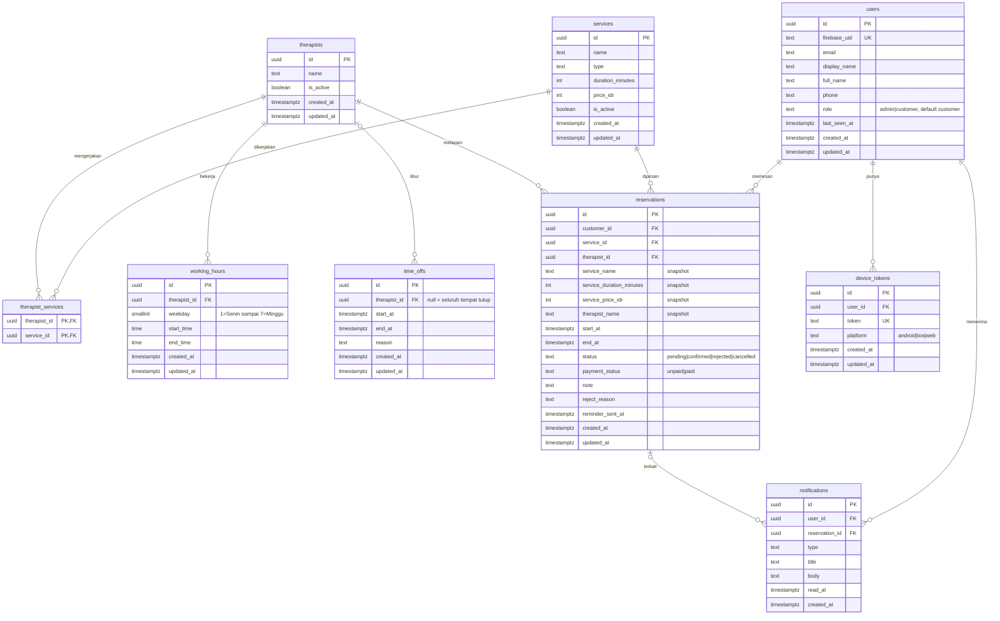

# Reservasi Massage & Spa

## 1. Context & Goal

Pemesanan jadwal di satu tempat massage atau spa masih manual, sehingga ketersediaan terapis sulit dilihat. Aplikasi ini memungkinkan pelanggan melihat layanan, memilih terapis, lalu memesan slot yang masih kosong dari satu alur. Admin mengelola layanan, terapis, dan jam kerja, lalu mengonfirmasi atau menolak reservasi yang masuk.

Tujuan versi pertama:
- Pelanggan dapat memesan tanpa bentrok jadwal. Validasi dilakukan di server dan di database.
- Admin dapat menyiapkan tempat dan memproses reservasi.
- Pelanggan dapat melihat riwayat, membatalkan, atau memindahkan jadwal sesuai aturan yang jelas.
- Semua pihak mendapat notifikasi dalam aplikasi dan push, termasuk pengingat reservasi otomatis.

Platform: Android, iOS, dan web dari satu codebase Flutter. SEO tidak penting karena semua konten ada di balik login. Aplikasi selalu online dan data diperbarui saat dibuka atau di-refresh. Pembayaran dilakukan di luar aplikasi; aplikasi hanya mencatat status pembayaran.

Peran: **admin** dan **pelanggan**. Aplikasi melayani satu tempat saja dan memakai satu zona waktu (default `Asia/Jakarta`).

Aturan default yang berlaku (RV-02, RV-03, RV-06, RV-07):
- Login memakai email dan kata sandi saja.
- Status menunggu langsung mengunci slot.
- Pembatalan dan pindah jadwal boleh dilakukan minimal 2 jam sebelum mulai, hanya untuk status menunggu atau dikonfirmasi.
- Tanpa jeda antar sesi.
- Pemesanan maksimal 30 hari ke depan.
- Terapis wajib dipilih.
- Satu reservasi berisi satu layanan dan satu terapis.

## 2. Scope

### In scope

Fase 0 (Fondasi)
- F-01 Akun dan login: daftar dan masuk dengan email dan kata sandi, keluar, profil dasar, isolasi data per akun.
- F-02 Peran admin dan pelanggan: admin pertama lewat seed (RV-05), pembatasan akses per peran.

Fase 1 (Pengelolaan tempat oleh admin)
- F-03 Pengelolaan layanan: tambah, ubah, hapus, aktif atau nonaktif.
- F-04 Pengelolaan terapis: data terapis dan layanan yang dikerjakan.
- F-05 Pengaturan jam kerja: jam kerja mingguan per terapis dan hari libur atau tidak tersedia.

Fase 2 (Alur pemesanan pelanggan)
- F-06 Daftar layanan untuk pelanggan.
- F-07 Pemilihan terapis dan jadwal kosong.
- F-08 Pemesanan reservasi dengan status awal menunggu dan pencatatan status pembayaran.

Fase 3 (Konfirmasi dan riwayat)
- F-09 Konfirmasi atau penolakan reservasi oleh admin, termasuk menandai status pembayaran.
- F-10 Riwayat reservasi pelanggan.

Fase 4 (Perubahan reservasi dan notifikasi)
- F-11 Pembatalan dan penjadwalan ulang oleh pelanggan.
- F-12 Notifikasi dalam aplikasi dan push.
- F-13 Pengingat reservasi otomatis (rekomendasi R-01 yang diterima, RV-01). Fitur terpisah dengan `depends_on` F-12.

Catatan jeda fase (RV-04): admin tidak mendapat pemberitahuan reservasi baru pada fase 2 dan 3. Admin harus membuka daftar reservasi di F-09 untuk melihatnya, sampai F-12 selesai di fase 4.

### Non-goals

- Pembayaran online di dalam aplikasi (hanya status pembayaran yang dicatat).
- Banyak tempat massage atau spa dalam satu aplikasi.
- Notifikasi lewat email, WhatsApp, SMS, atau Telegram.
- Optimasi SEO untuk halaman layanan.
- Mode offline.
- Banyak zona waktu.
- Ulasan dan rating terapis.
- Kalender reservasi untuk admin.
- Foto layanan dan profil terapis.
- Laporan sederhana untuk admin.
- Login dengan Google atau nomor HP.
- Pemesanan tanpa memilih terapis, banyak layanan atau banyak terapis dalam satu reservasi, dan jeda antar sesi.
- Kedaluwarsa otomatis reservasi berstatus menunggu.
- Endpoint atau layar untuk mengangkat admin baru.

## 3. Tech Constraints

- Monorepo pnpm: `apps/app` (Flutter web, Android, iOS), `apps/api` (Hono + TypeScript, Zod OpenAPI), `packages/contract` (OpenAPI + client Dart hasil generate).
- PostgreSQL + Drizzle + drizzle-kit, lokal lewat Docker Compose. Auth memakai Firebase Auth (email dan kata sandi) dengan Auth Emulator lokal. Push memakai FCM lewat port `PushSender`. Job terjadwal memakai pg-boss. Tidak ada Cloud Storage karena tidak ada upload file.
- Testing: Vitest (API), flutter_test + bloc_test + mocktail (app).
- Semua detail (struktur repo, format error, autentikasi, pagination, database, job, port push, Clean Architecture, aturan bisnis API vs client) mengikuti `docs/conventions.md`. Konvensi itu menang bila bertentangan dengan ringkasan ini.

Keputusan khusus produk ini:
- Peran disimpan di `users.role` (PostgreSQL), bukan di token. Pemeriksaan peran ada di use case lewat helper `assertAdmin(user)` (lihat docs/conventions.md bagian Organisasi dan tenancy untuk pola 403 di use case). Semua route admin berada di bawah `/v1/admin/*`.
- Kode error baru ditambahkan ke `error-codes.ts` (lalu `pnpm contract:generate` dan dipetakan di `failureCodeOf` serta `failure_messages.dart`; lihat docs/conventions.md bagian Format error):
  - `SLOT_UNAVAILABLE` (409)
  - `RESERVATION_STATE_INVALID` (409)
  - `CHANGE_WINDOW_CLOSED` (409)
- Konfigurasi aturan bisnis lewat env API, dengan default berikut. Nilainya bisa diubah tanpa mengubah kode:

| Env | Default | Arti |
| --- | --- | --- |
| `BUSINESS_TIMEZONE` | `Asia/Jakarta` | Zona waktu semua jadwal dan jam kerja. Flutter memakai nilai yang sama lewat dart-define untuk menampilkan waktu. |
| `SLOT_STEP_MINUTES` | `30` | Kelipatan menit awal slot sejak jam mulai kerja. |
| `BOOKING_MAX_DAYS_AHEAD` | `30` | Batas pemesanan ke depan (RV-06). |
| `CHANGE_MIN_LEAD_MINUTES` | `120` | Batas minimal sebelum mulai untuk batal atau pindah jadwal (RV-02). |
| `REMINDER_LEAD_MINUTES` | `180` | Pengingat dikirim saat sisa waktu ke mulai sesi sudah sama atau kurang dari nilai ini. |

- Job pengingat ada di `features/reservations/jobs/` dan berjalan hanya bila `RUN_WORKER=true`.
- Admin pertama dibuat lewat skrip server `pnpm --filter api seed:admin -- --email <email>` (RV-05). Skrip mengubah `role` user yang sudah pernah login menjadi `admin`, dan gagal dengan pesan jelas bila email belum terdaftar.

## 4. Data Model

Constraint dan aturan integritas penting (nama mengikuti docs/conventions.md bagian Database):
- **users**
  - `users_firebase_uid_unique`.
  - `users_email_lowercase_check`.
  - `users_role_check` (`admin`/`customer`).
  - `users_phone_format_check` (`^\+?[0-9]{8,15}$` bila tidak null).
  - `users_full_name_length_check` (maks 100).
  - `role` tidak pernah ditulis oleh `syncUser`, yang hanya mengisi email, display_name, dan last_seen_at. Pendaftar baru otomatis `customer` (RV-05).
- **services**
  - `services_name_lower_unique` (unique `lower(name)`).
  - Check panjang `name` (1–100) dan `type` (1–50).
  - `services_duration_minutes_check` (15–480, kelipatan 15).
  - `services_price_idr_check` (≥ 0).
- **therapists**
  - Check panjang `name` (1–100).
  - `therapist_services` memakai primary key komposit, FK ke keduanya `ON DELETE CASCADE`.
- **working_hours**
  - `working_hours_therapist_id_weekday_unique` (satu rentang per hari per terapis).
  - `working_hours_weekday_check` (1–7).
  - `working_hours_range_check` (`end_time > start_time`).
- **time_offs**
  - `time_offs_range_check` (`end_at > start_at`).
  - `time_offs_reason_length_check` (maks 200).
  - Index `(therapist_id, start_at)`.
- **reservations**
  - **Anti bentrok:** `reservations_therapist_no_overlap_exclude`. Ini exclusion constraint (`btree_gist`) pada `therapist_id WITH =` dan `tstzrange(start_at, end_at) WITH &&`, hanya untuk baris berstatus `pending` atau `confirmed` (RV-03). Constraint ini ditulis sebagai SQL kustom di migrasi karena Drizzle tidak mendukungnya. Pelanggaran (SQLSTATE `23P01`) ditangkap repository sebagai error domain dan menjadi `409 SLOT_UNAVAILABLE`. Status `rejected` dan `cancelled` melepas slot.
  - **Check:**
    - `reservations_status_check`.
    - `reservations_payment_status_check`.
    - `reservations_end_after_start_check`.
    - `reservations_note_length_check` (`char_length(note) <= 500`, RV2-05).
    - `reservations_reject_reason_length_check` (`char_length(reject_reason) <= 300`, RV2-04).
  - **FK:** `reservations_customer_id_fk` `ON DELETE CASCADE`; `reservations_service_id_fk` dan `reservations_therapist_id_fk` `ON DELETE RESTRICT`, sehingga layanan atau terapis yang pernah dipesan tidak bisa dihapus.
  - **Index:**
    - `reservations_customer_id_created_at_id_index` (pagination riwayat).
    - `reservations_status_created_at_id_index` (daftar admin).
    - `reservations_status_start_at_index` (job pengingat).
- **notifications**
  - FK `user_id` `ON DELETE CASCADE`; `reservation_id` `ON DELETE SET NULL`.
  - Index pagination `(user_id, created_at DESC, id DESC)`.
  - `notifications_type_check`.
- **device_tokens**
  - `device_tokens_token_unique`; token yang sama berpindah pemilik lewat upsert.
- Migrasi memuat `CREATE EXTENSION IF NOT EXISTS btree_gist`. Semua timestamp memakai helper `schema/columns.ts`.

## 5. API Contract

Semua endpoint berada di bawah `/v1/*` dan memerlukan `Authorization: Bearer <ID token>`. Karena itu semua endpoint juga dapat mengembalikan `401 UNAUTHENTICATED` dan `500 INTERNAL_ERROR`; kedua kode itu tidak diulang di tabel. Endpoint `/v1/admin/*` dapat mengembalikan `403 FORBIDDEN` untuk non-admin; kode itu juga tidak diulang. Semua id path divalidasi `z.uuid()` (→ `422 VALIDATION_ERROR`). Resource milik pelanggan lain dijawab `404 NOT_FOUND`. List memakai pagination kursor `limit` dan `cursor` (`{ items, nextCursor }`, lihat docs/conventions.md bagian Pagination). Semua `startAt` dan `endAt` berupa ISO 8601 UTC.

Skema respons bersama (RV2-01):
- **Reservation**: `id`, `status`, `paymentStatus`, `serviceId`, `serviceName`, `serviceDurationMinutes`, `servicePriceIdr`, `therapistId`, `therapistName`, `startAt`, `endAt`, `note|null`, `rejectReason|null`, `changeableUntil|null`, `createdAt`, `updatedAt`.
  - `changeableUntil` adalah `startAt` dikurangi `CHANGE_MIN_LEAD_MINUTES`; `null` bila status bukan `pending` atau `confirmed`.
  - Nilai layanan dan terapis diambil dari snapshot di baris reservasi.
- **AdminReservation**: semua field Reservation ditambah `customerId`, `customerName`, `customerPhone|null`.
  - `customerName` diambil dari `full_name`, lalu `display_name`, lalu email.
- **Notification**: `id`, `type`, `title`, `body`, `reservationId|null`, `readAt|null`, `createdAt`.
- Halaman: `ReservationPage`, `AdminReservationPage`, `NotificationPage`, `ServicePage`, `TherapistPage`.

| Endpoint | Request | Response | Error | Akses |
| --- | --- | --- | --- | --- |
| GET /v1/me | - | `User` `{ id, email, displayName, fullName, phone, role }` | - | Semua peran |
| PATCH /v1/me | Body strict `{ fullName?, phone? }`, minimal satu field. `fullName` trim 1–100; `phone` sesuai format atau `null` untuk menghapus. | `User` | 422 VALIDATION_ERROR (termasuk field `role` atau field tak dikenal) | Semua peran |
| GET /v1/services | query `limit`, `cursor` | `ServicePage` (hanya layanan aktif; item `{ id, name, type, durationMinutes, priceIdr }`) | 422 | Semua peran |
| GET /v1/services/{serviceId} | - | `Service` (aktif) | 404 NOT_FOUND (tidak ada atau nonaktif), 422 | Semua peran |
| GET /v1/services/{serviceId}/therapists | query `limit`, `cursor` | `TherapistPage` (terapis aktif yang mengerjakan layanan; item `{ id, name }`) | 404 NOT_FOUND (layanan tidak ada atau nonaktif), 422 | Semua peran |
| GET /v1/therapists/{therapistId}/slots | query `serviceId` (wajib), `date` (`YYYY-MM-DD`, tanggal lokal tempat) | `SlotList` `{ items: [{ startAt, endAt }] }`, urut naik | 404 NOT_FOUND (terapis atau layanan tidak ada atau nonaktif), 409 CONFLICT (terapis tidak mengerjakan layanan), 422 | Semua peran |
| POST /v1/reservations | Body `{ serviceId, therapistId, startAt, note? }`; `note` trim maks 500 | 201 `Reservation` (status `pending`, `paymentStatus` `unpaid`) | 404 NOT_FOUND (layanan atau terapis tidak ada atau nonaktif), 409 CONFLICT (terapis tidak mengerjakan layanan), 409 SLOT_UNAVAILABLE, 422 | Semua peran (untuk dirinya sendiri) |
| GET /v1/reservations | query `limit`, `cursor`, `period?` (`upcoming`/`past`/`all`, default `all`), `status?` | `ReservationPage` (hanya milik pemanggil, `created_at DESC`) | 422 | Semua peran, selalu hanya milik sendiri (admin memakai endpoint admin) |
| GET /v1/reservations/{reservationId} | - | `Reservation` | 404 NOT_FOUND (bukan milik pemanggil, termasuk admin), 422 | Pemilik reservasi |
| POST /v1/reservations/{reservationId}/cancel | tanpa body | `Reservation` (status `cancelled`) | 404 NOT_FOUND, 409 RESERVATION_STATE_INVALID, 409 CHANGE_WINDOW_CLOSED, 422 | Pemilik reservasi |
| POST /v1/reservations/{reservationId}/reschedule | Body `{ startAt }` | `Reservation` (jadwal baru; terapis dan layanan tetap) | 404 NOT_FOUND, 409 RESERVATION_STATE_INVALID, 409 CHANGE_WINDOW_CLOSED, 409 SLOT_UNAVAILABLE, 422 | Pemilik reservasi |
| GET /v1/admin/services | query `limit`, `cursor` | `ServicePage` (aktif dan nonaktif; item memuat `isActive`) | 422 | Admin |
| POST /v1/admin/services | Body `{ name, type, durationMinutes, priceIdr, isActive? }` | 201 `Service` | 409 CONFLICT (nama sudah ada, tanpa membedakan huruf besar-kecil), 422 | Admin |
| PATCH /v1/admin/services/{serviceId} | Body parsial, minimal satu field dari POST | `Service` | 404 NOT_FOUND, 409 CONFLICT, 422 | Admin |
| DELETE /v1/admin/services/{serviceId} | - | 204 | 404 NOT_FOUND, 409 CONFLICT (sudah punya reservasi; sarankan menonaktifkan), 422 | Admin |
| GET /v1/admin/therapists | query `limit`, `cursor` | `TherapistPage` (item `{ id, name, isActive, serviceIds }`) | 422 | Admin |
| POST /v1/admin/therapists | Body `{ name, isActive?, serviceIds }` | 201 `Therapist` | 404 NOT_FOUND (ada serviceId tidak dikenal), 422 | Admin |
| PATCH /v1/admin/therapists/{therapistId} | Body parsial `{ name?, isActive?, serviceIds? }`, minimal satu field | `Therapist` | 404 NOT_FOUND, 422 | Admin |
| DELETE /v1/admin/therapists/{therapistId} | - | 204 | 404 NOT_FOUND, 409 CONFLICT (sudah punya reservasi), 422 | Admin |
| GET /v1/admin/therapists/{therapistId}/working-hours | - | `{ items: [{ weekday, startTime, endTime }] }` | 404 NOT_FOUND, 422 | Admin |
| PUT /v1/admin/therapists/{therapistId}/working-hours | Body `{ items: [{ weekday 1–7, startTime "HH:mm", endTime "HH:mm" }] }`, maks satu item per hari; mengganti seluruh set | `{ items }` | 404 NOT_FOUND, 422 (hari ganda, `endTime <= startTime`, format salah) | Admin |
| GET /v1/admin/time-offs | query `limit`, `cursor`, `therapistId?` | `TimeOffPage` (item `{ id, therapistId|null, startAt, endAt, reason|null }`) | 422 | Admin |
| POST /v1/admin/time-offs | Body `{ therapistId?, startAt, endAt, reason? }`; tanpa `therapistId` berarti seluruh tempat tutup; `reason` maks 200 | 201 `TimeOff` | 404 NOT_FOUND (terapis tidak ada), 422 | Admin |
| DELETE /v1/admin/time-offs/{timeOffId} | - | 204 | 404 NOT_FOUND, 422 | Admin |
| GET /v1/admin/reservations | query `limit`, `cursor`, `status?`, `period?`, `paymentStatus?` | `AdminReservationPage` (`created_at DESC`) | 422 | Admin |
| GET /v1/admin/reservations/{reservationId} | - | `AdminReservation` | 404 NOT_FOUND, 422 | Admin |
| POST /v1/admin/reservations/{reservationId}/confirm | tanpa body | `AdminReservation` (status `confirmed`) | 404 NOT_FOUND, 409 RESERVATION_STATE_INVALID, 422 | Admin |
| POST /v1/admin/reservations/{reservationId}/reject | Body `{ reason? }`, trim maks 300; string kosong disimpan `null` | `AdminReservation` (status `rejected`, `rejectReason`) | 404 NOT_FOUND, 409 RESERVATION_STATE_INVALID, 422 | Admin |
| PATCH /v1/admin/reservations/{reservationId}/payment | Body `{ paymentStatus }` (`unpaid`/`paid`) | `AdminReservation` | 404 NOT_FOUND, 409 RESERVATION_STATE_INVALID (status bukan menunggu atau dikonfirmasi), 422 | Admin |
| GET /v1/notifications | query `limit`, `cursor`, `unreadOnly?` | `NotificationPage` (milik pemanggil) | 422 | Semua peran |
| POST /v1/notifications/{notificationId}/read | tanpa body | `Notification` (`readAt` terisi, idempoten) | 404 NOT_FOUND, 422 | Pemilik notifikasi |
| POST /v1/notifications/read-all | tanpa body | `ReadAllNotificationsResult` `{ updatedCount }` (200 walau 0) | - | Semua peran |
| PUT /v1/device-tokens | Body `{ token, platform }` (`android`/`ios`/`web`) | 204 (upsert; token berpindah ke pemanggil) | 422 | Semua peran |
| POST /v1/device-tokens/unregister | Body `{ token }` | 204 (idempoten, hanya menghapus token milik pemanggil) | 422 | Semua peran |

## 6. Functional Requirements

### FR-01: Akun dan login
Pengguna mendaftar dan masuk dengan email dan kata sandi lewat Firebase Auth (RV-07). Backend membuat baris `users` saat request pertama (`syncUser`). Profil dasar berisi nama lengkap dan nomor kontak. Setelah mendaftar, client memanggil `PATCH /v1/me` untuk mengisi nama dan nomor.

Fitur: F-01

Acceptance criteria:
- [ ] Given email belum terdaftar When pengguna mendaftar dengan email valid dan kata sandi minimal 6 karakter Then akun Firebase dibuat, `GET /v1/me` membuat baris `users` dengan `role` `customer`, dan layar profil awal tampil.
- [ ] Given akun terdaftar When pengguna masuk dengan kredensial benar Then ia masuk ke beranda sesuai peran; bila salah, pesan kegagalan ditampilkan tanpa membedakan email atau kata sandi yang keliru.
- [ ] Given pengguna masuk When memilih keluar Then sesi Firebase berakhir, token perangkat dilepas lewat `POST /v1/device-tokens/unregister`, dan layar login tampil.
- [ ] Given pengguna masuk When memanggil `PATCH /v1/me` dengan `fullName` dan `phone` valid Then `GET /v1/me` mengembalikan nilai baru dan `displayName` dari token tidak berubah.
- [ ] Given pelanggan A dan B When A memanggil endpoint reservasi atau notifikasi Then data B tidak pernah muncul dan akses langsung ke id B mengembalikan 404.
- [ ] Given tidak ada header Authorization When memanggil endpoint `/v1/*` Then respons 401 UNAUTHENTICATED.

Edge cases:
- `phone` berisi huruf atau kurang dari 8 digit → 422 dengan `details.phone`.
- Email yang sama dengan beda huruf besar-kecil tetap satu akun (email disimpan lowercase).
- Token kedaluwarsa saat aplikasi terbuka → client diarahkan ke layar login.

### FR-02: Peran admin dan pelanggan
Dua peran disimpan di `users.role`. Admin pertama ditetapkan lewat skrip seed di server (RV-05), tanpa endpoint terbuka. Semua pendaftar baru otomatis pelanggan. Route admin dan layar admin dibatasi untuk admin.

Fitur: F-02

Acceptance criteria:
- [ ] Given pendaftar baru When pertama kali memanggil `GET /v1/me` Then `role` bernilai `customer`.
- [ ] Given user sudah login satu kali When `pnpm --filter api seed:admin -- --email <email>` dijalankan Then `role` menjadi `admin` dan `GET /v1/me` berikutnya mengembalikan `admin`.
- [ ] Given email belum pernah login When skrip seed dijalankan Then skrip keluar dengan kode non-nol dan pesan jelas, tanpa mengubah data.
- [ ] Given pelanggan When memanggil endpoint mana pun di `/v1/admin/*` Then 403 FORBIDDEN, dan integration test mencakup seluruh route admin.
- [ ] Given `PATCH /v1/me` dengan field `role` When dipanggil siapa pun Then 422 dan peran tidak berubah.
- [ ] Given Flutter dibuka When peran admin Then go_router menampilkan menu admin; peran pelanggan tidak bisa membuka rute admin (redirect ke beranda).

Edge cases:
- Skrip seed dijalankan dua kali untuk email yang sama → idempoten.
- Admin juga boleh memesan sebagai pelanggan; riwayatnya hanya di `GET /v1/reservations`.
- Perubahan peran berlaku di request berikutnya karena peran dibaca dari database, bukan token.

### FR-03: Pengelolaan layanan
Admin menambah, mengubah, menghapus, serta mengaktifkan atau menonaktifkan layanan (nama, jenis pijat, durasi, harga). Form edit diisi dari item di `GET /v1/admin/services` (RV2-02), tanpa endpoint detail admin. Layar edit dibuka dari daftar admin dan tidak mendukung deep link mandiri.

Fitur: F-03

Acceptance criteria:
- [ ] Given admin When membuat layanan dengan data valid Then 201 dan layanan muncul di daftar admin.
- [ ] Given layanan bernama "Pijat Refleksi" When admin membuat atau mengubah layanan lain bernama "pijat refleksi" Then 409 CONFLICT dan `409` ditampilkan sebagai pesan nama sudah dipakai.
- [ ] Given durasi bukan kelipatan 15 atau di luar 15–480, atau harga negatif When disimpan Then 422 dengan `details` per field.
- [ ] Given layanan nonaktif When admin membuka daftar admin dan mengubah `isActive` menjadi true Then layanan aktif kembali dan form terisi dari item daftar.
- [ ] Given layanan sudah punya reservasi When admin menghapusnya Then 409 CONFLICT; tanpa reservasi → 204.
- [ ] Given layanan dinonaktifkan When reservasi lama ada Then reservasi lama tidak berubah dan layanan tidak tampil bagi pelanggan.

Edge cases:
- Mengubah harga atau durasi tidak mengubah snapshot reservasi yang sudah ada.
- Pembuatan nama yang sama secara bersamaan → satu berhasil, satu 409 (unique index).
- Daftar kosong menampilkan keadaan kosong dengan ajakan menambah layanan.

### FR-04: Pengelolaan terapis
Admin menambah, mengubah, menghapus, dan mengaktif-nonaktifkan terapis, serta menentukan layanan yang dikerjakan setiap terapis.

Fitur: F-04

Acceptance criteria:
- [ ] Given admin When membuat terapis dengan `serviceIds` valid Then 201 dan `therapist_services` terisi sesuai daftar.
- [ ] Given `serviceIds` memuat id yang tidak ada When disimpan Then 404 NOT_FOUND dan tidak ada data tersimpan (transaksi).
- [ ] Given terapis ada When admin mengubah `serviceIds` Then set layanan diganti seluruhnya dalam satu transaksi.
- [ ] Given terapis nonaktif When pelanggan memanggil `GET /v1/services/{serviceId}/therapists` Then terapis itu tidak muncul.
- [ ] Given terapis sudah punya reservasi When dihapus Then 409 CONFLICT; tanpa reservasi → 204 beserta jam kerja dan libur terkait.
- [ ] Given terapis tanpa layanan When disimpan Then diizinkan (`serviceIds` boleh kosong) tetapi tidak muncul untuk layanan mana pun.

Edge cases:
- Menonaktifkan terapis tidak membatalkan reservasi yang sudah ada.
- Nama terapis yang sama boleh ada (tidak unik).
- Layanan dinonaktifkan tetap tersimpan di `serviceIds` terapis.

### FR-05: Pengaturan jam kerja
Admin mengatur jam kerja mingguan per terapis (satu rentang per hari) dan periode libur atau tidak tersedia (per terapis atau seluruh tempat). Jam kerja ditafsirkan di `BUSINESS_TIMEZONE`.

Fitur: F-05

Acceptance criteria:
- [ ] Given admin When `PUT .../working-hours` dengan set valid Then seluruh set lama diganti dan `GET` mengembalikan set baru.
- [ ] Given dua item untuk hari yang sama atau `endTime <= startTime` When disimpan Then 422 dan set lama tidak berubah.
- [ ] Given `PUT` dengan `items` kosong When disimpan Then terapis tidak punya jam kerja dan tidak punya slot kosong.
- [ ] Given admin When membuat time-off dengan `therapistId` Then hanya terapis itu tidak tersedia pada rentang tersebut; tanpa `therapistId` seluruh tempat tutup.
- [ ] Given `endAt <= startAt` atau `reason` lebih dari 200 karakter When disimpan Then 422.
- [ ] Given time-off dihapus When slot dihitung ulang Then slot pada rentang itu kembali tersedia.

Edge cases:
- Time-off yang tumpang tindih dengan reservasi yang sudah ada tidak membatalkan reservasi itu; admin menanganinya manual.
- Jam kerja yang diubah tidak memengaruhi reservasi yang sudah ada.
- Time-off lintas hari didukung.

### FR-06: Daftar layanan untuk pelanggan
Pelanggan melihat daftar layanan aktif dengan jenis, durasi, dan harga, serta detail layanan. Harga ditampilkan dalam Rupiah.

Fitur: F-06

Acceptance criteria:
- [ ] Given layanan aktif dan nonaktif When pelanggan memanggil `GET /v1/services` Then hanya yang aktif muncul.
- [ ] Given layanan aktif When pelanggan membuka detail Then nama, jenis, durasi (menit), dan harga tampil, dan ada tombol "Pilih terapis".
- [ ] Given layanan nonaktif When dibuka lewat `GET /v1/services/{serviceId}` Then 404 NOT_FOUND.
- [ ] Given belum ada layanan aktif When daftar dibuka Then tampil keadaan kosong, bukan error.

Edge cases:
- Layanan dinonaktifkan saat pelanggan melihat detail → langkah berikutnya mendapat 404 dan layar menampilkan pesan layanan tidak tersedia.
- Daftar lebih dari 20 layanan dimuat bertahap lewat `nextCursor`.
- Harga 0 ditampilkan "Gratis".

### FR-07: Pemilihan terapis dan jadwal kosong
Pelanggan memilih layanan, memilih terapis (wajib), lalu melihat slot kosong per tanggal. Slot dihitung server dari jam kerja, time-off, dan reservasi berstatus menunggu atau dikonfirmasi milik terapis itu (RV-03, RV-06).

Fitur: F-07

Acceptance criteria:
- [ ] Given terapis bekerja 09:00–17:00 dan layanan 60 menit When slot untuk hari itu diminta Then slot dimulai tiap 30 menit dari 09:00 sampai 16:00 (slot terakhir selesai tepat 17:00), tanpa jeda antar sesi.
- [ ] Given reservasi `pending` atau `confirmed` terapis itu pukul 10:00–11:00 When slot diminta Then slot yang tumpang tindih tidak muncul; reservasi `rejected` atau `cancelled` tidak memblokir.
- [ ] Given time-off terapis atau seluruh tempat yang menutupi sebagian hari When slot diminta Then slot yang tumpang tindih tidak muncul.
- [ ] Given slot di masa lalu atau lebih dari 30 hari dari sekarang When slot diminta Then tidak muncul; tanggal di luar rentang menghasilkan `items` kosong dengan status 200.
- [ ] Given terapis tidak mengerjakan layanan When slot diminta Then 409 CONFLICT.
- [ ] Given pelanggan di UI When memilih layanan Then hanya terapis aktif yang mengerjakannya yang ditampilkan, dan terapis harus dipilih sebelum tanggal dan slot muncul.

Edge cases:
- Hari tanpa jam kerja → `items` kosong dan UI menampilkan "Tidak ada jadwal".
- Slot yang ditampilkan bisa diambil orang lain sebelum dipesan; ditangani di FR-08.
- Durasi layanan lebih panjang dari rentang kerja → `items` kosong.

### FR-08: Pemesanan reservasi
Pelanggan memesan slot terpilih. Reservasi berstatus `pending` dan langsung mengunci slot (RV-03). Server memvalidasi ulang slot dan database menjaga bentrok. Status pembayaran awal `unpaid`; pembayaran dilakukan di luar aplikasi.

Fitur: F-08

Acceptance criteria:
- [ ] Given slot valid dan kosong When `POST /v1/reservations` Then 201, status `pending`, `paymentStatus` `unpaid`, `endAt = startAt + durasi`, dan snapshot nama, durasi, harga layanan serta nama terapis tersimpan.
- [ ] Given `startAt` bukan slot yang akan dihitung FR-07 (di luar jam kerja, tidak sejajar langkah 30 menit, di masa lalu, lebih dari 30 hari, atau pada time-off) When dipesan Then 409 SLOT_UNAVAILABLE.
- [ ] Given dua pelanggan memesan terapis dan jam tumpang tindih secara bersamaan When kedua request diproses Then tepat satu 201 dan satu 409 SLOT_UNAVAILABLE (dijaga exclusion constraint), dibuktikan test konkurensi dengan banyak request paralel.
- [ ] Given layanan atau terapis nonaktif atau tidak ada When dipesan Then 404 NOT_FOUND; terapis tidak mengerjakan layanan → 409 CONFLICT.
- [ ] Given `note` lebih dari 500 karakter When dipesan Then 422 `details.note`.
- [ ] Given reservasi berhasil When selesai Then UI menampilkan ringkasan dan status "Menunggu konfirmasi".

Edge cases:
- Pelanggan boleh punya beberapa reservasi pada waktu yang sama dengan terapis berbeda.
- Slot tertahan oleh reservasi `pending` sampai admin menanggapi; tidak ada kedaluwarsa otomatis (RV-03).
- Perubahan harga setelah pemesanan tidak mengubah `servicePriceIdr`.

### FR-09: Konfirmasi reservasi oleh admin
Admin melihat daftar reservasi masuk dan detailnya (termasuk nama dan kontak pelanggan), lalu mengonfirmasi atau menolak (dengan alasan opsional), dan menandai status pembayaran. Pada fase 2 dan 3, daftar ini satu-satunya cara admin mengetahui reservasi baru (RV-04).

Fitur: F-09

Acceptance criteria:
- [ ] Given reservasi `pending` dengan `startAt` di masa depan When admin confirm Then status `confirmed` dan respons `AdminReservation` memuat `customerName` dan `customerPhone`.
- [ ] Given reservasi `pending` When admin reject dengan `reason` Then status `rejected`, `rejectReason` tersimpan, slot langsung dilepas dan bisa dipesan lagi (RV-03), dan detail menampilkan alasan.
- [ ] Given reservasi `pending` yang `startAt`-nya sudah lewat When admin confirm Then 409 RESERVATION_STATE_INVALID.
- [ ] Given reservasi bukan `pending` When confirm atau reject Then 409 RESERVATION_STATE_INVALID.
- [ ] Given admin When `GET /v1/admin/reservations` dengan filter `status`, `period`, atau `paymentStatus` Then hanya reservasi sesuai filter yang muncul, lengkap dengan data pelanggan.
- [ ] Given reservasi `pending` atau `confirmed` When admin `PATCH .../payment` Then `paymentStatus` berubah; status lain → 409 RESERVATION_STATE_INVALID.

Edge cases:
- Pelanggan membatalkan bersamaan dengan admin confirm → tepat satu menang; yang kedua 409 RESERVATION_STATE_INVALID (lihat FR-14).
- `reason` kosong atau spasi → disimpan `null`.
- Admin membuka detail reservasi yang tidak ada → 404.

### FR-10: Riwayat reservasi pelanggan
Pelanggan melihat reservasi miliknya, mendatang dan lampau, beserta detail dan statusnya.

Fitur: F-10

Acceptance criteria:
- [ ] Given pelanggan punya reservasi When memanggil `GET /v1/reservations` Then hanya miliknya yang muncul, urut `created_at DESC`, dimuat bertahap dengan kursor.
- [ ] Given `period=upcoming` When dipanggil Then hanya reservasi dengan `endAt` di masa depan; `past` untuk sebaliknya.
- [ ] Given `status=confirmed` When dipanggil Then hanya status tersebut.
- [ ] Given reservasi milik orang lain When dibuka lewat `GET /v1/reservations/{reservationId}` Then 404 NOT_FOUND.
- [ ] Given reservasi `rejected` When detail dibuka Then `rejectReason` tampil bila ada.
- [ ] Given belum ada reservasi When layar dibuka Then keadaan kosong dengan ajakan memesan.

Edge cases:
- Cursor rusak → 422 `details.cursor`.
- Waktu di UI selalu dalam zona waktu tempat, apa pun zona perangkat.
- Reservasi ditolak atau dibatalkan tetap tampil di riwayat.

### FR-11: Pembatalan dan penjadwalan ulang
Pelanggan membatalkan atau memindahkan jadwal reservasinya. Aturan default (RV-02): hanya status `pending` atau `confirmed`, dan minimal 2 jam sebelum mulai (`CHANGE_MIN_LEAD_MINUTES`). Pindah jadwal hanya untuk layanan dan terapis yang sama. Reservasi `confirmed` yang dipindah kembali ke `pending` dan perlu dikonfirmasi ulang oleh admin.

Fitur: F-11

Acceptance criteria:
- [ ] Given reservasi `pending` atau `confirmed` dengan `startAt` ≥ 2 jam dari sekarang When pelanggan cancel Then status `cancelled` dan slot dilepas.
- [ ] Given `startAt` kurang dari 2 jam dari sekarang When cancel atau reschedule Then 409 CHANGE_WINDOW_CLOSED.
- [ ] Given status `rejected` atau `cancelled` When cancel atau reschedule Then 409 RESERVATION_STATE_INVALID.
- [ ] Given slot baru valid dan kosong When reschedule Then `startAt` dan `endAt` berubah, `reminder_sent_at` menjadi `NULL` (RV2-05), dan status `confirmed` kembali `pending`; status `pending` tetap `pending`.
- [ ] Given slot baru bentrok dengan reservasi lain atau tidak memenuhi aturan slot FR-08 When reschedule Then 409 SLOT_UNAVAILABLE dan jadwal lama tidak berubah.
- [ ] Given slot baru tumpang tindih dengan jadwal reservasi itu sendiri When reschedule Then diizinkan, karena pembaruan satu baris tidak bentrok dengan dirinya sendiri.

Edge cases:
- Batas tepat 2 jam diperbolehkan (`startAt >= now + 2 jam`).
- Reschedule ke `startAt` yang sama dengan jadwal sekarang tetap valid dan mereset `reminder_sent_at`.
- Reschedule dan confirm bersamaan → atomik (FR-14).

### FR-12: Notifikasi dalam aplikasi dan push
Perubahan reservasi membuat notifikasi dalam aplikasi, disimpan di database, dan push FCM lewat port `PushSender`. Push ke admin untuk reservasi baru baru aktif di fase ini (RV-04).

Fitur: F-12

Acceptance criteria:
- [ ] Given pelanggan memesan When reservasi dibuat Then semua admin mendapat notifikasi `reservation_created`; konfirmasi, penolakan (isi memuat `rejectReason` bila ada) → pelanggan mendapat `reservation_confirmed` atau `reservation_rejected`.
- [ ] Given pelanggan membatalkan atau memindahkan jadwal When berhasil Then admin mendapat `reservation_cancelled` atau `reservation_rescheduled`.
- [ ] Given notifikasi dibuat When transisi status dikomit Then baris `notifications` dibuat dalam transaksi yang sama dengan transisi; kegagalan push tidak menggagalkan transisi dan hanya dicatat di log.
- [ ] Given push mengembalikan `invalid-token` When dikirim Then baris `device_tokens` itu dihapus.
- [ ] Given pengguna When `GET /v1/notifications` Then hanya notifikasinya, terbaru dulu; `POST .../read` mengisi `readAt`, `POST /v1/notifications/read-all` mengembalikan `updatedCount`.
- [ ] Given aplikasi dibuka When izin push diberikan Then token didaftarkan lewat `PUT /v1/device-tokens`; tanpa izin, notifikasi dalam aplikasi tetap berfungsi.

Edge cases:
- Pengguna punya banyak perangkat → push ke semua token miliknya.
- Reservasi dihapus (cascade pelanggan) → `reservation_id` menjadi `null`, notifikasi tetap tampil.
- `PUSH_ADAPTER` tidak diset → pengiriman push gagal dengan log, aplikasi tetap berjalan; tidak ada push, notifikasi dalam aplikasi tetap tersimpan.

### FR-13: Pengingat reservasi otomatis
Job pg-boss `reservations.send-reminders` (cron `*/5 * * * *`) mengirim notifikasi dalam aplikasi dan push pengingat kepada pelanggan untuk reservasi `confirmed` yang akan mulai dalam `REMINDER_LEAD_MINUTES` (default 180 menit).

Fitur: F-13 (rekomendasi R-01 diterima, RV-01; depends_on F-12)

Acceptance criteria:
- [ ] Given reservasi `confirmed` dengan `startAt` dalam 180 menit ke depan dan `reminder_sent_at` null When job berjalan Then notifikasi `reservation_reminder` dibuat, push dikirim, dan `reminder_sent_at` terisi.
- [ ] Given job dijalankan dua kali berturut-turut When tidak ada perubahan Then pengingat hanya terkirim sekali. Penandaan dilakukan lewat `UPDATE ... WHERE reminder_sent_at IS NULL AND status = 'confirmed' ... RETURNING` sebelum mengirim.
- [ ] Given reservasi `pending`, `rejected`, `cancelled`, atau `startAt` sudah lewat When job berjalan Then tidak ada pengingat.
- [ ] Given reservasi dipindah jadwal (FR-11) When transaksi reschedule selesai Then `reminder_sent_at = NULL` dalam transaksi yang sama, dan pengingat baru hanya terkirim setelah admin mengonfirmasi ulang dan jadwal baru masuk jendela pengingat.
- [ ] Given job menandai lalu push gagal When berikutnya Then kegagalan dicatat di log dan tidak ada pengiriman ulang; notifikasi dalam aplikasi tetap ada.
- [ ] Given `RUN_WORKER=false` When API berjalan Then job tidak terdaftar dan tidak ada pengingat.

Edge cases:
- Reservasi dikonfirmasi saat sudah dalam jendela 180 menit → pengingat terkirim pada siklus job berikutnya (maksimal 5 menit).
- Reservasi dibatalkan setelah pengingat terkirim → tidak ada pesan tambahan.
- Beberapa instance API menjalankan job → tetap tepat satu pengiriman per reservasi.

### FR-14: Transisi status reservasi yang atomik
Seluruh perubahan status (confirm, reject, cancel, reschedule, payment) harus aman terhadap konkurensi (RV2-03). Status yang diizinkan:
- `pending` → `confirmed`, `rejected`, `cancelled`.
- `confirmed` → `cancelled`.
- `confirmed` → `pending` (hanya lewat reschedule).
- `rejected` dan `cancelled` bersifat final.

Fitur: F-08, F-09, F-11

Acceptance criteria:
- [ ] Given sebuah transisi When dieksekusi Then repository memakai satu `UPDATE ... WHERE id = $1 AND status = <status asal> [AND kondisi waktu] RETURNING` (atau `SELECT ... FOR UPDATE`) dalam transaksi. Kondisi waktu memakai jam database (`now()`): confirm hanya bila `start_at > now()`, cancel dan reschedule hanya bila `start_at >= now() + CHANGE_MIN_LEAD_MINUTES`.
- [ ] Given update mengenai 0 baris When dibaca ulang Then hasilnya `404 NOT_FOUND` bila baris tidak ada atau bukan milik pemanggil, `409 CHANGE_WINDOW_CLOSED` bila status benar tetapi lewat batas 2 jam, selain itu `409 RESERVATION_STATE_INVALID`.
- [ ] Given confirm dan cancel dikirim bersamaan untuk reservasi `pending` yang sama When keduanya diproses Then tepat satu berhasil dan yang lain 409 RESERVATION_STATE_INVALID; test konkurensi menjalankan pasangan ini untuk confirm/reject/cancel/reschedule.
- [ ] Given dua reschedule bersamaan ke slot berbeda When diproses Then keduanya tidak boleh menimpa keadaan yang sudah berubah; hasil akhir konsisten dengan salah satu urutan eksekusi dan `reminder_sent_at` tetap `NULL`.
- [ ] Given reject atau cancel When berhasil Then slot terlepas dalam transaksi yang sama sehingga pemesanan berikutnya untuk slot itu berhasil (RV-03).
- [ ] Given transisi sukses When pembuatan notifikasi (FR-12) ada Then baris notifikasi dibuat dalam transaksi yang sama.

Edge cases:
- Kegagalan di tengah transaksi → seluruh perubahan dibatalkan (status, `reminder_sent_at`, notifikasi).
- Reschedule yang melanggar exclusion constraint (`23P01`) → `409 SLOT_UNAVAILABLE` dan transaksi dibatalkan.
- Idempotensi: cancel kedua pada reservasi yang sudah `cancelled` → 409 RESERVATION_STATE_INVALID, bukan 200.

## 7. Non-Functional Requirements

- **NFR-01 Keamanan akses:** 100% route `/v1/*` mewajibkan token (diperiksa `all-routes-require-auth.int.test.ts`); 100% route `/v1/admin/*` ditolak 403 untuk pelanggan (integration test per route); tidak ada endpoint yang dapat mengubah `users.role`.
- **NFR-02 Isolasi data:** setiap query reservasi dan notifikasi memfilter pemilik di query yang sama; integration test membuktikan pelanggan A mendapat 404 untuk 100% id milik B.
- **NFR-03 Anti double booking:** test konkurensi dengan minimal 20 request paralel untuk slot yang sama menghasilkan tepat 1 sukses dan sisanya 409 SLOT_UNAVAILABLE; 0 pasangan reservasi `pending` atau `confirmed` tumpang tindih untuk satu terapis.
- **NFR-04 Konsistensi status:** setiap transisi di FR-14 punya test konkurensi dengan tepat satu pemenang; tidak ada transisi yang tidak memfilter status asal.
- **NFR-05 Performa:** p95 `GET /v1/therapists/{therapistId}/slots` kurang dari 500 ms dan p95 endpoint list kurang dari 300 ms pada data uji 10.000 reservasi dan 20 terapis di Docker Compose lokal; index yang disebut di bagian 4 dibuktikan dengan `EXPLAIN` pada test skema untuk pagination.
- **NFR-06 Waktu:** semua waktu tulis memakai jam database; seluruh hitungan jam kerja, slot, dan tanggal memakai `BUSINESS_TIMEZONE`; test slot mencakup batas hari, tepat 30 hari, dan tepat 2 jam.
- **NFR-07 Validasi dan batas panjang:** setiap batas panjang (`note` 500, `reject_reason` 300, `reason` 200, `full_name` 100) ditegakkan di Zod dan di CHECK database; batas Zod sama atau lebih ketat; test integrasi menulis langsung ke database untuk membuktikan CHECK menolak nilai melebihi batas.
- **NFR-08 Notifikasi tangguh:** kegagalan push tidak pernah menggagalkan request (diverifikasi dengan adapter fake yang melempar); job pengingat idempoten, dengan dua kali eksekusi menghasilkan paling banyak satu pengingat per reservasi.
- **NFR-09 Kontrak dan kualitas:** `pnpm contract:check` dan `pnpm check` lulus di CI; `db:generate` tanpa perubahan skema mencetak `No schema changes`; setiap kode error baru terpetakan ke teks Indonesia di `failure_messages.dart`.
- **NFR-10 Cakupan test:** use case reservasi (FR-08, FR-09, FR-11, FR-13, FR-14) punya unit test dengan cakupan baris minimal 90%; setiap Bloc/Cubit di Flutter punya bloc_test untuk keadaan loading, sukses, dan gagal.
- **NFR-11 Antarmuka:** UI berbahasa Indonesia, layout web dapat dipakai pada lebar 360–1440 px, dan setiap layar daftar punya keadaan loading, kosong, dan error dengan tombol coba lagi.
- **NFR-12 Logging dan privasi:** token, kata sandi, dan nomor telepon tidak pernah dicatat di log; error tak terduga dikembalikan sebagai 500 INTERNAL_ERROR tanpa pesan asli.

## 8. Assumptions & Decisions

Bagian ini disusun aplikasi dari keputusan dan jawaban yang tersimpan, bukan ditulis AI.

### Keputusan

- **RV-01** (consistency): Rekomendasi R-01 (pengingat reservasi otomatis) sudah kamu pilih, tapi belum ada di fitur atau fase mana pun, jadi tidak akan ikut dikerjakan. Fitur ini butuh job terjadwal dan push yang baru ada di notifikasi.
  - Diputuskan: Buat fitur terpisah F-13 di fase 4
  - Konsekuensi: Lingkup lebih jelas dan mudah diberi acceptance criteria sendiri, dengan depends_on ke F-12. Ada satu fitur tambahan yang perlu dikelola.
- **RV-02** (testability): Aturan pembatalan dan penjadwalan ulang belum didefinisikan, padahal F-11 bergantung padanya. Acceptance criteria belum bisa ditulis tanpa batas waktu dan status yang boleh diubah.
  - Diputuskan: Tetapkan aturan default sekarang
  - Konsekuensi: Contoh: boleh batal atau pindah jadwal minimal 2 jam sebelum mulai, hanya untuk status menunggu atau dikonfirmasi. Fitur bisa langsung diuji, dan angkanya bisa diubah nanti.
- **RV-03** (consistency): Belum jelas apakah reservasi berstatus menunggu sudah mengunci slot. Ini menentukan logika bentrok jadwal di F-07, F-08, dan F-11, serta bisa memunculkan double booking atau slot yang terblokir terlalu lama.
  - Diputuskan: Status menunggu langsung mengunci slot
  - Konsekuensi: Tidak ada double booking dan aturan di database mudah dibuat. Slot bisa tertahan kalau admin lama merespons, dan penolakan harus melepas slot.
- **RV-04** (dependency_order): Daftar layanan pelanggan (F-06) hanya butuh F-03, tapi ditempatkan di fase 2. Itu wajar, namun F-12 mencakup push ke admin untuk reservasi baru dari F-08, padahal notifikasi baru ada di fase 4. Admin tidak mendapat pemberitahuan reservasi baru selama fase 2 dan 3.
  - Diputuskan: Terima jeda dan pastikan daftar reservasi masuk di F-09 cukup
  - Konsekuensi: Tidak ada perubahan rencana. Admin harus membuka aplikasi untuk melihat reservasi baru sampai fase 4.
- **RV-05** (security): Cara admin pertama ditetapkan belum jelas. Kalau tidak diatur aman, bisa muncul celah pengambilalihan peran admin. Setiap pendaftar baru juga harus otomatis berperan pelanggan.
  - Diputuskan: Admin pertama lewat seed atau skrip di server
  - Konsekuensi: Tidak ada endpoint terbuka untuk jadi admin, dan semua pendaftar baru otomatis pelanggan. Penambahan admin lain butuh langkah manual atau fitur terpisah.
- **RV-06** (testability): Beberapa aturan jadwal belum jelas sehingga perhitungan slot kosong di F-07 sulit diuji: jeda antar sesi, batas pemesanan ke depan, dan apakah boleh memesan tanpa memilih terapis.
  - Diputuskan: Tetapkan default sederhana
  - Konsekuensi: Contoh: tanpa jeda, pemesanan maksimal 30 hari ke depan, terapis wajib dipilih, satu layanan dan satu terapis per reservasi. Semuanya bisa diuji dan sesuai alur yang kamu minta.
- **RV-07** (testability): Metode login belum ditentukan, sehingga alur daftar dan masuk di F-01 belum bisa diberi acceptance criteria yang tegas.
  - Diputuskan: Email dan kata sandi saja
  - Konsekuensi: Paling sederhana, mudah diuji dengan emulator lokal, dan tidak butuh konfigurasi tambahan per platform.
- **RV2-01** (ui_endpoint): Admin harus melihat reservasi lewat GET /v1/admin/reservations, tetapi detail reservasi milik pelanggan lain tidak punya endpoint yang jelas. GET /v1/reservations/{reservationId} mengizinkan admin, namun response `Reservation` tidak jelas memuat nama dan kontak pelanggan. Layar detail admin (untuk confirm/reject/payment) bisa kekurangan data. Selain itu GET /v1/reservations berlabel akses 'Pelanggan' saja, sehingga perilaku admin ambigu.
  - Diputuskan: Definisikan skema Reservation dan AdminReservation
  - Konsekuensi: PRD ditulis ulang: Reservation berisi field snapshot, terapis, status, payment; admin mendapat varian dengan customerName dan customerPhone di detail. Layar admin punya data lengkap.
- **RV2-02** (ui_endpoint): Form edit layanan admin butuh data lama per item, tetapi tidak ada GET /v1/admin/services/{serviceId}. GET /v1/services/{serviceId} menolak layanan nonaktif (404), padahal admin perlu mengedit layanan nonaktif (misalnya mengaktifkannya lagi). Daftar admin memang ada, tetapi tidak ada pengambilan per item.
  - Diputuskan: Isi form dari daftar admin
  - Konsekuensi: Tidak ada perubahan PRD. Form diisi dari item di GET /v1/admin/services; cukup untuk daftar kecil, tetapi deep link ke form edit tidak bisa berdiri sendiri.
- **RV2-03** (business_rule): Reschedule memindahkan jadwal, tetapi exclusion constraint hanya menjaga bentrok antar-baris. Edge case FR-11 mengizinkan pindah ke slot yang tumpang-tindih dengan jadwalnya sendiri; ini aman karena update satu baris. Namun aturan 'confirm tidak boleh jika sudah lewat waktu mulai', 'min 2 jam' dan perubahan status (confirm/reject/cancel/reschedule bersamaan) tidak dijaga mekanisme konkurensi. PRD hanya menyebut hasilnya ('yang kedua mendapat RESERVATION_STATE_INVALID') tanpa mekanisme: update bersyarat atau row lock dalam transaksi.
  - Diputuskan: Wajibkan transisi status atomik
  - Konsekuensi: PRD ditulis ulang: setiap transisi memakai UPDATE ... WHERE status = <status asal> (atau SELECT FOR UPDATE) dalam transaksi, plus test konkurensi. Perilaku konsisten di semua transisi.
- **RV2-04** (data_model): FR-09 menyebut reject menerima `reason?`, dan time_offs punya `reason`, tetapi tabel reservations tidak punya kolom untuk alasan penolakan. Alasan akan hilang, dan notifikasi `reservation_rejected` tidak bisa menampilkannya setelahnya.
  - Diputuskan: Tambah kolom reject_reason di reservations
  - Konsekuensi: PRD ditulis ulang: kolom text nullable dengan batas panjang (CHECK char_length), ditampilkan di detail dan isi notifikasi. Perlu migrasi.
- **RV2-05** (business_rule): Batas panjang `note` (500) dan `reason` disebut, tetapi tidak ada CHECK di database yang tercantum, padahal konvensi mewajibkan CHECK char_length selain Zod. Juga `reminder_sent_at` direset saat reschedule, tetapi di FR-13 tertulis direset 'saat dikonfirmasi ulang'; titik reset tidak jelas, dan job bisa mengirim pengingat untuk jadwal lama bila status sempat confirmed.
  - Diputuskan: Tetapkan CHECK note dan reset reminder_sent_at saat reschedule
  - Konsekuensi: PRD ditulis ulang: reservations_note_length_check, dan reminder_sent_at = NULL di transaksi reschedule. Perilaku pengingat jelas.

### Asumsi

- Masalah utama: pemesanan jadwal massage masih manual dan butuh cara yang lebih rapi untuk melihat ketersediaan.
- Aksi pertama pelanggan: melihat daftar layanan lalu memilih terapis dan jadwal kosong.
- Pembeda: kemudahan memilih terapis dan jadwal langsung dari satu alur, tanpa fitur pembeda tambahan di versi pertama.
- Reservasi yang masuk berstatus menunggu sampai admin mengonfirmasi.
- Aplikasi melayani satu tempat massage atau spa saja.
- Data tiap pelanggan hanya bisa diakses oleh akun pelanggan itu sendiri dan oleh admin tempat tersebut (isolasi data per akun).
- Ada dua peran: admin yang mengelola layanan, terapis, jam kerja, dan konfirmasi reservasi, serta pelanggan yang memesan dan melihat riwayat.
- Reservasi baru berstatus menunggu sampai admin mengonfirmasi.
- Seluruh jadwal memakai satu zona waktu sesuai lokasi tempat massage.
- Aplikasi selalu online dan data diperbarui saat dibuka atau di-refresh.

### Open Questions

- Apa batas waktu pembatalan dan penjadwalan ulang (misalnya minimal berapa jam sebelum jadwal)? Ini masih tebakan dan memengaruhi alur status.
- Apakah reservasi yang ditolak admin atau dibatalkan pelanggan perlu alasan?
- Berapa lama jeda antar sesi (waktu bersih-bersih) yang perlu dihitung antar reservasi untuk satu terapis?
- Apakah satu reservasi boleh berisi lebih dari satu layanan atau lebih dari satu terapis?
- Apakah pelanggan bisa memesan tanpa memilih terapis tertentu (misalnya "terapis siapa saja")?
- Seberapa jauh ke depan pelanggan boleh memesan jadwal?
- Apakah akun admin hanya satu atau bisa lebih dari satu, dan bagaimana admin pertama ditetapkan?
- Metode login apa yang dipakai (email dan kata sandi, Google, nomor HP)?
- Apakah reservasi yang menunggu konfirmasi sudah mengunci slot atau slot baru terkunci setelah dikonfirmasi?
